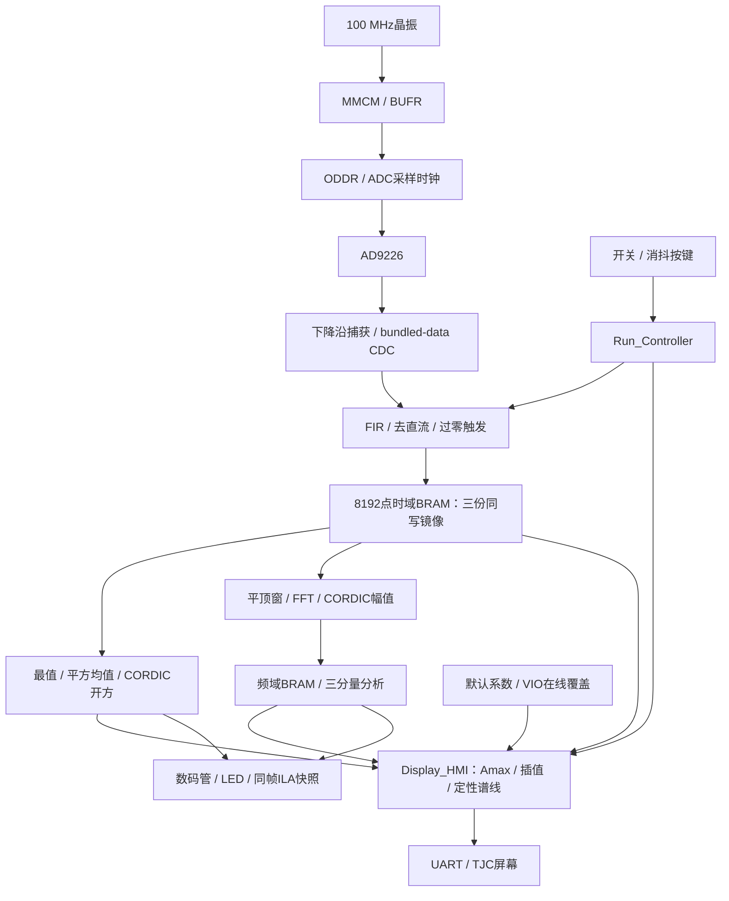

# 周期信号测量分析装置

基于 **Basys 3 / Artix-7、AD9226 和 TJC 串口屏**的纯 FPGA 测量系统。采集、滤波、时域统计、FFT、分量识别、参数换算及显示通信均在 FPGA 内完成，不使用 MCU。电脑只参与构建、下载、调试和测试仪器控制。

本项目按[用户提供的 G 题原文](docs/requirements/2026年G题.md)练习，项目约定排除“单路 +5 V 供电”和“屏幕至少6英寸”两项要求；其他测量与显示指标仍需逐项验收。

## 当前状态

核对日期：**2026-10-30**。本表区分源码能力、构建结果和实物验收，历史过程见文末资料索引。

| 层次 | 当前结论 |
| --- | --- |
| RTL | 已集成采集、Vpp/RMS、8192点FFT、最多三分量分析、默认幅值系数、双页显示及板载控制 |
| 最新实现 | 用户09:06的布线报告：**WNS +0.447 ns、WHS +0.013 ns、TNS/THS均0**；满足当前已指定时序约束 |
| 最新产物 | 用户09:06:50生成bit及匹配LTX；bitgen前DRC 0错误，构建日志0严重警告。此版本是否已烧写，尚无本轮确认 |
| 资源 | BRAM 47/50、DSP 89/90、LUT 14948/20800；后续扩展需按当前余量核算 |
| 实板基线 | 此前版本已验证单音、部分三分量/非整频组合和板载交互；这些结果不能代替新显示版本的回归 |
| 显示 | 新双页协议与完整尺寸UART行为仿真通过；最终屏幕布局、坐标方向、可见刷新和新版本实屏表现待确认 |
| 尚未完成的验收 | 独立绝对电压精度、完整C模式干扰测试、外部ADC时序/CDC边界、任意组合波稳定完整周期、端到端两秒响应 |

最新构建详情及产物校验值见[构建核对记录](docs/build_verification_20261030.md)。此前WNS为−4.383 ns的08:43构建已被本次通过结果取代，[失败定位记录](reports/display_timing_20261030/README.md)仅用于追溯。

## 阅读导航

- [系统设计](#系统设计)：规格、架构、定点数与帧一致性。
- [硬件连接](#硬件连接)：信号链、PMOD和按键引脚。
- [操作与预期显示](#操作与预期显示)：开关、按钮、LED、数码管和屏幕。
- [构建与下载](#构建与下载)：Windows/Vivado手动流程与产物位置。
- [首次上机测试](#首次上机测试)：100 kHz基线、ILA和验收边界。
- [仿真与自动化](#仿真与自动化)：回归入口和仪器控制。
- [资料索引](#资料索引)：专项说明与历史证据。

## 系统设计

### 规格

| 项目 | 实现或约定 |
| --- | --- |
| 器件/工具 | XC7A35T-1CPG236；当前开发环境为Windows、Vivado 2025.2 |
| 系统时钟 | 板载100 MHz；算法逻辑均在100 MHz域 |
| ADC | AD9226，12-bit并行输入，默认offset binary |
| 采样时钟 | 目标4.096 MSPS；实际约4.0960452 MHz，MMCM辅助输出经BUFR /3后由ODDR送出 |
| 帧长度 | 8192点；采集约2 ms，不含等待过零、计算与显示 |
| 频域 | 8192点Radix-4 Burst I/O FFT，定点Unscaled，自然顺序输出 |
| 频率换算 | `f = bin × 500 Hz`；实际时钟对应约500.0055 Hz/bin |
| A/B/C频带 | A：10～200 kHz；B/C：10～500 kHz，限制适用于被测各分量 |
| UART | 115200、8N1、仅TX；100 MHz下每bit为868拍 |
| 显示暂定值 | wave/fft双页，绘图区均240×160，每页曲线ID=1、通道0；可参数化 |

500 Hz是FFT名义格点间隔，不能据此认定任意两条相邻谱线都能分辨，也不是实测频率误差保证。C模式还要求抑制额外高频干扰，不能由单音或普通三音测试推定通过。

### 架构



不支持Mermaid时可按以下链路理解：

```text
信号源 → 模拟滤波器 → AD9226 → FPGA
                              ├─ ADC捕获/CDC → FIR → 去直流 → 过零触发
                              ├─ 时域BRAM → Vpp、RMS
                              ├─ 时域BRAM → 平顶窗 → FFT → 最多三分量
                              └─ 同帧结果/BRAM → 校准换算 → 显示/调试
```

采集完成后冻结BRAM，三个消费者分别使用时域、FFT和HMI读副本。显示完成全部UART停止位和命令间隔后才允许下一帧；单次保持重绘期间也禁止覆盖源帧。系统按显示事务节拍更新，不是每2 ms连续发布一帧。

### 数据处理与精度边界

- **采集/时域**：12-bit码默认减2048、左移4位后进入FIR；带小数状态的IIR跟踪残余DC，预热后检测非正到正过零。Vpp为unsigned 17-bit，RMS为unsigned 16-bit；RMS由未加窗样本平方平均后开方，不由Vpp推算，也不是逐帧精确去均值。
- **频域**：平顶窗ROM为signed Q1.15。FFT/CORDIC幅值是raw；分析器排除同一主瓣、估计谱底，再按频率排序并检查谐波一致性。最多输出三分量，仍可能漏检弱基频；不支持亚bin估计。`MIN_SIGNAL_RMS=64 raw`为当前默认门限，不是64 mV。
- **波形**：按`p × C × 8192 / ((W−1) × bin)`的Q12分数地址插值，C为1或3；按整帧最大绝对样本Amax设置对称纵轴。仍依赖格点基频估计，不保证任意非整频、复杂多次过零组合波的精确周期边界或相位稳定。
- **谱图**：绘制已检测三分量的定性谱线；不是完整噪声底。共用像素的峰取最大值，精确频率/幅值看文本列表。
- **时序/CDC**：ADC输入延迟目前仍采用min 0 ns / max 8 ns占位假设；bundled-data CDC依赖总线保持窗口。内部实现通过不代表这些外部接口假设已经实测验收。

### 默认幅值系数

新RTL上电/复位启用下列实测参考bank，`epoch=0`。系数集中在`G_FPGA_Top.v`参数区，格式为unsigned Q16.16的**发生器设定参考µV/raw**：

| 项目 | 默认整数系数 | 显示定义 |
| --- | --- | --- |
| Vpp / 波形Amax | 3623460 | 峰峰值 / 波形纵轴范围 |
| RMS | 3701829 | 真有效值 |
| FFT | 4194 | 各正弦分量峰值，非Vpp、非RMS |

换算为`µV = saturate_uint32((raw × gain + 32768) >> 16)`，屏幕以一位小数mV显示。该bank曾用于现有HIGHZ设置和接线条件下的单音/多音验证，尚非独立绝对输入电压标定。

VIO可原子覆盖或禁用活动bank；复位恢复RTL默认值，不保留在线修改。复位后不会重放VIO保留的旧提交。关闭VIO时仍可用静态默认bank；设置`DEFAULT_CALIBRATION_ENABLED=0`可禁用默认值。更新系数后应取新测量帧，保持态重绘仍沿用原帧系数。[在线调参说明](docs/runtime_calibration.md)包含提交和回读方法。

## 硬件连接

常规信号链为 **信号源OUT → 模拟滤波器 → ADC模拟输入 → FPGA**。当前滤波器采用既有±5 V供电；ADC/屏幕分别按模块要求供电并与FPGA共地。模拟输入不连接PMOD数字脚；确认ADC输出为兼容3.3 V逻辑，并选择FPGA提供的外部采样时钟，避免同时驱动两个时钟源。

以下引脚以仓库[Basys3_Pinout.xdc](sources/constraints/Basys3_Pinout.xdc)为准。PMOD编号表示连接器针脚，不是FPGA封装脚；按板上丝印确认朝向，数据位按模块实际位权连接。

| 端口 | 板上位置 | 封装引脚 |
| --- | --- | --- |
| sys_clk | 板载晶振 | W5 |
| sys_rst_n | BtnC | U18 |
| key_cycle / key_down | BtnU / BtnD | T18 / U17 |
| key_left / key_right | BtnL / BtnR | W19 / T17 |
| uart_tx → 屏幕RX | JA1 | J1 |
| adc_clk_out → ADC时钟输入 | JB1 | A14 |
| adc_data_in[0] | JB2 | A16 |
| adc_data_in[1] | JB3 | B15 |
| adc_data_in[2] | JB4 | B16 |
| adc_data_in[3] | JB7 | A15 |
| adc_data_in[4] | JB8 | A17 |
| adc_data_in[5] | JB9 | C15 |
| adc_data_in[6] | JB10 | C16 |
| adc_data_in[7] | JC1 | K17 |
| adc_data_in[8] | JC2 | M18 |
| adc_data_in[9] | JC3 | N17 |
| adc_data_in[10] | JC4 | P18 |
| adc_data_in[11] | JC7 | L17 |

PMOD 5/11为GND，6/12为3.3 V。屏幕TX不接FPGA；本设计无UART RX。板载USB-UART也不等于JA1，若用电脑接收显示命令，需另用电平兼容的USB-TTL接收器，不能让两个TX同时驱动屏幕RX。

## 操作与预期显示

### 开关、按钮

| 控件 | 行为 |
| --- | --- |
| SW3 / SW2 / SW1 / SW0 | C / B / A / 调试，优先级由高到低；全关默认A |
| SW15 | 0连续；1单次，单次启动需要BtnD |
| SW14:4 | 预留 |
| BtnC | 按下高有效复位；端口虽名为sys_rst_n，默认不再反相 |
| BtnD | 请求测量；忙时最多排队一次 |
| BtnU | 请求切换1/3周期 |
| BtnR / BtnL | 四个诊断视图顺向/逆向循环：频率、Vpp raw、RMS raw、谱幅 raw |

模式、单次标志、板载诊断视图在下次测量事务入场时锁存。新屏幕链另读页面/周期请求，单次保持时可重绘同一冻结帧，不需要BtnD；板载视图标志仍按原事务语义更新。发送中的请求变化在安全批次边界处理，不打断半条UART命令。

默认屏幕映射为**谱幅视图选fft，其余视图选wave**；从初始频率视图按一次左键即可请求fft。映射可由`SCREEN_FFT_VIEW`修改。人工交互基线见[板载测试记录](docs/interactive_controls_20261029.md)，旧版板载行为与新屏幕重绘行为应分别验证。

### LED与数码管

| 指示 | 含义 |
| --- | --- |
| LD0 / LD1 | MMCM锁定 / 心跳 |
| LD2 | 测量事件拉长指示 |
| LD3 / LD4 / LD5 | 采集忙 / 算法忙 / HMI忙 |
| LD6 / LD7 | 结果新鲜且信号有效 / 故障码非零 |
| LD9:8 | A=00、B=01、C=10、调试=11 |
| LD10 / LD11 | 已生效单次模式 / 三周期标志 |
| LD15:12 | 故障码：1超时、2采集时ADC碰码轨、F非法状态；保持至复位 |

数码管频率视图以kHz显示一位小数，例如100 kHz为`100.0`；其他三视图均为raw整数，**不是mV**。无有效结果显示`----`，超出四位显示`OFLO`。数码管在连续采集间隙保持上一组完整结果；LD6可能随事务新鲜状态变化，不要求始终常亮。

### 串口屏

目标型号为TJC3224T128_011，单向115200/8N1。新源码默认`ENABLE_DISPLAY=1`；`ENABLE_DISPLAY=0`才使用旧t0～t3协议。

| 页面 | 主要内容 |
| --- | --- |
| wave | tUpp、tUrms、tF1；±Amax刻度、1T/3T标签和时域曲线 |
| fft | tF1/tA1、tF2/tA2、tF3/tA3；幅值刻度和定性谱线 |

两页各自使用曲线ID=1、通道0；默认发送240点，Y范围0～159，不以屏幕总分辨率代替绘图区大小。每条ASCII正文后追加三个二进制FF，无回车换行。仅刷新选定页，不逐帧在两页间轮播。

首次显示前同步串口解析器；之后可周期性重申当前页，支持连续测量下屏幕重启后的恢复。单向TX无法读取ACK或判断页面是否执行完毕。缺失分量/无效电压显示`--`；已判无效的新帧清除旧曲线并绘中线或零基线。若输入恒定到没有过零，新帧可能无法完成，须区分采集超时和无效帧清除。

**最终控件、绘图区和Y方向仍待实屏核对。** 完整名称/参数以[显示集成契约](docs/display_integration_20261029.md)及`Display_HMI.v`为准；[队友的屏幕spec](docs/TJC_UART_FORMAT.md)含历史描述，待最终修订，不能与旧bit协议混用。

## 构建与下载

### 使用现有工程

1. 在Vivado打开仓库根目录的`G_FPGA.xpr`，确认top为`G_FPGA_Top`、器件为`xc7a35tcpg236-1`。有Basys 3 board定义可使用，但自定义ADC/串口接线仍由XDC决定。
2. 已打开的GUI可能持有旧源列表。需要补齐注册时，在Tcl Console执行以下命令并保存工程；它们不启动综合或烧写：

   ```tcl
   source C:/Users/Joe/Documents/Verilog/G_FPGA/scripts/setup_contest.tcl
   source C:/Users/Joe/Documents/Verilog/G_FPGA/scripts/setup_display_prepare.tcl
   ```

3. 当前工程generic启用`ENABLE_RUNTIME_CALIBRATION=1`，保留已有VIO IP；顶层参数的缺省值与工程generic并非一回事。默认幅值bank不依赖手动JTAG加载。
4. **由用户手动**运行Synthesis、Implementation，检查资源、setup/hold、DRC及未约束路径，再Generate Bitstream。当前仓库保留历史自动构建脚本，日常流程不运行它们。
5. Hardware Manager连接器件，Program Device选择本轮bit和同轮LTX。烧写后再确认时钟、模式、默认bank及测量结果。

纯RTL修订不要求重新生成FIR/FFT/ILA/VIO。`setup_capture_calc.tcl`、`setup_fft_uart.tcl`、`setup_board_top.tcl`属于首次IP配置/重建工具；重跑可能覆盖已有FIR均衡等配置，不作为常规注册步骤。首次复现应按[IP设计说明](docs/FFT_UART.md)核对实际XCI、系数及工具版本。

### 产物与持久化

| 文件或目录 | 用途 |
| --- | --- |
| G_FPGA.runs/synth_1 | 综合日志与检查点 |
| G_FPGA.runs/impl_1/G_FPGA_Top_timing_summary_routed.rpt | 本轮布线时序报告 |
| G_FPGA.runs/impl_1/G_FPGA_Top.bit | 本轮下载文件 |
| G_FPGA.runs/impl_1/debug_nets.ltx | 当前GUI生成的调试探针文件；以本轮匹配产物为准 |
| reports/ | 归档证据；不会随运行目录重建而自动更新 |
| test_results/ | 本机仿真/实测输出，默认不纳入Git |

“生成bit成功”不代替时序检查；旧正WNS报告也不能签核新源码。JTAG加载的是易失配置，断电后需重新下载，除非已将对应版本正确写入板载配置Flash。已有`.mcs/.prm`不能仅凭文件名当作最新版；本次没有更新或验证这些Flash文件。

## 首次上机测试

使用已确认量程内的 **100 kHz、100 mVpp、HIGHZ、0 V偏置正弦**作为现有信号链基线。默认系数参考源的HIGHZ设定值，未经负载核对不要自行把电压乘/除2。

| 步骤 | 操作 | 预期与检查 |
| --- | --- | --- |
| 1 | 信号源OUT关闭，核对供电/共地/位序/时钟，下载匹配bit/LTX | 松开BtnC后LD0亮、LD1心跳；JB1约4.096045 MHz |
| 2 | SW1=1，SW0/2/3/15=0 | A/连续，LD9:8=00、LD10灭；以生效状态判断开关方向 |
| 3 | 开启上述正弦 | 新帧应识别bin约200，数码管约100.0；LD7应无新增故障 |
| 4 | 取新ILA事件 | raw值与同条件基线比较；frame_id更新，三分量槽/epoch/有效标志一致 |
| 5 | 核对新屏幕协议 | 匹配工程及方向正确时，参考Vpp约100.0 mV、RMS约35.4 mV、单音峰值约50.0 mV；这是预期，不是本轮已验收读数 |
| 6 | 单次模式用BtnD测量，改源但不重测，再切页/周期 | 应保持同帧结果；新屏幕可重绘，BtnD后才取得新测量 |
| 7 | OUT关闭后再恢复 | 检查新无效帧/过期/无过零超时的区别及恢复，不把旧保持值当成新测量 |

单音只用于基本链路检查。完整验收需补充三分量、弱基波/强谐波、非整频、幅值/频带边界、相位变化、C模式干扰以及可见响应计时。记录表见[实机测试记录](docs/hardware_test_record.md)，指标定义见[执行与验收计划](docs/contest_execution_plan.md)。

### ILA结果触发

在100 MHz ILA中用 **probe0 == 1** 触发，取完一组数据后重新Run Trigger采集下一组；已显示的capture不会自行更新。probe0是延迟对齐后的同帧测量快照事件，不是ADC帧完成脉冲。

| Probe | 位宽 | 内容 |
| --- | --- | --- |
| 0 | 1 | 同帧measurement_valid |
| 1 / 2 | 17 / 16 | Vpp raw / RMS raw |
| 3 / 4 | 32 / 12 | 基频分量幅值raw / 基频bin |
| 5 / 6 / 7 | 5 / 32 / 12 | HMI状态 / 实时诊断状态 / 实时ADC码 |
| 8 / 9 | 36 / 32 | 三分量bin / 实时谱底均值raw |
| 10 / 11 | 96 / 2 | 三分量幅值raw / 分量数 |
| 12 / 13 / 14 | 32 / 32 / 8 | frame_id / 校准epoch / 同帧元数据 |

打包槽0在低位，bin每槽12 bit、幅值每槽32 bit；未使用槽清零。probe5/6/7/9为实时诊断，其他结果按事件锁存。元数据bit0为信号有效、bit1为标定bank启用、bit2为VIO存在，bit4:3模式、bit5单次、bit6三周期。默认bank的epoch=0也可以有效；bit1不再受bit2强制门控。

## 仿真与自动化

在仓库根目录PowerShell执行需要的回归，脚本只调用仿真工具，不替用户综合、实现或下载：

```powershell
.\scripts\run_display_hmi_sim.ps1
.\scripts\run_display_prepare_sim.ps1
.\scripts\run_runtime_calibration_sim.ps1
.\scripts\run_measurement_debug_sim.ps1
.\scripts\run_contest_sim.ps1
.\.venv-hds\Scripts\python.exe -m unittest discover -s scripts/instruments -p 'test_*.py'
```

显示测试解码实际UART线，检查每条命令、每个像素、同帧校准、HOLD重绘、无效状态、背压与复位。顶层端口测试使用厂商DSP黑盒，不能据此宣称完整FFT数值链验证。需要生成IP功能模型的专项测试可运行`run_behavioral_sim.ps1`、`run_afe_capture_sim.ps1`和`run_magnitude_scale_sim.ps1`；详细边界见对应说明/归档日志。

仪器自动化在电脑侧运行，不改变纯FPGA装置架构。HDS242S、UTG932、[AFG1022](docs/afg1022_automation.md)和常驻服务入口见下表；仪器连接、量程或输出变化按当次测试状态核对，不把历史记录中的ON/OFF当成当前读回状态。

## 资料索引

| 主题 | 文档 |
| --- | --- |
| 本轮通过的构建 | [2026-10-30构建核对](docs/build_verification_20261030.md) |
| 显示接口/参数 | [显示集成契约](docs/display_integration_20261029.md)、[屏幕spec草案](docs/TJC_UART_FORMAT.md) |
| 默认/在线标定 | [标定与VIO](docs/runtime_calibration.md)、[默认bank回归](reports/boot_calibration_20261030/README.md) |
| 时序修订/仿真证据 | [时序定位与回归](reports/display_timing_20261030/README.md)、[双页集成回归](reports/display_integration_20261030/README.md) |
| 操作/测量记录 | [板载交互确认](docs/interactive_controls_20261029.md)、[实机记录表](docs/hardware_test_record.md) |
| IP/定点实现 | [采集与时域](docs/CAPTURE_CALC.md)、[FFT与幅值](docs/FFT_UART.md)、[参考模型与标度](docs/contest_model.md) |
| 单音/频带实测 | [非整频单音](docs/offbin_hardware_20261023.md)、[均衡后频带](docs/fir_equalization_hardware_20261023.md)、[低端补测](docs/fir_equalization_extension_20261023.md) |
| 多音与完整幅值实测 | [三分量幅值](docs/component_amplitudes_hardware_20261024.md)、[高频/相位/非整频组合](docs/highband_multitone_hardware_20261024.md) |
| 仪器控制 | [HDS242S](docs/hds242s_automation.md)、[UTG932](docs/utg932_automation.md)、[服务与API](docs/lab_api.md) |
| 需求与流程 | [原题归档](docs/requirements/2026年G题.md)、[执行/验收计划](docs/contest_execution_plan.md)、[手动构建背景](docs/manual_vivado_workflow.md) |

专题文档中的日期、旧bit、旧探针数、接线现场及“尚未实现”等描述保留历史意义。当前入口以本文核对状态和实际RTL/XDC为准；新增实验过程写入专项记录，不再逐条追加到README开头。
