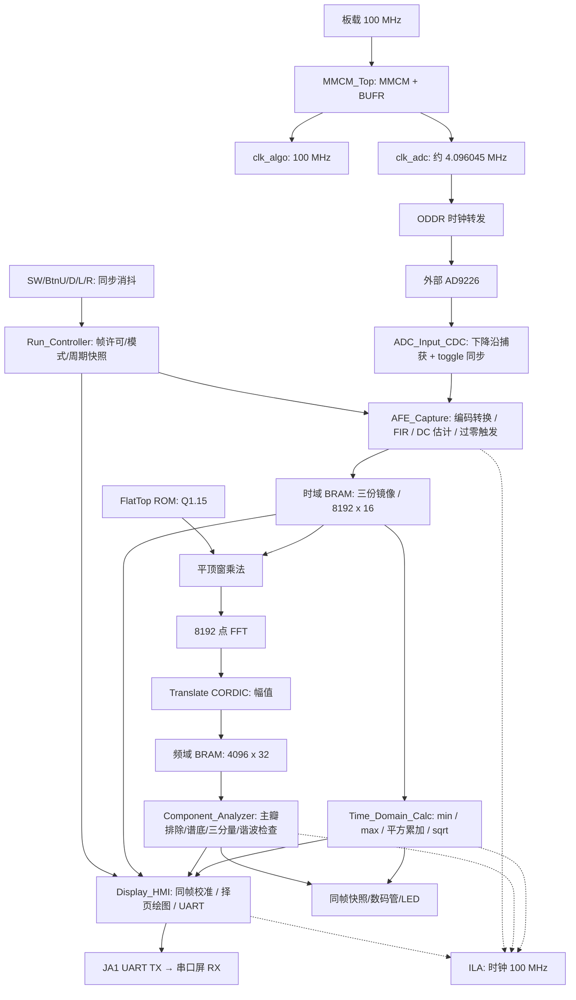

# 周期信号测量分析装置：Basys 3 / AD9226 / UART 串口屏

纯 FPGA 周期信号采集、时域测量、频谱分析与显示实验工程。目标平台为 Basys 3（Artix-7 `xc7a35tcpg236-1`），外接 AD9226 12-bit 并行 ADC 和淘晶驰协议 UART 屏，不使用 MCU。

本文按照“设计目标—系统原理—实验搭建—验证结果—局限与改进”的结构记录工程。项目名称来自竞赛练习背景，不表示官方赛题确认或指标验收通过。文档核对日期：2026-10-29。

> 最新源码进度（2026-10-29）：[双页显示已接入完整FPGA链路](docs/display_integration_20261029.md)，默认240×160，校准mV/三分量文本、波形/频谱择页刷新、单次保持重绘，实际UART字节及完整尺寸行为仿真通过。未综合、实现、生成bit或烧写；板上仍为旧raw显示版本。新资源/时序、最终屏幕布局与实屏响应待用户手动构建/联调，不能沿用旧版WNS作为新源码签核。输入端绝对电压、完整C模式及外部ADC时序仍按原边界验收。

## 目录

时序修订（2026-10-30上午）：用户08:43实现报告WNS=-4.383ns、3106个setup失败端点；工具虽已生成bit，时序并未通过。已针对显示频谱长算术链、宽文本命令组装及复位高扇出修订RTL，8组针对性XSim和110项主机测试通过；**尚未重新实现，WNS是否转正待用户手动构建确认**。见[定位、原始报告与修订记录](reports/display_timing_20261030/README.md)。不改时钟约束或IP，保留原工程/产物。

默认标定更新（2026-10-30）：实测参考系数Vpp=3623460、RMS=3701829、FFT=4194已写入顶层RTL参数，新bit上电/复位启用epoch=0，无需先经JTAG加载；VIO仍可在线覆盖，复位恢复默认值。VIO关闭时同样使用静态默认bank。详见[默认系数与在线调参](docs/runtime_calibration.md)；尚未综合/烧写，不改变现有板上bit，参考仍非独立绝对输入电压标定。

P4显示实现（2026-10-29）：[集成、参数和手动构建交接](docs/display_integration_20261029.md)。先前[独立准备模块记录](docs/display_prepare_20261029.md)保留为历史阶段；现在已实例化到顶层，激活新功能需要用户手动构建/烧写。最终spec到位主要调整集中配置，不再阻塞FPGA集成。

基础交互检查完成（2026-10-29）：[板载操作人工确认记录](docs/interactive_controls_20261029.md)。用户已确认代表性模式优先级、单次保持/重测、连续自动更新、无信号清除及恢复、BtnU周期标志往返和左右键四视图双向循环；Vpp约183x raw、RMS640/641 raw、谱幅四位溢出显示OFLO，均非校准电压显示。UTG两路已关闭；未冒充实屏波形、完整控制边界或两秒验收。

最新扩展：[125/375/500kHz三音、受控相位与非整频组合](docs/highband_multitone_hardware_20261024.md)。四组八帧通过，最大Vpp/RMS/分量峰值设定参考偏差约1.458/0.591/0.776mV，非整频各线误差≤250Hz；只改第三谐波相位时Vpp按预期变化、RMS保持。仍沿用00:33 bit，无RTL或IP变更，非独立绝对电压及完整赛题验收。

最新实板结果：[15探针完整三分量幅值](docs/component_amplitudes_hardware_20261024.md)。用户已烧写00:33新版本，WNS+0.128ns/WHS+0.019ns，BRAM47/50；三个案例共六帧的全部分量幅值已读通，同帧编号和epoch一致。两组三音的最大分量峰值设定参考偏差0.534mV，OFF时全部槽位清零；仍非绝对输入电压或全赛题验收。

此前改动/复现指南（2026-10-24）：[三分量幅值快照与手动构建说明](docs/measurement_debug_snapshot_20261024.md)。已增加同帧96bit三分量幅值、count、frame_id、校准epoch和有效元数据，ILA为15探针；最新构建/烧写状态以上述实板记录为准，当前无需重复构建。其他电脑复现时仍须先配置ILA并生成匹配bit/LTX。

最新多音进展：[UTG932首次三分量实测](docs/utg_multitone_hardware_20261023.md)。UTG CH1接滤波器，单音、50/150/200kHz普通三音和弱基波/强谐波各两帧通过已观测指标；最强分量在150kHz时仍正确选50kHz基频。原标定系数未重拟合，三音最大Vpp设定数学参考偏差约0.924mV。仅观测基波幅值，未验收各谐波幅值、绝对输入电压或完整A/B/C题；无新bit。

最新补测：[均衡候选低端与半频点](docs/fir_equalization_extension_20261023.md)。沿用22:46版本和临时系数，10/50/10.25/100.25/499.75kHz各两帧通过：频率误差最大250Hz，100mVpp设定参考下最大Vpp/RMS/峰值偏差1.474/0.108/0.159mV。未重新构建或烧写；非绝对精度、非多音验收。

最新均衡候选实测：[首次对称FIR均衡对照](docs/fir_equalization_hardware_20261023.md)。用户手动烧写22:46版本，WNS+0.463ns/WHS+0.021ns；100/250/375/500kHz各两帧频率准确、诊断正常。100mVpp设定下，500kHz的Vpp参考值恢复至99.024～99.411mV，八帧最大Vpp参考偏差1.142mV。仍是发生器设定参考，不是绝对电压或完整B/C验收；以下旧版频响记录保留用于对照。详见记录中的IP小数位派生差异及测试边界。

最新B频带验证：[B模式单音与频响实测](docs/b_band_hardware_20261023.md)。用户恢复一次HDS USB中断后，250/375/500kHz各两帧频率准确、诊断正常、完整事务成功；但500kHz按100kHz系数重算的Vpp仅92.721～92.887mV（源设定100mVpp），参考一致性不通过。RMS/FFT同比下降约6.5%，需整链频响校核，不能仅改FFT比例或宣布B题通过。OUT已确认关闭，无RTL/bit变更。

最新继续验证：[A频带非整频点实测](docs/offbin_hardware_20261023.md)。10.25/100.25/100.4/199.75kHz各两帧有效，最大频率误差250Hz，平顶窗幅值未明显塌陷。原计划因OFF即时确认滞后保持failed；已修复单次OFF后的有界只读确认并以新单点完整事务实测通过。55项主机回归及11项参考模型通过。暂无多音合成设备，多音/C模式硬件验收仍未测；无RTL/bit变更。

临时系数、六帧线性数据、首次手动构建及后续免重编译调参命令统一见[幅值标定 / JTAG VIO](docs/runtime_calibration.md)。标定行为仿真和既有九组contest仿真通过；首次硬件连接修正后47项仪器/拟合/Tcl测试通过。JTAG加载及新包回读现已实际验证，不仅是离线mock。

首次在线测试收尾：100/50mVpp均通过有效回读，OFF新ILA为RMS4raw、频率0、诊断码0；VIO当前测量失效、标定输出清零，OUT最终已确认关闭。快速OFF包曾触发严格双读拒绝，未删除一致性检查来掩盖；细节和安全关闭过程见首次实板记录。

最新恢复验证：[BNC插紧后的实板复测](docs/bnc_recovery_20261023.md)。用户确认发生器至滤波器接头松动，插紧后精密示波器显示干净正弦；恢复整链共九帧：首帧100kHz、50/100/200kHz各两帧均有效且频率正确，OFF两帧RMS均4raw、最终频率0。OFF仍有一帧弱189.5kHz内部候选，被门控拒绝。原64raw固件不变，不把重焊滤波器当作当前故障恢复的前提；幅值标定及C模式干扰仍须独立验收。OUT已确认关闭。

最新模拟侧补充：[滤波器独立示波测量](docs/filter_scope_20261023.md)。当前临时接线为滤波器输出接 CH1、ADC 模拟输入断开，OUT 已确认关闭。已纠正同轴直连误设 10X 的倍率；测得的幅值、偏置及异常自动频率尚不能用于确认 189kHz 干扰来源，须先核对 50Ω 终端与 ADC 负载。

最近补充：滤波器PCB移开下方其他电路板后，保持原64raw固件完成六帧OFF→100kHz ON→OFF对照，OFF仍检出189～189.5kHz，单音仍受额外非谐波候选影响；仅调整摆放尚未解决。详见[实板记录的移位对照](docs/hardware_gui_20261023.md#pcb移位后重新接入滤波器的对照)。当前OUT已关闭，接线为滤波器接回，下一步优先定位模拟输出/供电路径，暂不重烧或调门限。

题目依据：[用户提供的 2026 年 G 题原文](docs/requirements/2026年G题.md)（原样归档）；逐项实施与验收方案见 [G 题执行计划](docs/contest_execution_plan.md)。计划**已批准并于 2026-10-23 开始实施**。P2 控制面板已接入 RTL，完整构建/下载状态以最新阶段记录为准；原有 10 月 16 日 bit 不包含面板功能。操作与测试说明见 [板载控制面板](docs/board_panel.md)。本项目明确忽略“单路 +5 V 供电”和“屏幕≥6 英寸”两项要求；其余测量/显示/两秒时限仍按计划验收，不能由现有单音板测推定全部通过。

自动化联调见 [HDS242S 指南](docs/hds242s_automation.md) 和 [2026-10-16 实板调试记录](docs/hardware_debug_20261016.md)。已接通信号源→滤波器→ADC→FPGA→JTAG 链路，记录实板发现的去直流量化问题、修复及验证边界。手动记录见[实机测试记录表](docs/hardware_test_record.md)。

常驻控制接口见[自动化服务与 API](docs/lab_api.md)：设备独占、异步任务、状态同步与过期标记、停止/取消、纯 FPGA 读数计划，以及不接硬件的一键模拟演示。

新增 [UTG932 / UTG932E 控制指南](docs/utg932_automation.md)：`scripts/utg932.ps1` 支持双通道状态、预置波形、自定义采样表上传、多音合成、输出开关及 Python 调用。2026-10-23 已通过 NI-VISA 实机连接 UTG900 固件 1.09，验证 4000 点双音上传/选择/屏幕预览及五种预置 OFF 配置；33 项离线测试通过。已恢复原两路正弦设置、均 OFF，用户槽 1 保留双音表；实际端口电压/频谱尚未测量。

- [1. 设计目标与实际参数](#1-设计目标与实际参数)
- [2. 系统架构与工作原理](#2-系统架构与工作原理)
- [3. 工程文件与 IP](#3-工程文件与-ip)
- [4. 硬件连接](#4-硬件连接)
- [5. 串口屏工程配置](#5-串口屏工程配置)
- [6. Windows 构建与仿真](#6-windows-构建与仿真)
- [7. 上机实验步骤与预期现象](#7-上机实验步骤与预期现象)
- [8. ILA 观察方法](#8-ila-观察方法)
- [9. 验证记录与证据边界](#9-验证记录与证据边界)
- [10. 标定与验收实验](#10-标定与验收实验)
- [11. 已知问题与排障](#11-已知问题与排障)
- [12. 参考资料与维护约定](#12-参考资料与维护约定)

## 1. 设计目标与实际参数

| 项目 | 目标/当前实现 | 说明 |
| --- | --- | --- |
| FPGA | Artix-7 XC7A35T，CPG236，-1 | Basys 3 |
| 板载输入时钟 | 100 MHz | W5 |
| 算法时钟 | 100 MHz | FIR、BRAM、FFT、CORDIC、UART 控制均在此域 |
| ADC 时钟 | 目标 4.096 MHz；实际约 4.0960452 MHz | MMCM + BUFR /3，ODDR 转发出板 |
| 输入数据 | 12-bit，默认 Offset Binary | 必须核对模块输出编码 |
| 每帧长度 | 8192 点 | 名义采集时间 2 ms，不含等待触发 |
| FFT | 8192 点，Radix-4 Burst I/O，定点 Unscaled | 非实时 AXI 流，自然顺序输出 |
| 频率格点 | 代码按 500 Hz/bin 换算 | 依实际时钟约为 500.0055 Hz/bin |
| 目标信号范围 | 10 kHz～500 kHz | 对应名义 bin 20～1000 |
| 当前RTL谱峰扫描 | A bin20～400，B/C bin20～1000，调试bin10～4000 | P3接入三分量/谱底/RMS判决；构建下载状态见阶段报告 |
| 串口 | 115200 bps，8N1，只有 TX | 每 bit 868 拍，实际约 115207 bps |
| 波形显示 | 新源码默认240×160，1或3估计周期 | 绘图区/Y方向参数化；相邻样本分数位置插值 |
| 幅值单位 | 新屏幕mV，板载数码管/ILA raw | VIO系数为发生器设定参考，非独立绝对电压标定；板上旧bit仍raw |

实际采样时钟比名义值高约 11 ppm，不是严格的 4.096000 MHz。当前频率公式仍固定为 `index × 500`。平顶窗改善幅值的离栅格误差，但不能自动提高 500 Hz 格点的频率分辨率。

## 2. 系统架构与工作原理

### 2.1 模块连接



不支持 Mermaid 的阅读器可参考：

```text
G_FPGA_Top
├── MMCM_Top ── 100 MHz 算法时钟
│             └─ MMCM 辅助时钟 → BUFR /3 → ADC 时钟 → ODDR → JB1
├── Reset_Synchronizer ×2：各时钟域复位释放同步
├── Button_Debounce ×4 + Switch_Filter → Run_Controller（事务边界提交选项）
├── Board_Status_Display → SevenSeg_Scan / LED（未标定数据明确为raw）
├── Capture_Calc_Subsystem
│   ├── ADC_Input_CDC → AFE_Capture → 时域 BRAM（三份同写镜像）
│   ├── 时域读口 → Time_Domain_Calc → Vpp / Vrms
│   ├── FFT 读口 → 平顶窗 ROM/乘法 → FFT → CORDIC → 频域 BRAM
│   │                                                   └→ Component_Analyzer
│   └── HMI 读口 + 测量结果 → BCD/命令拼装 → UART_Tx
└── ila_system：帧完成、测量值、谱峰索引、HMI 状态
```

### 2.2 时钟、复位与跨时钟域

Clocking Wizard 的辅助输出约为 12.2881356 MHz，再由 BUFR 三分频得到 ADC 时钟；并非直接要求 MMCM 输出严格的 4.096 MHz。ODDR 使用 `D1=1、D2=0` 转发时钟。ADC 数据在 `clk_adc` 下降沿寄存，通过保持数据总线和同步 toggle 标志交给 100 MHz 域。

这是一种 bundled-data CDC，**不是异步 FIFO**。它依赖源数据在目的端接收前保持稳定；约 24.4 个算法周期/采样点的余量不能替代 CDC 验证。XDC 中的跨域 false path 也不等于证明数据一致性。

BtnC 按下为高电平。顶层端口虽然叫 `sys_rst_n`，但默认 `BUTTON_ACTIVE_HIGH=1`，即**按下复位，松开运行**。不能仅因 `_n` 后缀再外加一次反相。MMCM 未锁定时保持系统复位，各域独立同步释放。

### 2.3 采集与时域计算

1. 默认把 ADC 码减去 2048，再左移 4 位，转换为 signed 16-bit 数据。
2. FIR 使用 95 taps 低通系数，设计目标为通带 600 kHz、阻带 900 kHz；实际通带增益和阻带衰减仍需测量。
3. IIR 估计残余 DC，默认状态保留 16 位小数，按 `dc_q += ((x<<16)-dc_q) >>> 12` 更新，输出减去 `dc_q >>> 16`。时间常数约 4096 个有效样本。旧版纯整数状态会产生方向性截断偏差，使小信号过零触发停滞并抬高 RMS；2026-10-16 已增加小数累加精度及专门回归。它仍不是逐帧精确求均值。
4. 等待 4096 个有效滤波样本预热，再检测非正到正的过零，记录连续 8192 点。写入完成后产生内部 `frame_valid`；它只表示采样 BRAM 已冻结，不表示 Vpp/FFT 结果已经就绪。
5. 时域 FSM 遍历 BRAM，计算 `Vpp = max - min`、平方和、`mean_square = sum >> 13`，再由 Square Root CORDIC 求 RMS。

时域数据为 signed 16-bit；Vpp 接口为 unsigned 17-bit，Vrms 为 unsigned 16-bit，平方和为 44-bit。RMS 输入是 AFE 已处理的数据，不是时域 FSM 再次减去了精确帧均值。

三份时域BRAM共享写入、各有独立同步读口，分别服务时域计算、FFT和HMI。采集完成后AFE进入`ST_HOLD`；新显示链等UART最后停止位和命令间隔结束才释放。保持态重绘期间进一步屏蔽AFE采集许可，不新增整帧缓存。240点曲线仅线缆约0.25～0.29秒，另有文本/计算；无效帧更新`--`文本并画中线/零基线，不绘噪声。按显示包节拍运行，不是连续无间隙ADC帧处理。

### 2.4 窗函数、FFT 与谱峰

平顶窗为对称窗，`θ = 2πn/(8192-1)`：

```text
w[n] = 0.21557895 - 0.41663158 cos(θ)
     + 0.277263158 cos(2θ) - 0.083578947 cos(3θ)
     + 0.006947368 cos(4θ)
```

系数四舍五入为 signed Q1.15，并饱和到 -32768～32767。时域数据乘窗得到 signed 32-bit，右移 15 位并饱和回 16-bit 后送 FFT。

FFT 配置通道发送 `8'h01` 选择正变换，数据/配置均按 `tvalid && tready` 接受。FFT 为 Unscaled，不使用 scaling schedule；输出实虚部各有 30 个有效位，分别装入 32-bit 槽。RTL 将实虚部各右移 1 位后送入 Translate CORDIC，将幅值写入前 4096 个 bin；其余 FFT 输出仍被接收，不能在半帧处停止排空。当前有一级输出缓冲，握手性质仍需更强的随机背压测试。

受控板级顶层已接入`Component_Analyzer`：最多三轮扫描寻找候选主瓣，以±6bin排除同一主瓣，再扫描剩余背景并求整数均值；候选须超过8倍背景均值，按频率排序后检查近似整数谐波关系。有效基频为最低的可信分量，不再直接把最强谐波当基频。未实现亚bin插值，也不保证检出任意弱基频。旧`Peak_Search`仅保留供非受控子系统和旧自检使用。

当前链路另以`MIN_SIGNAL_RMS=64 raw`拒绝低电平杂散；该值根据本轮OFF约20raw和50mVpp/100kHz约313raw进行初步校核，不是通用mV门限或全频带验收。判决无效时仍产生事务完成事件，频率/索引/谱幅置零，数码管显示`----`、LD6灭；旧屏幕控件t0～t3发送`--`并清曲线，不绘制噪声。完整状态与测试见[P3记录](docs/p3_signal_validity_20261023.md)。

`MAG_SCALE_FACTOR` 默认 1，是整数倍率并带饱和，不是任意小数标定系数。平顶窗相干增益约 0.21555；实际补偿还涉及 FFT、CORDIC 定点格式和前端增益，不可直接将原始幅值标成 mV。

### 2.5 显示与吞吐量

新源码默认`Display_HMI`，旧`HMI_UART_Ctrl`仅供`ENABLE_DISPLAY=0`回退及旧bit对照。完整控件清单见[集成文档](docs/display_integration_20261029.md)。

| 控件 | 新源码发送内容 | 单位 |
| --- | --- | --- |
| `tUpp` / `tUrms` | Vpp / RMS | 一位小数参考mV，无系数则`--` |
| `tF1..tF3` | 频率升序三分量 | 整数Hz，缺失槽`--` |
| `tA1..tA3` | 三分量正弦峰值 | 一位小数参考mV |

命令示例：`tUpp.txt="100.0mV"`，随后为三个真正的 `0xFF` 字节。每批只更新选定页面：文本/刻度→`cle 1,0`→240条`add 1,0,Y`；无额外换行。BIN2BCD使用Double Dabble。

新波形坐标为`p*C*8192/((W-1)*bin)`的Q12分数位置，C=1或3，读取相邻样本做有符号线性插值；纵轴按整帧Amax归一化并标注±Amax，避免非对称波形截峰。仍依赖500Hz格点估计周期，不提供亚bin周期精度或复杂组合波相位锁定；插值不增加真实ADC信息。频谱显示最多三个已检测分量的谱线，不是噪声底全谱。

每点命令约12～14字节，240点仅线缆约0.25～0.29秒，另有命令间隔/切页/文本和屏幕执行时间。单次保持时左右键/BtnU可重绘同一冻结帧，不生成新测量或读取新live增益；发送中变化在安全批次边界生效。两秒可见响应尚未实屏验收。

## 3. 工程文件与 IP

```text
G_FPGA.xpr                     Vivado 工程入口
sources/
├── rtl/                       顶层、采集、计算、FFT、显示和存储 RTL
├── constraints/Basys3_Pinout.xdc
├── coeffs/                    FIR / Flat-top COE
└── ip/                        IP 配置与生成文件
scripts/
├── setup_capture_calc.tcl      第一阶段：FIR、sqrt 与采集/时域模块
├── generate_flattop.py         标准库 Python，生成平顶窗 COE
├── setup_fft_uart.tcl          第二阶段：ROM、FFT、Translate 与显示模块
├── setup_board_top.tcl         第三阶段：时钟、ILA、XDC、绝对顶层
├── impl_check_board_top.tcl    Vivado project-run 全流程到 write_bitstream
├── impl_check_board_top_direct.tcl  不依赖 cscript/vrs 的直接实现流程
├── run_impl_check_windows.cmd  Windows 环境映射与直接实现入口
└── run_behavioral_sim.ps1      四组独立 XSim 自检仿真
sim/                           SystemVerilog 测试平台
reports/                       已保存报告，注意时间与版本
docs/                          分阶段接口与 IP 配置说明
```

入口代码：[G_FPGA_Top.v](sources/rtl/G_FPGA_Top.v)、[Capture_Calc_Subsystem.v](sources/rtl/Capture_Calc_Subsystem.v)、[约束文件](sources/constraints/Basys3_Pinout.xdc)。

| IP/存储 | 主要配置或实现 |
| --- | --- |
| FIR Compiler | 95 taps，低通 COE，采样有效使能，算法域 100 MHz |
| Square Root CORDIC | Unsigned Integer，输入 32-bit；有效输出 17-bit，AXI 槽 24-bit |
| Flat-top ROM | Block Memory Generator，Single Port ROM，8192 × 16，COE 初始化 |
| FFT | 8192，Radix-4 Burst I/O，Fixed Point，Unscaled，Natural Order，Non-Realtime |
| Translate CORDIC | Signed Fraction，输入 30-bit，输出 31-bit；粗旋转及增益补偿 |
| Clocking Wizard | 算法 100 MHz，辅助约 12.2881356 MHz，之后 BUFR /3 |
| ILA | 100 MHz，10 个 probe，深度 1024；原probe0～5保持，新增状态/ADC/候选bin/谱底诊断，见ILA说明 |
| 时域/频域 BRAM | RTL 推断；时域三份 8192 × 16 镜像，频域 4096 × 32 |

详细参数以三个 `setup_*.tcl` 和当前 RTL 为准。[第一阶段说明](docs/CAPTURE_CALC.md)、[第二阶段说明](docs/FFT_UART.md)保留接口/定点设计过程；其中阶段顶层、时钟或旧流程描述不应覆盖本文的最终板级连接。

## 4. 硬件连接

### 4.1 接线前检查

断电接线。准备 Basys 3、USB/JTAG 数据线、AD9226 模块及对应供电、串口屏及其电源、信号源和示波器。

- 所有 FPGA 外部信号采用 LVCMOS33。**先确认 ADC 数据输出和屏幕串口电平兼容 3.3 V，再直连。** AD9226 模拟供电与输出驱动供电不同；模块使用 5 V 电源不代表输出一定是 3.3 V，也不代表一定是 5 V。查模块原理图并测量。[AD9226 数据手册](https://www.analog.com/media/en/technical-documentation/data-sheets/AD9226.pdf)
- 不要把 5 V 逻辑、RS-232 正负电压或 RS-485 差分线直接接入 PMOD；必要时使用匹配的接口转换电路。
- 屏幕和 ADC 按各自模块规格供电，不要默认用 PMOD 3.3 V 引脚驱动大功率屏幕。FPGA、ADC、屏幕和信号源参考地按实验系统要求共地。
- 当前由 FPGA 向 ADC 送时钟。若 ADC 模块带振荡器，先确认外部时钟选择方式，避免两个时钟输出互相驱动。
- 模拟信号接模块模拟输入及合适前端，不接 FPGA PMOD。量程、偏置、耦合方式和双极性输入支持取决于具体模块，不能假定任意 AD9226 模块可以直接接负电压。时钟/数据线尽量短，配合可靠地线。

### 4.2 引脚表

表格与仓库 XDC 对应。JB1 表示 **JB 连接器第 1 针**，不是芯片封装脚。PMOD 信号针号为 1、2、3、4、7、8、9、10；5/11 为 GND，6/12 为 3.3 V。按丝印/官方图确认朝向，不把第二排信号误认成第 5、6 针。[Basys 3 参考手册](https://digilent.com/reference/_media/reference/programmable-logic/basys-3/basys3_rm.pdf)

| RTL 端口 | 板上资源/PMOD | FPGA 封装脚 | 连接说明 |
| --- | --- | --- | --- |
| `sys_clk` | 板载晶振 | W5 | 已在板上连接，不外接 |
| `sys_rst_n` | BtnC，中间键 | U18 | 按下高有效复位 |
| `key_cycle` | BtnU，上键 | T18 | 1/3 周期切换 |
| `uart_tx` | JA1 | J1 | 接屏幕 UART RX |
| `adc_clk_out` | JB1 | A14 | 接 ADC 外部采样时钟输入 |
| `adc_data_in[0]` | JB2 | A16 | ADC 数据最低位 |
| `adc_data_in[1]` | JB3 | B15 | ADC 数据位 1 |
| `adc_data_in[2]` | JB4 | B16 | ADC 数据位 2 |
| `adc_data_in[3]` | JB7 | A15 | ADC 数据位 3 |
| `adc_data_in[4]` | JB8 | A17 | ADC 数据位 4 |
| `adc_data_in[5]` | JB9 | C15 | ADC 数据位 5 |
| `adc_data_in[6]` | JB10 | C16 | ADC 数据位 6 |
| `adc_data_in[7]` | JC1 | K17 | ADC 数据位 7 |
| `adc_data_in[8]` | JC2 | M18 | ADC 数据位 8 |
| `adc_data_in[9]` | JC3 | N17 | ADC 数据位 9 |
| `adc_data_in[10]` | JC4 | P18 | ADC 数据位 10 |
| `adc_data_in[11]` | JC7 | L17 | ADC 数据最高位 |
| GND | PMOD GND 或合适板上地 | — | 接 ADC/屏幕信号地 |

引脚依据：[Digilent Basys-3 Master XDC](https://github.com/Digilent/digilent-xdc/blob/master/Basys-3-Master.xdc)。ADC 芯片手册将 BIT1 定义为 MSB、BIT12 为 LSB，不要直接把芯片 BIT1 当成模块“数据位 1”；按模块总线实际位权接线。[AD9226 数据手册](https://www.analog.com/media/en/technical-documentation/data-sheets/AD9226.pdf)

屏幕 TX 当前不连接 FPGA；顶层没有 UART RX。ADC OTR 等附加信号没有顶层输入。Basys 3 自带 USB-UART 也不是 JA1 这条串口；在 PC 上检查命令，需另用电平兼容的 USB-TTL 接收器接 JA1 和 GND。

## 5. 串口屏工程配置

新源码的页面/控件契约以[双页集成说明](docs/display_integration_20261029.md)为准；[TJC_UART_FORMAT.md](docs/TJC_UART_FORMAT.md)是待队友修订的草案，其中旧基线、每帧轮播和旧坐标描述不覆盖新实现。只使用FPGA单向TX，不包含触摸/UART RX；默认谱幅视图选fft，其余视图选wave。

仓库目前不包含针对具体屏幕型号的 `.HMI` / `.TFT` 界面工程，仅有 FPGA 发送端。先用适配该型号的厂商编辑器建立并烧录页面：

1. 新源码创建`wave`和`fft`页，按集成说明建立全部数值与坐标文本；旧板上bit才使用t0～t3，不能混用。
2. 两页各创建ID=1、通道0的曲线；默认实际有效绘图区240×160，发送Y=0～159，方向可参数翻转。`add`中的1是页面内组件ID，不是名称。
3. 将屏幕串口设为 115200、8N1，确认重启后仍保持。FPGA 没有自动设置屏幕波特率的初始化流程，也不读取 ACK。
4. 先用独立 USB-TTL 测试文本和 add 指令，确认三个二进制 FF 结束符有效，再换为 FPGA TX。不要同时把两个发送器接到屏幕 RX。
5. 不创建触摸回传逻辑；FFT 和波形分别放在 `fft`、`wave` 两个页面，由 FPGA 发送页面切换命令。当前由 BtnU 切换 FPGA 内部的 1/3 周期选择，屏幕触摸事件不会被 FPGA 接收。

## 6. Windows 构建与仿真

当前采用[手动构建交接流程](docs/manual_vivado_workflow.md)。以下自动构建命令保留用于历史复现，不代表助手会继续代为执行综合、实现、生成bit或烧写。不要在GUI构建期间并行运行这些脚本。

### 6.1 环境与工程识别

已使用 Windows + Vivado 2025.2，安装目录 `C:\AMDDesignTools\2025.2\Vivado\bin`。Python 3 只用于生成 COE，无需 NumPy。其他 Vivado 版本需检查 IP 兼容性与升级记录。

PowerShell 中进入仓库，关闭同工程其他 Vivado 构建，避免并发修改：

```powershell
Set-Location -LiteralPath 'C:\Users\Joe\Documents\Verilog\G_FPGA'
$vivadoExe = 'C:\AMDDesignTools\2025.2\Vivado\bin\vivado.bat'
$projectFile = (Resolve-Path -LiteralPath '.\G_FPGA.xpr').Path
$env:PROCESSOR_ARCHITECTURE = 'AMD64'
$vivadoRoot = 'C:\AMDDesignTools\2025.2\Vivado'
$env:XILINX_VIVADO = $vivadoRoot
$env:PATH = "$vivadoRoot\lib\win64.o;$vivadoRoot\bin;$vivadoRoot\bin\unwrapped\win64.o;$env:PATH"
```

在 Vivado GUI 打开 `G_FPGA.xpr`，Tcl Console 检查：

直接执行 `vivado.exe` 可能绕过安装目录的环境初始化；Windows 命令行建议调用同目录的 `vivado.bat`。`xv_common.dll` 位于 `Vivado\lib\win64.o`，普通 PowerShell 若未经过 Vivado 环境初始化，需像上面一样把该目录加入 `PATH`；`run_behavioral_sim.ps1` 已自动完成这一步。本机的 Tcl 文件规范化还会把 `Documents` 路径段折叠掉，因此完整实现采用 `run_impl_check_windows.cmd` 临时映射 `V:` 盘，结束时自动解除映射。若遇到 Tcl Store 权限/旧 manifest 错误，应先退出所有 Vivado，再修复或备份用户 Tcl Store 后重启，不要删除工程源码。

```tcl
get_property PART [current_project]
get_property BOARD_PART [current_project]
get_property TOP [get_filesets sources_1]
```

器件应为 `xc7a35tcpg236-1`，最终顶层应为 `G_FPGA_Top`。板级脚本尝试选择已安装的 Basys 3 board part；未安装板卡文件时，可依靠正确 part 和完整 XDC 构建。**选择 board 不会自动证明自定义 ADC/UART 接线正确，最终以本项目 XDC 为准。**

### 6.2 生成系数并配置 IP

使用已有 `G_FPGA.xpr`；这些脚本不是“从不存在的工程创建 XPR”的入口。

```powershell
python .\scripts\generate_flattop.py
if ($LASTEXITCODE -ne 0) { throw 'COE generation failed' }

foreach ($setupName in @('setup_capture_calc.tcl', 'setup_fft_uart.tcl', 'setup_board_top.tcl')) {
    & $vivadoExe -mode batch -source (Join-Path '.\scripts' $setupName) -tclargs $projectFile
    if ($LASTEXITCODE -ne 0) { throw "Vivado setup failed: $setupName" }
}
```

最后运行板级脚本，因为阶段脚本可能设置阶段顶层。修改 IP 参数/COE 后重新生成相应 Output Products，检查 IP 状态，不要继续使用旧仿真模型或旧 bitstream。

### 6.3 行为/功能仿真回归

```powershell
powershell -NoProfile -ExecutionPolicy Bypass -File .\scripts\run_behavioral_sim.ps1 `
    -VivadoBin 'C:\AMDDesignTools\2025.2\Vivado\bin'
if ($LASTEXITCODE -ne 0) { throw 'Simulation regression failed' }
```

该入口调用 xvlog/xelab/xsim，运行四个独立自检平台，使用 RTL 与生成的 IP 功能模型；不是板级时序仿真。FFT 功能模型可能运行数分钟。脚本除退出码外还检查 `Fatal` / `ERROR` / `FAIL`，防止 XSim 在 `$fatal` 后仍返回成功码。

检查所有测试均通过，不只看最后进程退出码。`xsim.log` 可能被后续测试覆盖，保留终端输出并注明提交号。GUI 默认 `sim_1` 不等价于该四组回归，不能用“Run Simulation 没报错”替代。覆盖范围见第 9 节。

### 6.4 综合、实现与 bitstream

```powershell
& .\scripts\run_impl_check_windows.cmd
if ($LASTEXITCODE -ne 0) { throw 'Synthesis / implementation failed' }
```

该 Windows 入口使用 `impl_check_board_top_direct.tcl` 在单个 Vivado 进程中执行 `synth_design → opt_design → place_design → phys_opt_design → route_design → write_bitstream`，规避部分 Windows Script Host 上 `runme.bat → cscript/vrs` 的设置加载失败。若使用正常 GUI/命令行环境，也可以直接运行 `impl_check_board_top.tcl` 的 project-run 版本。输出包括：

- `G_FPGA.runs/impl_1/G_FPGA_Top.bit`：下载文件。
- `G_FPGA.runs/impl_1/G_FPGA_Top.ltx` / `debug_nets.ltx`：ILA 探针文件，以本次生成文件为准。
- [时序报告](reports/board_top_timing.rpt)、[资源报告](reports/board_top_utilization.rpt)、[DRC](reports/board_top_drc.rpt)、[引脚报告](reports/board_top_io.rpt)、[时钟报告](reports/board_top_clocks.rpt)。

脚本自动要求 WNS > 0，但**仍需人工检查保持时间、TNS/THS、DRC、未约束路径和 CDC 例外**。ADC 输入延迟目前为 min 0 ns / max 8 ns 的占位值，需结合模块延迟、捕获边沿和走线完善。在这些假设下通过实现，不等于验证了真实外部接口时序。

## 7. 上机实验步骤与预期现象

### 7.1 下载前

1. 核查供电、逻辑电平、位序、共地和外部时钟选择，先不接大幅度模拟信号。
2. 用最新 RTL 完成仿真与实现，核对 bit/ltx 时间、提交号和顶层。不要直接沿用 2026-09-12 旧产物。
3. 给 Basys 3 正确供电，用 USB 数据线连接编程接口；屏幕完成界面下载和波特率配置。

### 7.2 Vivado JTAG 下载

打开 **Hardware Manager → Open Target → Auto Connect**，确认发现 XC7A35T。选择 **Program Device**，指定本次生成的 `.bit` 与同次构建 `.ltx`，下载后刷新硬件。

JTAG 下载配置在 SRAM 中，断电后不保留，重新上电需再次下载。配置 Flash 的持久化启动不在当前流程内，首次 JTAG 下载不等于烧录了启动镜像。

### 7.3 分层实验

| 次序 | 操作 | 预期现象 / 判断 |
| --- | --- | --- |
| 1 | 下载后松开 BtnC，示波器测 JB1 | 约 4.096045 MHz；没有时钟先查复位/下载/时钟，不直接查 FFT |
| 2 | 按下并松开 BtnC | 系统复位/重新预热，按键高有效 |
| 3 | 输入量程内、围绕模块允许工作点的 100 kHz 正弦 | ADC 不削顶，过零触发后应周期性出现 frame_valid |
| 4 | ILA 观察稳定结果 | 干净单音的最大峰预期靠近 bin 200，频率文本靠近 100000 Hz |
| 5 | 检查 JA1 | 空闲高，8N1，115200；可解出四条文本和 add 命令 |
| 6 | 查看屏幕 | 文本为原始幅值和 Hz；曲线应覆盖正、负半周，具体形状仍需实板验证 |
| 7 | 按 BtnU，等待后续显示批次 | 请求切换 1/3 周期，不应期望立即完成 400 点传输 |

零均值正弦的理论关系 `Vrms ≈ Vpp/(2√2)` 可作同尺度下粗检，但残余 DC、滤波、跨帧读取和截断会影响结果。未确认帧一致性时，不用一次屏显比值进行精度验收。

“完整一/三周期、平滑对称曲线”是 RTL 修订后的上机验收目标；仿真已经对负值坐标映射和帧释放握手做了定值检查，但还不是实板证据。代码没有实现 LED/数码管测量显示，其不变化不代表系统没有工作。无输入或恒定 DC 可能不触发新帧，屏幕保留旧值，而非立即显示零。

## 8. ILA 观察方法

ILA 时钟为 100 MHz，深度 1024，连续观察时间约 10.24 µs。

| Probe | 信号 | 位宽 | 解释 |
| --- | --- | --- | --- |
| 0 | `measurement_valid` | 1 | HMI 已装载同一帧的 Vpp/Vrms/峰值，适合作为结果触发 |
| 1 | `vpp_out[15:0]` | 16 | 顶层接口为 17-bit，此处只取低 16 位 |
| 2 | `vrms_out` | 16 | 时域 RMS |
| 3 | `amp_f1_out[30:0]` | 31 | 接口为 32-bit；倍率增大时注意未观察的最高位 |
| 4 | `max_index_out` | 12 | 乘 500 得当前代码报告频率 |
| 5 | `uart_state` | 5 | HMI 消息状态，不是 UART bit 状态机 |

当前版本应触发 `probe0 == 1`（即 `measurement_valid`），而不是把原始 `frame_valid` 当作结果触发。`frame_valid` 只表示 8192 点采样帧写完；时域和 FFT 计算在其后进行，若在原始帧脉冲上触发，Vpp/Vrms/谱峰可能仍是上一帧。每次 ILA 捕获结束进入 `Idle` 后，必须再次点击 `Run Trigger` 重新武装；改变信号源本身不会自动刷新 ILA 存储器。

HMI 状态中 0=空闲，1/2=BCD 启动/等待，3～6=文本，7～23=波形准备、清屏、双采样读取、插值除法和发送相关状态；17 是首个 BRAM 读数据寄存阶段，18/19 是 `cle 1,0`，20～23 是相邻采样读取和线性插值。可触发状态 3 观察开始发送文本时的结果。完整枚举见 [HMI_UART_Ctrl.v](sources/rtl/HMI_UART_Ctrl.v)。

10.24 µs 不足以连续覆盖 2 ms 采集帧、整次 FFT，甚至不足一个约 86.8 µs 的 UART 字节。需要调整触发/采集条件、增加深度或使用外部逻辑分析仪。当前没有原始 ADC、FIR 输出、AXI 握手或 `uart_tx` 探针；添加这些信号须重新实现并评估 BRAM 余量。

## 9. 验证记录与证据边界

### 9.1 已有自检仿真

2026-10-16 增加 AFE 小信号回归并重跑原有四组测试；最终提交号以 `git log -1` 为准。

| 测试 | 已记录结果 | 已覆盖 / 未覆盖 |
| --- | --- | --- |
| `tb_afe_small_signal.sv` | 插入负向异常点后继续完成 77 帧；均值约 0.5 raw LSB | 单周期 FIR 恒等模型，验证小信号 DC 跟踪、正负半周与帧重新触发；原整数 RTL 在同一测试中停滞 |
| `tb_time_domain_calc.sv` | 8192 次读；Vpp=16000，mean_square=23992065，Vrms=4898 | 一组确定性向量与完成流程；不包含 AFE DC/FIR |
| `tb_fft_processor.sv` | 8192 输入、4096 频域写入，无已检测 TLAST 异常 | 地址/计数与基本流转；输入为模运算序列，非精确单音幅值标定；无随机背压完整证明 |
| `tb_peak_search.sv` | 3991 个扫描点；index=123，f=61500，amp=10000 | 倍率 2 的已知峰；不证明复杂信号基频识别 |
| `tb_hmi_uart.sv` | 解码 184 个 UART 字节，4 条文本、1 条 `cle`、8 条曲线命令；`frame_release` 置高 | BCD 含 0、250、12345、4294967295；WAVE_POINTS=8 下用参考模型检查线性插值、负值符号处理和 0～255 坐标 |

HMI 仿真使用加速配置，每 bit 10 个仿真时钟，而非生产配置的 868 拍；帧长和点数也缩短。通过不能证明真实 115200 时序、400 点抽样跨度或串口屏实际兼容性。

P3新增参考模型与八组自检见`run_contest_sim.ps1`和[P3记录](docs/p3_signal_validity_20261023.md)，含无效帧协议、背景谱底、显示保持、同步/消抖等检查。仍未覆盖真实FIR/ADC CDC、顶层MMCM/复位、ADC到UART完整集成仿真及任意背压形式证明。原有AFE专项为`run_afe_capture_sim.ps1`，其余四组IP/算法自检为`run_behavioral_sim.ps1`；模块测试不能替代板级或仪器验收。

### 9.2 历史实现基线（2026-10-16）

以下保留10月16日历史比较值，不是今日RTL的最新签核。器件为`xc7a35tcpg236-1`，顶层为`G_FPGA_Top`。当前构建状态、bit/LTX散列以最新阶段报告为准：

| 指标 | 10月16日历史值 |
| --- | --- |
| WNS / TNS | +0.082 ns / 0 ns |
| WHS / THS | +0.022 ns / 0 ns |
| LUT | 9535 / 20800，45.84% |
| FF | 14299 / 41600，34.37% |
| BRAM tiles | 39 / 50，78.00% |
| DSP | 74 / 90，82.22% |
| DRC | 0 errors，13 warnings（DSP 输入/输出寄存器、LUT 方程和无负载检查） |

`reports/board_top_*.rpt`随每次重建更新，不能拿最新报告冒充上述历史构建。下载文件为`G_FPGA.runs/impl_1/G_FPGA_Top.bit`及同目录LTX（不提交大型产物）；每版散列和下载记录统一归档于[P2记录](docs/hardware_debug_20261023.md)和[P3记录](docs/p3_signal_validity_20261023.md)，请用`Get-FileHash`核对。探针未改时LTX散列可以不变，不表示bit未更新。没有带独立模拟参考的≤5mV误差或正式抗干扰验收数据。

### 9.3 实板功能验证（2026-10-16）

HDS242S OUT→滤波器→AD9226→Basys 3，JTAG 读取新结果：修订版下载后，15/15 次新事件采集成功，未复位连续切频，覆盖 10/20/50/100/200/300/400/500 kHz。全部名义频率格点匹配发生器设定；不是独立测量的零频率误差。

100 kHz / 100 mVpp 设定下，Vrms 从修复前 1099 raw 降至约 626 raw，Vpp 仍约 1790 raw，接近正弦应有比例；50 mVpp 时 Vrms=313 raw，频谱幅值约减半。500 kHz 的 RMS/FFT 幅值相对 100 kHz 下降约 6.5%，仍需参考仪器区分信号源、模拟前端、ADC 与实际采样链路，不据此盲改 FFT 标定倍率。

原始数据、完整测试表、bit 散列、CDC/方法学告警及结束状态见 [实板调试记录](docs/hardware_debug_20261016.md)。输出已关闭，服务正常退出；板上保留新配置。未并联示波器测量实际 ADC 输入，因此没有验收 ≤5 mV 精度；串口屏、长稳、非整 bin、干扰及偏置测试也尚未完成。

## 10. 标定与验收实验

### 10.1 幅值标定原则

若 ADC 有效满量程跨度为 `V_FS`，理想情况下每 ADC 码约为 `V_FS/4096`；本工程转换到时域整数时左移 4 位，不能沿用“一个内部码等于一个 ADC 码”的比例。还需考虑模块模拟增益、FIR 通带增益、偏置残差、截断和频率响应。

先用参考示波器/仪表建立“时域 raw → 输入端 mV”的实测映射，分别记录 Vpp、Vrms，再标定 FFT 幅值。`MAG_SCALE_FACTOR` 整数乘法不足以表达任意校准斜率；需要小数增益时，后续设计定点乘法/右移及饱和格式。

平顶窗只解决误差来源之一。≤5 mV 还依赖参考仪器精度、前端、ADC 噪声/非线性、抗混叠、时钟、算法和数据一致性，不能仅凭“已加平顶窗”宣布满足。

### 10.2 建议实验矩阵

| 实验 | 输入/操作 | 记录及判据 |
| --- | --- | --- |
| 基本单音 | 10、100、500 kHz 正弦，量程内 | bin 约 20、200、1000；记录数字量与参考值 |
| 离栅格 | 如 100250 Hz | 记录峰值跳 bin 和幅值变化；不能要求整数 bin 给出精确 100250 Hz |
| 幅值线性 | 同频、多档幅值，避免削顶 | 拟合 raw→mV，独立验证点检验误差 |
| DC 偏置 | 在模块允许范围内改变偏置 | 观察预热、触发、RMS 和 IIR 跟踪残差；HDS242S 自动化目前仅允许零偏置 |
| 干扰 | 有用单音叠加 1 MHz | 比较抑制前后频谱与幅值误差，保证总输入不超量程 |
| 谐波 | 基波+更强二次谐波 | 当前可能报告二次谐波，记录为算法限制 |
| 显示 | 切换 BtnU，正负样本 | 修复映射后验证 400 点、周期跨度、上下半周 |
| 连续运行 | 多次复位/拔除输入/长时间运行 | 检查丢帧、旧值、跨帧撕裂和串口批次一致性 |

每次至少记录：日期、Git 提交、Vivado 版本、bit/ltx 时间、ADC/屏幕型号与供电、前端量程/增益、参考仪器设置、输入频率/幅值/偏置、ILA/串口数据、误差及结论。建议表头：

```text
序号 | 提交/bit版本 | 输入Hz | 参考Vpp(mV) | 参考Vrms(mV)
     | Vpp_raw | Vrms_raw | peak_bin | amp_raw | 校准后误差 | 现象/结论
```

## 11. 已知问题与排障

### 11.1 上机前必须理解的限制

| 项目 | 当前事实与影响 | 后续工作 |
| --- | --- | --- |
| 波形负值绝对值 | 已修正为先符号扩展到 17-bit 再取绝对值；加速 HMI 仿真检查 `-1`、负值、零和正值坐标，避免负半周整体饱和到 Y=255 | 实板验证坐标方向、屏幕纵轴定义和满量程显示 |
| 时域帧冻结 | 已增加 AFE `ST_HOLD` 与 HMI `frame_release` 电平握手；UART 波形发送期间三份镜像不再被下一帧覆盖 | 实板长时间运行验证释放、重新触发和异常复位；吞吐仍受约 0.4～0.5 秒/包限制 |
| HMI 批次隔离 | 已增加 `*_active` 活动包快照；一旦开始转换/发送，文本和波形使用同一组值 | mailbox 仍只有一项，极端高速结果到达时只保留最新待发送项 |
| AFE 输入流控 | 已增加一项 FIR AXI 输入寄存器，在 `tready=0` 时保持 `tvalid` 与数据稳定 | ADC `sample_valid` 没有 ready/overflow 回报；若 FIR 长时间背压，仍需增加 FIFO 或溢出指示 |
| DC 残差 | IIR 已保留 16 位小数，但不保证每帧严格零均值 | 区分稳态 AC RMS 与偏置变化瞬态；逐帧去均值需单独定义和测试 |
| 峰值不等于基频 | 搜索最强分量，区间宽于目标带 | 结合需求加阈值、频带限制、谐波判决、插值 |
| 波形参数化 | 地址跨度使用 `WAVE_POINTS-1`，每点读取相邻样本并做线性插值；测试用 8 点配置覆盖余数、符号和坐标结果，且检查 `cle` 帧头 | 修改点数后仍应重新仿真并检查串口屏横向像素；插值只改善显示，不增加 ADC 信息 |
| 接口时序 | ADC input_delay 为占位值，跨域例外较宽 | 用真实模块时序重建预算，审查 CDC/未约束路径 |
| 验证版本 | 当前 routed 报告、bit/ltx 均由 2026-10-16 修订 RTL 重新生成 | 后续任何 RTL/IP/XDC 修改后必须重新回归、实现并同步更新时间/提交号 |

`waveform_done` 表示最后一个字节已交给 UART，不表示最后一个停止位已在引脚发送完成；外部时序判断还应考虑发送器是否空闲。

### 11.2 常见现象

| 现象 | 优先排查 |
| --- | --- |
| 无 ADC 时钟 | 顶层/下载、BtnC、MMCM 锁定、JB1 针号 |
| 有时钟无 frame_valid | ADC 编码/位序、电平、模拟输入、过零条件、预热、CDC/FIR 有效脉冲 |
| 数值极大/频谱异常 | 位序接反、Offset Binary/二补码不匹配、削顶、跨帧覆盖 |
| 频率成倍 | 更强谐波被选为最大峰，不先假定 FFT 错误 |
| 屏幕无变化 | 电源/共地、TX→RX、115200、控件名和数字 ID、FF 结束符 |
| 屏幕乱码 | 电平/波特率、8N1、接错板载 USB-UART、线缆干扰 |
| 曲线负半周平顶 | 先核对最新 bit/ltx、纵轴方向、ADC 编码和削顶；RTL 已修正负值绝对值路径 |
| 曲线撕裂/跳动 | BRAM 覆盖、HMI 批次参数更新、整数周期抽样误差 |
| 无信号仍有旧值 | 没有新过零帧；当前无超时清零/无信号 UI 状态 |
| ILA 找不到/不匹配 | bit/ltx 是否同次构建、硬件刷新、当前顶层是否含 ILA |
| WNS 通过仍异常 | 外部时序占位、CDC、电平、帧所有权；STA 不验证算法 |

## 12. 参考资料与维护约定

- [AD9226 官方数据手册](https://www.analog.com/media/en/technical-documentation/data-sheets/AD9226.pdf)：用具体模块原理图补足供电、编码、电平和时序信息。
- [Basys 3 官方参考手册](https://digilent.com/reference/_media/reference/programmable-logic/basys-3/basys3_rm.pdf)、[官方 Master XDC](https://github.com/Digilent/digilent-xdc/blob/master/Basys-3-Master.xdc)：板上资源、连接器和封装脚。
- [采集/时域说明](docs/CAPTURE_CALC.md)、[FFT/UART 说明](docs/FFT_UART.md)：分阶段设计资料，最终实现同时核对脚本和 RTL。

本次文档对应的实现核对日期为 2026-10-16；当前 bitstream/ltx 生成时间约为 10:21，WNS/WHS 分别为 +0.082/+0.022 ns。修改采样率、FFT 长度、定点格式或屏幕协议时，同时审查 IP、COE、频率换算、周期抽样、XDC 和参考测试值。修改引脚同步更新接线表。报告注明日期与提交，区分“仿真通过”“实现通过”“真实板测通过”和“精度验收通过”。完成工作后提交并推送源码/文档；生成目录、缓存和日志按 `.gitignore` 管理，不把旧 bitstream 的存在当作最新构建成功的证据。
