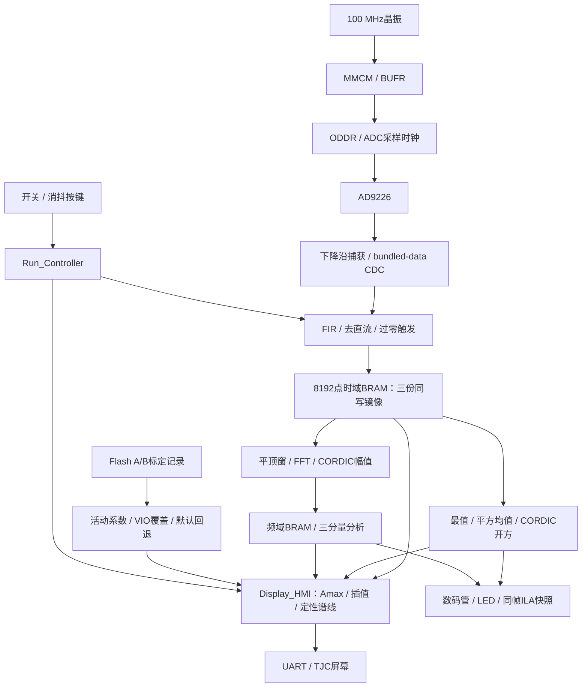

# 周期信号测量分析装置

基于 **Basys 3 / Artix-7、AD9226 和 TJC 串口屏**的纯 FPGA 测量系统。采集、滤波、时域统计、FFT、分量识别、参数换算及显示通信均在 FPGA 内完成，不使用 MCU。电脑只参与构建、下载、调试和测试仪器控制。

本项目按[用户提供的 G 题原文](docs/requirements/2026年G题.md)练习。用户最新确认整机仅一路外部+5 V输入，板内先升压12 V、再由所称MP5418模块生成模拟±5 V，具体完整支路待实物核对；不再将单路供电列为排除项。屏幕≥6英寸仅按用户允许作项目范围调整，不代表官方豁免。报告所需事实、数据和待测表见[工程审计素材](docs/report_materials_2026-11-06.md)。

## 当前状态

核对日期：**2026-11-06**。程序版本、活动系数和证据边界统一见[当前状态](docs/project_status.md)；完整文档入口见[文档导航](docs/README.md)。

| 项目 | 当前结论 |
| --- | --- |
| 程序 | 11月6日08:33 bit，包含窗ROM读取修复与schema3原始候选；对应新MCS已由用户烧写并成功加载 |
| 实现 | WNS **+0.280 ns**、WHS **+0.011 ns**、TNS/THS 0；[镜像与审计](reports/boot_mcs_20261106/README.md) |
| 单音识别 | BNC/SMA重新连接后11/12/42/100kHz恢复单峰有效；[前后复测](reports/single_tone_reseat_20261106/README.md) |
| 标定 | AFG1022 HIGHZ设定参考，活动/保存系数 **3576768 / 3601627 / 4079**；B槽sequence1保存核对通过；[标定证据](reports/afg_calibration_20261106/README.md) |
| 待验收 | 新B槽断电恢复、独立绝对电压精度、完整多音/C模式干扰、实屏组合波显示、ADC外部时序/CDC及端到端≤2s |

## 阅读导航

- [报告素材与事实审计](docs/report_materials_2026-11-06.md)：供另一名AI独立阅读的硬件、算法、实测数据、图稿及待测表。
- [系统设计](#系统设计)：规格、架构、定点数与帧一致性。
- [硬件连接](#硬件连接)：信号链、PMOD和按键引脚。
- [操作与预期显示](#操作与预期显示)：开关、按钮、LED、数码管和屏幕。
- [构建与下载](#构建与下载)：Windows/Vivado手动流程与产物位置。
- [首次上机测试](#首次上机测试)：100 kHz基线、ILA和验收边界。
- [比赛验收现场手册](docs/contest_acceptance_runbook.md)：接线核对、仪器设置、A/B/C十二项操作、计时与收尾；配套[空白记录表](docs/contest_acceptance_record_template.md)。
- [仿真与自动化](#仿真与自动化)：回归入口和仪器控制。
- [资料索引](#资料索引)：专项说明与历史证据。

## 系统设计

### 规格

| 项目 | 实现或约定 |
| --- | --- |
| 器件/工具 | XC7A35T-1CPG236；当前开发环境为Windows、Vivado 2025.2 |
| 系统时钟 | 板载100 MHz；算法逻辑均在100 MHz域 |
| ADC | AD9226，12-bit并行输入，默认offset binary |
| 采样时钟 | 目标4.096 MSPS；实际约4.0960452 MHz，MMCM辅助输出经BUFR /3后由ODDR送出 |
| 帧长度 | 8192点；采集约2 ms，不含等待过零、计算与显示 |
| 频域 | 8192点Radix-4 Burst I/O FFT，定点Unscaled，自然顺序输出 |
| 频率换算 | `f = bin × 500 Hz`；实际时钟对应约500.0055 Hz/bin |
| A/B/C频带 | A：10～200 kHz；B/C：10～500 kHz，限制适用于被测各分量 |
| UART | 115200、8N1、仅TX；100 MHz下每bit为868拍 |
| 显示暂定值 | wave/fft双页，绘图区均240×160，每页曲线ID=1、通道0；可参数化 |

500 Hz是FFT名义格点间隔，不能据此认定任意两条相邻谱线都能分辨，也不是实测频率误差保证。C模式还要求抑制额外高频干扰，不能由单音或普通三音测试推定通过。

### 架构



不支持Mermaid时可按以下链路理解：

```text
信号源 → 模拟滤波器 → AD9226 → FPGA
                              ├─ ADC捕获/CDC → FIR → 去直流 → 过零触发
                              ├─ 时域BRAM → Vpp、RMS
                              ├─ 时域BRAM → 平顶窗 → FFT → 最多三分量
                              └─ 同帧结果/BRAM → 校准换算 → 显示/调试
```

采集完成后冻结BRAM，三个消费者分别使用时域、FFT和HMI读副本。显示完成全部UART停止位和命令间隔后才允许下一帧；单次保持重绘期间也禁止覆盖源帧。系统按显示事务节拍更新，不是每2 ms连续发布一帧。

### 数据处理与精度边界

- **采集/时域**：12-bit码默认减2048、左移4位后进入FIR；带小数状态的IIR跟踪残余DC，预热后检测非正到正过零。Vpp为unsigned 17-bit，RMS为unsigned 16-bit；RMS由未加窗样本平方平均后开方，不由Vpp推算，也不是逐帧精确去均值。
- **频域**：平顶窗ROM为signed Q1.15。FFT/CORDIC幅值是raw；分析器排除同一主瓣、估计谱底，再按频率排序并检查谐波一致性。最多输出三分量，仍可能漏检弱基频；不支持亚bin估计。`MIN_SIGNAL_RMS=64 raw`为当前默认门限，不是64 mV。
- **波形**：默认通过两半帧Hann加权基波投影，细化显示周期并确定基波相位起点，再对原始AFE复合采样作16抽头/64相位带限插值，保留谐波畸变；按全帧Amax与预计算绘图点最大值设置对称纵轴。低置信度回退格点跨度；此细化仅用于显示，不改变测量结果，任意组合及实屏稳定性仍待验收。
- **谱图**：绘制已检测三分量的定性谱线；不是完整噪声底。共用像素的峰取最大值，精确频率/幅值看文本列表。
- **时序/CDC**：ADC输入延迟目前仍采用min 0 ns / max 8 ns占位假设；bundled-data CDC依赖总线保持窗口。内部实现通过不代表这些外部接口假设已经实测验收。

### 幅值系数与持久化

unsigned Q16.16 µV/raw，换算为`µV = saturate_uint32((raw × gain + 32768) >> 16)`。屏幕显示换算值；板载Vpp/RMS/谱幅诊断视图仍显示raw。

| 项目 | 当前活动/Flash保存 | RTL回退默认 |
| --- | ---: | ---: |
| Vpp / 波形Amax | 3576768 | 3623460 |
| RMS | 3601627 | 3701829 |
| FFT正弦分量峰值 | 4079 | 4194 |

参考是发生器HIGHZ显示设定值，尚非输入端独立绝对电压认证。P2启动/BtnC优先恢复有效保存记录，没有有效记录才回退RTL默认值。VIO apply仅更新活动值，save才持久化；更新系数不需要重新生成bit/MCS。详见[在线标定与恢复](docs/runtime_calibration.md)。

## 硬件连接

常规信号链为 **信号源OUT → 模拟调理 → ADC模拟输入 → FPGA**。用户确认外部单+5 V、内部Boost至12 V再转换出±5 V，单点共地、无USB供电。Basys3/ADC/屏幕的具体供电分支与模块参数尚需照片核对；[供电关系表及模拟原图](docs/report_materials_2026-11-06.md#c-实际硬件组成与供电结构)区分用户确认、图纸推导与未知信息。模拟输入不连接PMOD数字脚；确认ADC输出为兼容3.3 V逻辑，并选择FPGA提供的外部采样时钟，避免同时驱动两个时钟源。

以下引脚以仓库[Basys3_Pinout.xdc](sources/constraints/Basys3_Pinout.xdc)为准。PMOD编号表示连接器针脚，不是FPGA封装脚；按板上丝印确认朝向，数据位按模块实际位权连接。

| 端口 | 板上位置 | 封装引脚 |
| --- | --- | --- |
| sys_clk | 板载晶振 | W5 |
| sys_rst_n | BtnC | U18 |
| key_cycle / key_down | BtnU / BtnD | T18 / U17 |
| key_left / key_right | BtnL / BtnR | W19 / T17 |
| uart_tx → 屏幕RX | JA1 | J1 |
| adc_clk_out → ADC时钟输入 | JB1 | A14 |
| adc_data_in[0] | JB2 | A16 |
| adc_data_in[1] | JB3 | B15 |
| adc_data_in[2] | JB4 | B16 |
| adc_data_in[3] | JB7 | A15 |
| adc_data_in[4] | JB8 | A17 |
| adc_data_in[5] | JB9 | C15 |
| adc_data_in[6] | JB10 | C16 |
| adc_data_in[7] | JC1 | K17 |
| adc_data_in[8] | JC2 | M18 |
| adc_data_in[9] | JC3 | N17 |
| adc_data_in[10] | JC4 | P18 |
| adc_data_in[11] | JC7 | L17 |

PMOD 5/11为GND，6/12为3.3 V。屏幕TX不接FPGA；本设计无UART RX。板载USB-UART也不等于JA1，若用电脑接收显示命令，需另用电平兼容的USB-TTL接收器，不能让两个TX同时驱动屏幕RX。

## 操作与预期显示

### 开关、按钮

| 控件 | 行为 |
| --- | --- |
| SW3 / SW2 / SW1 / SW0 | C / B / A / 调试，优先级由高到低；全关默认A |
| SW15 | 0连续；1单次，单次启动需要BtnD |
| SW14:4 | 预留 |
| BtnC | 按下高有效复位；端口虽名为sys_rst_n，默认不再反相 |
| BtnD | 请求测量；忙时最多排队一次 |
| BtnU | 请求切换1/3周期 |
| BtnR / BtnL | 四个诊断视图顺向/逆向循环：频率、Vpp raw、RMS raw、谱幅 raw |

模式、单次标志、板载诊断视图在下次测量事务入场时锁存。新屏幕链另读页面/周期请求，单次保持时可重绘同一冻结帧，不需要BtnD；板载视图标志仍按原事务语义更新。发送中的请求变化在安全批次边界处理，不打断半条UART命令。

默认屏幕映射为**谱幅视图选fft，其余视图选wave**；从初始频率视图按一次左键即可请求fft。映射可由`SCREEN_FFT_VIEW`修改。人工交互基线见[板载测试记录](docs/interactive_controls_20261029.md)，旧版板载行为与新屏幕重绘行为应分别验证。

### LED与数码管

| 指示 | 含义 |
| --- | --- |
| LD0 / LD1 | MMCM锁定 / 心跳 |
| LD2 | 测量事件拉长指示 |
| LD3 / LD4 / LD5 | 采集忙 / 算法忙 / HMI忙 |
| LD6 / LD7 | 结果新鲜且信号有效 / 故障码非零 |
| LD9:8 | A=00、B=01、C=10、调试=11 |
| LD10 / LD11 | 已生效单次模式 / 三周期标志 |
| LD15:12 | 故障码：1超时、2采集时ADC碰码轨、F非法状态；保持至复位 |

数码管频率视图以kHz显示一位小数，例如100 kHz为`100.0`；其他三视图均为raw整数，**不是mV**。无有效结果显示`----`，超出四位显示`OFLO`。数码管在连续采集间隙保持上一组完整结果；LD6可能随事务新鲜状态变化，不要求始终常亮。

### 串口屏

目标型号为TJC3224T128_011，单向115200/8N1。新源码默认`ENABLE_DISPLAY=1`；`ENABLE_DISPLAY=0`才使用旧t0～t3协议。

| 页面 | 主要内容 |
| --- | --- |
| wave | tUpp、tUrms、tF1；±Amax刻度、1T/3T标签和时域曲线 |
| fft | tF1/tA1、tF2/tA2、tF3/tA3；幅值刻度和定性谱线 |

两页各自使用曲线ID=1、通道0；默认发送240点，Y范围0～159，不以屏幕总分辨率代替绘图区大小。每条ASCII正文后追加三个二进制FF，无回车换行。仅刷新选定页，不逐帧在两页间轮播。

首次显示前同步串口解析器并恢复刷新；默认仅首次/切页发送page，同页不重发。批内依次暂停刷新、cle及240点add、同帧文本/刻度及逐项ref、显式刷新曲线并恢复刷新。暂停指令的具体屏幕固件兼容性待实测，可用DISPLAY_REFRESH_GUARD=0禁用；该选项关闭后仍可能看到cle/add逐点重画。wave横轴为0us、中点、1T/3T对应的右端时间；fft横轴为0～200/500kHz，并更新横/纵轴中点。单向TX无法读取ACK或判断页面是否执行完毕。缺失分量/无效电压显示`--`；已判无效的新帧清除旧曲线并绘中线或零基线。若输入恒定到没有过零，新帧可能无法完成，须区分采集超时和无效帧清除。

**控件、绘图区和Y方向仍需按实际HMI工程核对。** 当前程序已包含[屏幕spec](docs/TJC_UART_FORMAT.md)的时间/中点刻度、FFT方向修正及带限波形插值。UART仿真、代码进入当前bit和实屏最终验收是不同结论；不能仅凭仿真认定所有页面效果通过。

## 构建与下载

**工程已打开时更新代码**：外部修改XPR不会自动同步Vivado内存里的源列表。新增显示RTL后务必在当前GUI执行下列注册脚本，确认11条REGISTERED后再综合；否则旧窗口保存还会覆盖磁盘登记。遇到模块找不到见[源文件登记修复](docs/synthesis_source_registration_20261030.md)。

### 使用现有工程

1. 在Vivado打开仓库根目录的`G_FPGA.xpr`，确认top为`G_FPGA_Top`、器件为`xc7a35tcpg236-1`。有Basys 3 board定义可使用，但自定义ADC/串口接线仍由XDC决定。
2. 已打开的GUI可能持有旧源列表。需要补齐注册时，在Tcl Console执行以下命令并保存工程；它们不启动综合或烧写：

   ```tcl
   source C:/Users/Joe/Documents/Verilog/G_FPGA/scripts/setup_contest.tcl
   source C:/Users/Joe/Documents/Verilog/G_FPGA/scripts/setup_display_prepare.tcl
   ```

3. 当前P2工程generic启用`ENABLE_RUNTIME_CALIBRATION=1`和`ENABLE_FLASH_PERSISTENCE=1`，只读P1探针关闭，保留已有VIO IP；顶层参数的缺省值与工程generic并非一回事。默认幅值bank不依赖手动JTAG加载。
4. **由用户手动**运行Synthesis、Implementation，检查资源、setup/hold、DRC及未约束路径，再Generate Bitstream。当前仓库保留历史自动构建脚本，日常流程不运行它们。
5. Hardware Manager连接器件，Program Device选择本轮bit和同轮LTX。烧写后再确认时钟、模式、默认bank及测量结果。

纯RTL修订不要求重新生成FIR/FFT/ILA/VIO。`setup_capture_calc.tcl`、`setup_fft_uart.tcl`、`setup_board_top.tcl`属于首次IP配置/重建工具；重跑可能覆盖已有FIR均衡等配置，不作为常规注册步骤。首次复现应按[IP设计说明](docs/FFT_UART.md)核对实际XCI、系数及工具版本。

### 产物与持久化

| 文件或目录 | 用途 |
| --- | --- |
| G_FPGA.runs/synth_1 | 综合日志与检查点 |
| G_FPGA.runs/impl_1/G_FPGA_Top_timing_summary_routed.rpt | 本轮布线时序报告 |
| G_FPGA.runs/impl_1/G_FPGA_Top.bit | 本轮下载文件 |
| G_FPGA.runs/impl_1/debug_nets.ltx | 当前GUI生成的调试探针文件；以本轮匹配产物为准 |
| reports/ | 归档证据；不会随运行目录重建而自动更新 |
| test_results/ | 本机仿真/实测输出，默认不纳入Git |

“生成bit成功”不代替时序检查；旧正WNS报告也不能签核新源码。JTAG加载的是易失配置，断电后需重新下载，除非已将对应版本正确写入板载配置Flash。已有`.mcs/.prm`不能仅凭文件名当作最新版。当前已烧写文件为`test_results/p2_boot_20261106_romfix_e733a9e.mcs`，版本与升级步骤见[手动工作流](docs/manual_vivado_workflow.md)。程序镜像与标定记录是两种持久化数据，更新镜像必须保留参数区。

## 首次上机测试

使用已确认量程内的 **100 kHz、100 mVpp、HIGHZ、0 V偏置正弦**作为现有信号链基线。活动系数参考源的HIGHZ设定值，未经负载核对不要自行把电压乘/除2。

| 步骤 | 操作 | 预期与检查 |
| --- | --- | --- |
| 1 | 信号源OUT关闭，核对供电/共地/位序/时钟，下载匹配bit/LTX | 松开BtnC后LD0亮、LD1心跳；JB1约4.096045 MHz |
| 2 | SW1=1，SW0/2/3/15=0 | A/连续，LD9:8=00、LD10灭；以生效状态判断开关方向 |
| 3 | 开启上述正弦 | 新帧应识别bin约200，数码管约100.0；LD7应无新增故障 |
| 4 | 取新ILA事件 | raw值与同条件基线比较；frame_id更新，三分量槽/epoch/有效标志一致 |
| 5 | 核对新屏幕协议 | 匹配工程及方向正确时，参考Vpp约100.0 mV、RMS约35.4 mV、单音峰值约50.0 mV；这是预期，不是本轮已验收读数 |
| 6 | 单次模式用BtnD测量，改源但不重测，再切页/周期 | 应保持同帧结果；新屏幕可重绘，BtnD后才取得新测量 |
| 7 | OUT关闭后再恢复 | 检查新无效帧/过期/无过零超时的区别及恢复，不把旧保持值当成新测量 |

单音只用于基本链路检查。完整验收需补充三分量、弱基波/强谐波、非整频、幅值/频带边界、相位变化、C模式干扰以及可见响应计时。记录表见[实机测试记录](docs/hardware_test_record.md)，指标定义见[执行与验收计划](docs/contest_execution_plan.md)。

### ILA结果触发

在100 MHz ILA中用 **probe0 == 1** 触发，取完一组数据后重新Run Trigger采集下一组；已显示的capture不会自行更新。probe0是延迟对齐后的同帧测量快照事件，不是ADC帧完成脉冲。

| Probe | 位宽 | 内容 |
| --- | --- | --- |
| 0 | 1 | 同帧measurement_valid |
| 1 / 2 | 17 / 16 | Vpp raw / RMS raw |
| 3 / 4 | 32 / 12 | 基频分量幅值raw / 基频bin |
| 5 / 6 / 7 | 5 / 32 / 12 | HMI状态 / 实时诊断状态 / 实时ADC码 |
| 8 / 9 | 36 / 32 | 原始候选bin / 实时谱底均值raw |
| 10 / 11 | 96 / 2 | 原始候选幅值raw / 候选数 |
| 12 / 13 / 14 | 32 / 32 / 8 | frame_id / 校准epoch / 同帧元数据 |

打包槽0在低位，bin每槽12 bit、幅值每槽32 bit；未使用槽清零。probe5/6/7/9为实时诊断，其他结果按事件锁存。元数据bit0为信号有效、bit1为标定bank启用、bit2为VIO存在，bit4:3模式、bit5单次、bit6三周期、bit7原始候选schema3。schema3无效帧仍保留拒绝前候选，不能当作有效分量；基波结果仍按有效性清零。详见[ILA指南](docs/ila_diagnostics.md)。默认bank的epoch=0也可以有效；bit1不再受bit2强制门控。

## 仿真与自动化

在仓库根目录PowerShell执行需要的回归，脚本只调用仿真工具，不替用户综合、实现或下载：

```powershell
.\scripts\run_display_hmi_sim.ps1
.\scripts\run_display_prepare_sim.ps1
.\scripts\run_display_alignment_sim.ps1
.\scripts\run_display_bandlimited_sim.ps1
.\scripts\run_runtime_calibration_sim.ps1
.\scripts\run_measurement_debug_sim.ps1
.\scripts\run_fft_window_backpressure_sim.ps1 -CheckLegacy
.\scripts\run_fft_rom_alignment_sim.ps1
.\scripts\run_contest_sim.ps1
.\.venv-hds\Scripts\python.exe -E -m unittest discover -s scripts/instruments -p 'test_*.py'
```

显示测试解码实际UART线，检查每条命令、每个像素、同帧校准、HOLD重绘、无效状态、背压与复位。顶层端口测试使用厂商DSP黑盒，不能据此宣称完整FFT数值链验证。需要生成IP功能模型的专项测试可运行`run_behavioral_sim.ps1`、`run_afe_capture_sim.ps1`和`run_magnitude_scale_sim.ps1`；详细边界见对应说明/归档日志。

仪器自动化在电脑侧运行，不改变纯FPGA装置架构。HDS242S、UTG932、[AFG1022](docs/afg1022_automation.md)和常驻服务入口见下表；仪器连接、量程或输出变化按当次测试状态核对，不把历史记录中的ON/OFF当成当前读回状态。

## 资料索引

完整分类见[文档导航](docs/README.md)。常用入口：

| 任务 | 文档 |
| --- | --- |
| 确认版本与活动系数 | [当前状态](docs/project_status.md) |
| 比赛验收操作与记录 | [操作手册](docs/contest_acceptance_runbook.md)、[记录表](docs/contest_acceptance_record_template.md) |
| 构建、bit/LTX、MCS升级 | [手动Vivado工作流](docs/manual_vivado_workflow.md) |
| 标定与持久化 | [在线标定](docs/runtime_calibration.md)、[AFG实测报告](reports/afg_calibration_20261106/README.md) |
| ILA与单音横杠排查 | [ILA指南](docs/ila_diagnostics.md)、[BNC/SMA恢复证据](reports/single_tone_reseat_20261106/README.md) |
| 屏幕与仪器 | [屏幕spec](docs/TJC_UART_FORMAT.md)、[AFG1022](docs/afg1022_automation.md) |

日期型专项文档保留当时构建、接线、探针和实验边界；不作为当前已验证状态的替代。新实验写入独立报告，主入口只维护当前结论及链接。
