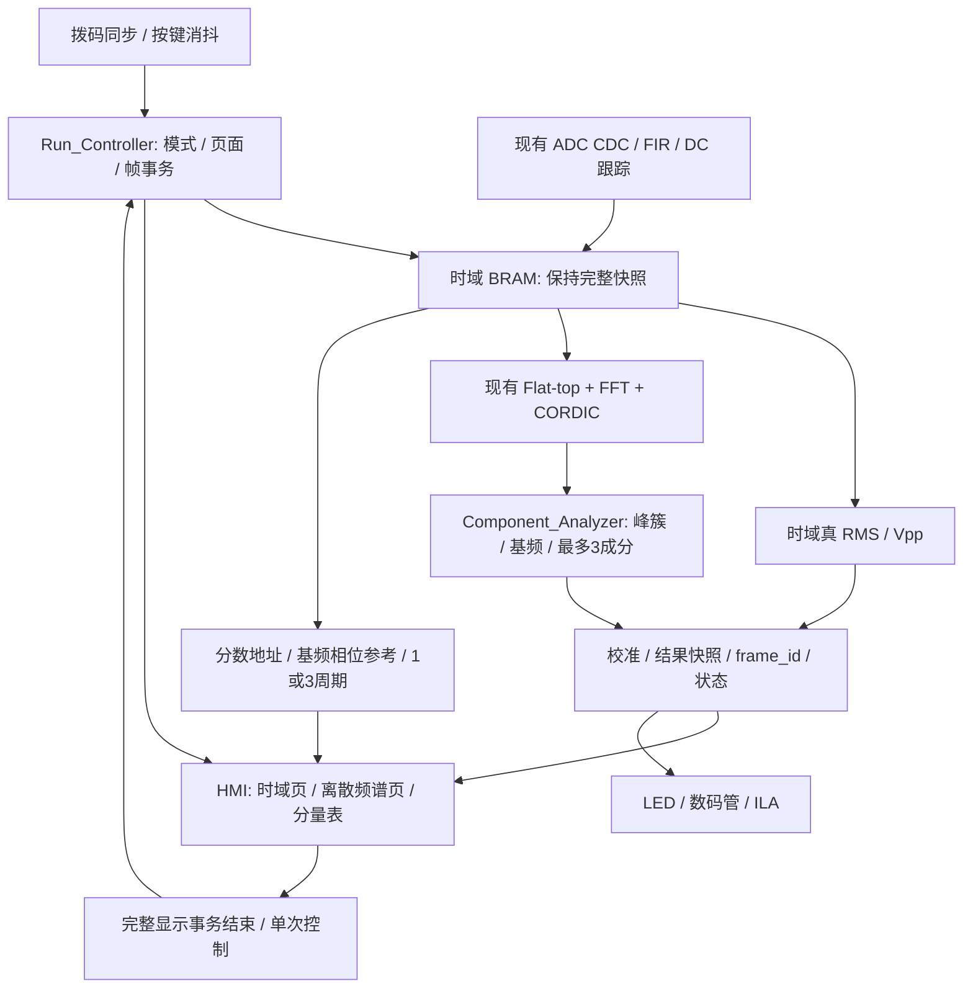

# G 题逐项实现与验收计划（已批准，等待开始）

日期：2026-10-16（Asia/Shanghai）。现有功能基线提交：`3395821`。

**状态：用户已批准本计划，但明确要求暂不开始实施。当前只修订并推送计划文档；下述 RTL、脚本功能、屏幕工程、构建、下载及实测均未执行，等待用户明确发出开始指令。** 本文不是达标声明，不改变现有 bitstream。

## 1. 依据与归档

- 用户提供的 [2026 年 G 题原文](requirements/2026年G题.md) 是本计划的需求依据；本次没有独立核验其官方发布来源。
- 原始来源：`C:\Users\Joe\Downloads\2026年G题.md`。原样复制，不修订原文、公式或图。
- 导入文件 SHA-256：`0CC175A54AC893D118DBE43772185E5C48F829BEDEB4581487959DA8793AEA59`，源文件与归档文件一致。归档目录 `.gitattributes` 禁用文本换行转换，以保留原始字节。
- 现状证据：[10 月 16 日实板报告](hardware_debug_20261016.md)、当前 RTL/IP/XDC、[人工测试记录](hardware_test_record.md)。人工记录原有填写内容本次不修改。

### 1.1 用户已确认的项目范围与控制约定

1. **本项目明确忽略“单路 +5 V 供电”和“屏幕至少 6 英寸”两项原题要求。** 二者不再列为实施阻碍或本项目验收指标，不要求为符合它们而更换屏幕、采购或改造供电。原题归档保持不变；项目排除两项要求不等于已符合原题全部条件。
2. SW1/SW2/SW3 分别请求 A/B/C；SW0 请求调试，且调试最低优先。最终优先级为 **SW3（C）> SW2（B）> SW1（A）> SW0（调试）**，不是两位二进制拨码选模式。
3. SW15 控制连续/单次测量，沿用 0=连续、1=单次；不参与模式优先编码。SW[14:4] 暂预留。
4. LD[9:8] 显示四种已生效状态：`00`=A、`01`=B、`10`=C、`11`=调试；其余操作、算法与验收计划获批准。全部模式开关关闭时默认 A，沿用此前记录。
5. **方案批准不等于立即开工。** 当前用户只授权本轮文档修订与推送；后续实施继续等待开始指令。新增采购、接线/供电变更、提高仪器输出限值仍需另行确认。

## 2. 原题转化为可验收指标

### 2.1 三组输入条件

| 模式 | 题目对应 | 被测组合信号总 Vpp | 所有被测频率成分 | 额外干扰 |
| --- | --- | --- | --- | --- |
| A | 二、1 | 100～250 mV | 10～200 kHz | 无 |
| B | 二、2 | 50～250 mV | 10～500 kHz | 无 |
| C | 二、3 | ub 为 50～250 mV | ub 为 10～500 kHz | 单音，200 mVpp，fJ≥1 MHz |

ua/ub 均为“基波 + 1 或 2 个谐波”的组合，不是只测一个正弦。频带限制作用于所有成分，不只作用于基频；例如 B 模式的 500 kHz 可以是最高谐波，不应只用 500 kHz 单音代替该模式验收。组合信号的总 Vpp 与各分量幅值、相位有关，不能把分量幅值简单相加后当作实测 Vpp。

### 2.2 每个模式共享四个子项，共十二项

| 子项 | 实现目标 | 验收标准 |
| --- | --- | --- |
| A1/B1/C1 | 按键切换 1/3 个完整周期，波形稳定 | 周期数、周期边界、稳定性、响应时间；不截掉负半周或屏幕首尾 |
| A2/B2/C2 | Vpp、真有效值、基频 | Vpp/RMS 绝对误差各≤5 mV，基频绝对误差≤1 kHz |
| A3/B3/C3 | 正频率离散谱线图 | 真实成分数、相对频率位置和幅值比例大体一致；不将窗主瓣画成多个成分 |
| A4/B4/C4 | 每个频谱成分的频率及幅值列表 | 各成分幅值绝对误差≤5 mV，单位明确；FFT 名义格点间隔 500 Hz |

每一子项在启动装置后完成时间≤2 s。冷上电、复位启动、用户切换页面/重新测量分别计时，原题“启动”的最终判据需确认；保守方案同时记录三者，不将“计算完成”冒充“屏幕完成”。

### 2.3 必须统一的定义

- 题例中 `u=Σ Ui sin(...)` 的 Ui 是正弦**峰值幅度**，不是 Vpp 或 RMS。界面标注 `Ui / mV peak`；单个分量的 Vpp=2Ui，RMS=Ui/√2。
- 真有效值按采样平方平均后开方；不能用总 Vpp/2√2 替代复合信号的 RMS。对零均值理想谐波组合，完整周期参考 RMS=`sqrt(Σ Ui²/2)`；非整周期有限记录用实际逐点平方平均模型核对。
- 时域测量基于未加窗的被测信号；平顶窗只用于频谱幅值分析。记录 IIR 去直流的工作定义与瞬态，不把受干扰总输入的 RMS 当作 C 模式的 ub RMS。
- 500 Hz 是频谱名义格点间隔，不是所有数值的实测误差，也不能保证两条任意接近的谱线可分辨。基频允许误差是另一个指标。
- 50 Ω 输出阻抗/BNC 电缆要求，不等于装置输入必须直接并联 50 Ω，也不等于 HDS 的显示负载应固定设为 50 Ω。须建立一致的信号源负载设置、实际输入端电压与标称值约定。
- 按原文说明 7，合规信号源的参数设置值是相应参数测量的标称值；参考示波器/仪表用于标定和排查负载/通道差异，不擅自替换最终评测的标称定义。组合信号总 Vpp 的设定/归一化方式也应记录。

## 3. 当前能力与主要缺口

| 项目 | 当前状态 | 待做 |
| --- | --- | --- |
| 采样/FIR/时域统计/FFT | 已有 RTL，单音 15/15 次板测通过 | 增加复合信号及最坏条件验证，不外推为十二项全部达标 |
| 基频 | Peak_Search 仅取全局最大幅值，扫描 bin 10～4000 | 真正区分基频和更强谐波；按模式限制频带 |
| 分量列表 | 只有一个峰的输出 | 同时输出最多三个真实成分及各自频率、峰值幅度、可信度 |
| 谱图 | 已有频域 BRAM，未向屏幕发送谱图 | 谱线聚类、显示缓冲、坐标映射、频域页 |
| 幅值单位 | raw；MAG_SCALE_FACTOR 仅整数倍率 | 定点小数校准、窗/FFT/CORDIC 增益追溯、输入端 mV 与单位一致 |
| 通道频响 | 500 kHz RMS/FFT 比 100 kHz 约低 6.5% | 用参考测量定位，再决定前端调整或共用时域均衡；不可盲调一个倍率 |
| 波形周期 | 已线性插值，但周期样本数先做整数截断 | 基频正确后，用分数地址/相位步进形成精确 1/3 周期跨度，检查端点约定及相位稳定 |
| 板载操作 | BtnC 复位、BtnU 1/3 周期，其余未接 | 运行/模式控制、LED、四位数码管、完整 XDC |
| 屏幕 | 尚未验收，实际型号/像素与工程待核对 | 匹配控件 ID/绘图区像素/点数/波特率；物理尺寸下限已排除 |
| 时序/CDC | WNS +0.082 ns，WHS +0.022 ns；12 条 ADC CDC-15 警告 | 专项审查 bundled-data 保持窗口/约束/复位，不能屏蔽告警当作修复 |

现有实现使用 BRAM 39/50、DSP 74/90。优先复用 FFT/FIR 和时域存储，使用小规模候选表及显示缓冲，不默认增加全帧双缓冲、第二套 FFT 或 IFFT；每阶段重新核算资源与时序。

## 4. 硬件适配与测试安全核对项

### 4.1 屏幕功能与像素适配（不限制物理尺寸）

用户已明确排除≥6 英寸要求，现有屏幕可以直接作为本项目主显示屏，不仅限于联调用途，不再因尺寸要求采购或更换屏幕。记录型号为 `TJC3224T128_011`；同系列 `TJC3224T128_011R_Z01` 厂家规格书列出 320×240 像素，实际使用仍以实物型号及屏幕工程配置为准。[厂家规格书](https://offer-product.oss-cn-beijing.aliyuncs.com/product/offer/attachment/3041029078/file/subPdf_163438_79458_20211221-164550582.pdf)

需要核对的是分辨率、曲线组件实际绘图区宽高、控件 ID、点数和通信能力，而不是物理对角线达标与否。若实际曲线宽度只有 320 像素，当前固定发送 400 点可能滚走前部内容；正式 WAVE_POINTS 必须与曲线组件宽度及 1/3 周期定义匹配。

### 4.2 供电兼容与安全（不要求单路 +5 V）

用户已明确排除单路 +5 V 供电要求。保留现有已调通的 ±5 V 滤波器；本项目不要求将外部供电改为单路，也不以负轨是否由内部产生作为达标条件。不擅自修改供电或硬件。

同时检查总功耗、电源纹波、ADC/FPGA/屏幕共地、BNC 输入座、ADC 输入余量。不能把 Basys 的 3.3 V I/O 直接当作可承受 5 V 的输入。

### 4.3 复合信号与干扰源

HDS242S 目前只验证了单音输出；不能假定它可生成用户指定谐波幅值/相位，或可独立同时输出 ub 和 uJ。CH1/CH2 是采集通道，不是两路发生器输出。

完整验收需要经确认的谐波发生器/AWG，或同步多音源及合路网络；C 模式还需合成被测组合信号与单频干扰。合路器、阻抗、两路源隔离和幅度均须核实，不直接用 T 接头把两个发生器输出硬并联。暂不购买、配置或启用新设备。

现有脚本安全上限仍为 100 mVpp。题目要求的 250 mVpp 及叠加 200 mVpp 干扰需要重新确认组合峰值、前端增益、ADC 量程后，另行批准测试限值；不因题目写了幅值范围就自动提高输出。

### 4.4 抗混叠边界

Fs≈4.096 MHz，Nyquist≈2.048 MHz。1 MHz 干扰在数字域可滤除，但≥1 MHz 没有给出明确上限：更高频干扰可能混叠回 10～500 kHz，数字低通不能恢复已经混叠的数据。例如名义 4 MHz 在该采样率下可混叠到约 96 kHz。

C 模式必须审查 ADC 前模拟抗混叠滤波与线性余量；拟测 1.0、1.5、2.0 MHz，并在仪器能力及输入安全得到确认后测试会折叠回带内的 3.596/4.0 MHz 等点。有限频点验证不等于证明任意无限高频的抑制，需确认实际评测干扰范围。

## 5. 已确认的操作协议（尚未实现）

### 5.1 开关与按钮

| 控件 | 定义 |
| --- | --- |
| SW1 | 请求 A：10～200 kHz / ua |
| SW2 | 请求 B：10～500 kHz / ub，优先于 SW1/SW0 |
| SW3 | 请求 C：ub+uJ，显示滤除干扰后的 ub，模式最高优先 |
| SW0 | 请求调试/标定页，模式最低优先，不作为正式小题 |
| SW15=0 / 1 | 连续 / 单次测量，与模式选择独立 |
| BtnC | 保留系统复位 |
| BtnU | 保留一屏 1/3 周期切换 |
| BtnD | 单次模式启动完整测量；连续模式请求一次新测量，不反复复位 |
| BtnL / BtnR | 循环切换“时域波形与参数 / 频谱图与分量表”；诊断数码管随页面选择读数 |

优先编码与 LED 对照如下，`x` 表示该位可为任意值：

| SW[3:0] | 最终模式 | LD[9:8] |
| --- | --- | --- |
| `1xxx` | C | `10` |
| `01xx` | B | `01` |
| `001x` | A | `00` |
| `0001` | 调试 | `11` |
| `0000` | 默认 A（沿用此前记录） | `00` |

例如 SW3 与 SW0 同时开启时选择 C，不会被调试开关覆盖。LD[9:8] 显示按帧/事务边界提交后的已生效模式，而不是尚未生效的开关瞬态值。

屏幕采用板上按键控制即可满足键控需求，不把触摸回传作为首阶段依赖；现有 UART 仅 TX，未实现触摸接收。A/B/C 共享处理链，C 不是关闭前级滤波，初版建议各模式均保持已验证的 FIR 工作。

拨码先同步并在稳定后采纳，多位编码不逐位瞬间切换。按键消抖；模式/页面/周期数以帧或显示包边界提交，附 mode_id/frame_id，禁止跨帧混合。单次模式持有完整结果，重新启动才更新；不停止 ADC/FIR 时钟，不绕过帧所有权握手。

### 5.2 指示与数码管

- LD0：时钟锁定；LD1：算法时钟心跳；LD2：新结果（展宽约 100 ms）。
- LD3：采集忙；LD4：算法忙；LD5：UART 忙；LD6：结果有效且未过期；LD7：锁存异常。
- LD[9:8]：`00`=A、`01`=B、`10`=C、`11`=调试；LD10：已生效的单次模式（对应 SW15）；LD11：三周期；LD15:12 预留错误码。
- 四位数码管默认频率，以 kHz 显示并明确单位；分页显示其他读数。未标定时只能显示 raw；无结果/过期显示 `----`，溢出不能截高位冒充正常值。
- 连续模式使用超时/观测年龄判断新鲜度；单次锁存结果保留采集时间和“保持”标志，不能照搬连续模式超时含义。完成结果不代表 UART 屏已渲染；UART 忙不代表硬件卡死。

板载显示辅助操作与排障，现有串口屏承担波形、频谱和分量列表的主显示，不再设物理尺寸门槛。引脚按 [Digilent Master XDC](https://github.com/Digilent/digilent-xdc/blob/master/Basys-3-Master.xdc) 增补，不变更现有 ADC/UART 接线；数码管位选/段选按官方低有效约定实现。[Basys 3 手册](https://digilent.com/reference/_media/reference/programmable-logic/basys-3/basys3_rm.pdf)

## 6. 算法与架构改造方向

### 6.1 基频与分量

1. 按模式扫描合法正频率区间（名义 A: bin 20～400；B/C: bin 20～1000），边界留必要的窗主瓣采样，最终按估计频率判定，不截掉边界峰的主瓣。
2. 自适应噪声估计、候选峰检测及窗主瓣聚类，防止 flat-top 相邻多个大 bin 被算成多个谐波。候选表保留适当冗余，再选真实的两/三个成分。
3. 根据最低可信成分、各候选频率的整数倍一致性判别基频，不简单选最大峰，也不对带量化误差的 bin 直接求 GCD。谐波阶次不限定只能 2/3/4；最强谐波、弱基波和离栅格输入均列入验证。
4. 基波存在但原题未给最低分量幅度，检测下限/阈值与噪声必须记录；对低可信情况报状态，不捏造基频。先用参考模型检查弱基波极限，再决定阈值及需要用户澄清的不可辨识边界。
5. 按 golden model 验证主峰/插值/簇估计的幅值公式；不把主瓣幅值直接相加，也不把几个峰值 bin 当多个成分。输出各成分 Ui_peak_mV、频率和有效标志。

### 6.2 标定与真 RMS

先明确输入参考面（BNC 入口），校核源显示负载及实际电压；建立 raw→输入端电压的定点小数转换、舍入、饱和和无效状态，不继续只用整数 MAG_SCALE_FACTOR。

FFT 标定需从量化窗系数的实际 coherent gain、FFT 未缩放输出、I/Q 右移、CORDIC 配置推导，再以定点参考向量校验；原题 Ui 用 peak，不用总 Vpp 混代。

频响校正不能仅按基频给所有时域样本乘一个数：不同谐波受衰减可能不同，而 Vpp 还依赖相位。先定位已见的高频衰减，优先保证共用测量通道的幅相保真，再决定模拟调整或资源可承受的时域均衡。只给频谱分量查增益表，不能宣称已修复组合信号的 Vpp/RMS；不先承诺昂贵的 IFFT 重建方案。

### 6.3 完整周期与稳定显示

当前每周期先算 floor(8192/bin)，再乘周期数并减 1，不能保证高频下的完整周期。拟改为用估计基频直接计算分数采样跨度/相位步进，并明确末端是否重复起点。已有线性插值可复用；复合信号可能每基周期多次过零，应增加基周期相位/相关参考，避免画面锁在更强谐波的子周期上。

显示点数根据已确认的屏幕组件宽度配置，Y 轴按实际绘图区高度限幅，不默认所有屏幕都是 400×256。保留同帧波形和参数；页面切换时清除旧数据、更新坐标/单位，不能把旧页残留谱线当新成分。

### 6.4 两秒预算与调试接口

8192 点采样约 2 ms，不是两秒瓶颈。按 115200/8N1，400 条最坏约 14 字节的 add 指令仅线缆发送就约 0.486 s；加控件文本、清屏、谱图和屏幕执行时间后须实测。初版只更新当前页面，不无条件发送两幅完整图；用小显示缓存避免新增全帧双缓冲。

目标正常单页事务≤1 s，给冷启动/切换留裕量；这是设计目标，不是已测结果。记录从操作事件、采集起止、结果就绪、最后停止位、屏幕实际稳定可见的时间。端到端两秒最终由屏幕观测/合适仪器确认，PC 每次启动 Vivado 的数十秒不得算作装置内部处理时间，也不能据 ILA 快照推断屏幕已完成。

拟用片内事件时间戳/周期计数器记录耗时，避免要求 ILA 在 100 MHz 下直接存满两秒。当前 frame_release 是最后字节交给发送器时产生，计时到线缆结束须另外观察 UART 最后停止位/空闲事件；TX-only 无屏幕完成回执，实屏稳定时间仍需外部观测。

ILA 重点补充 mode_id/frame_id、capture/process/display 事务事件、基频与成分列表、超时/过载/CDC 诊断。资源紧张时以分批探针配置取证，不能默认大幅扩深所有探针；新增调试不应掩盖实际数据通路问题。

## 7. 已批准的实施顺序与执行条件

| 阶段 | 拟工作与交付 | 进入下一阶段的条件 |
| --- | --- | --- |
| P0 条件核对 | 确认屏幕像素/工程、电平/共地、BNC/阻抗、信号合成能力、幅值上限；形成接口/单位契约 | 开始指令下达后核对功能与安全；不审核已排除的供电形式/屏幕物理尺寸，也不要求先采购才能做离线模型 |
| P1 参考模型 | Python 组合信号/离栅格/干扰向量、幅值与定点位宽模型、十二项测试矩阵 | 不依赖新硬件的模型自检通过，算法边界明确 |
| P2 操作面板 | Run_Controller、SW3>SW2>SW1>SW0 优先编码、SW15 连续/单次、按钮、LED、数码管、模式/页面快照、XDC 及仿真 | 不破坏现有单音基线；覆盖同时拨开/全关默认及调试最低优先；模式/按键在忙/空闲状态均无死锁和帧混合 |
| P3 分量与计量 | Component_Analyzer、真实基频、最多三个分量、幅值格式及校准路径；按批准条件采集标定数据 | 强谐波/弱基波/离栅格数值对照通过；硬件标定需参考源和安全限值 |
| P4 主屏流程 | 匹配实际屏幕的时域/频域页、1/3 周期分数抽样、分量表、无效/保持提示 | 实屏谱线数和幅比正确、波形完整、单位一致；控件工程可复现 |
| P5 集成验收 | CDC/外部时序复核，完整回归、实现/bit/LTX、A→B→C 十二项及两秒/长稳测试 | WNS>0、保持/布线/DRC检查合格；逐项记录实测误差与失败，不以截图替代数据 |

P2/P3/P4 各阶段需要上板时才生成对应新 bit；每次生成同步记录源码版本、bit/LTX 散列、报告和下载版本，不能将旧 bit 当新版本。保留本次基线与用户未提交改动。每阶段完成后提交推送；不推送本地令牌、大型缓存或未验证结论。

拟新增文件（名称为计划，并未创建）：`Run_Controller.v`、`Board_Status_Display.v`、`SevenSeg_Scan.v`、`Component_Analyzer.v`、`Measurement_Calibrator.v`，以及组合信号参考模型和相应自检 testbench。拟修改 `G_FPGA_Top.v`、`Capture_Calc_Subsystem.v`、`HMI_UART_Ctrl.v` 和板级 XDC；以新的 Tcl 集成脚本注册文件/仿真源。现有 FFT/FIR/CORDIC IP 默认复用，只有参考模型或频响定位证明需要时才提出 IP/系数变更，不顺带重构已通过的 ADC 采样链。

**批准记录：用户已批准本计划其余内容，并确认第 1.1 节的排除项与控制规则；不再请求重复批准总体方案。执行仍暂缓，直到用户明确发出开始指令。采购、接线/供电变更、提高输出限值等额外动作仍须另行确认，不能由总体方案批准推定。**

## 8. 拟测试向量与判据

- A：题例 10.5/31.5/42 kHz（1/3/4 阶）；另加最高分量 200 kHz 的合法组合，如 50/150/200 kHz。按总 Vpp=100/175/250 mV 归一化。
- B：复用 A 并增加 125/375/500 kHz 等合法组合，按总 Vpp=50/100/250 mV。单音仍用于诊断和标定，不替代复合信号验收。
- 基频特例：三/四次谐波比基波强；只有一个谐波；不同谐波相位；10.25 kHz 等非整 bin 基波，所有成分仍在对应频带内。小信号/低可信边界单独记载。
- Vpp 参考通过高密度波形求极值并与实际参考源/仪器核对；改变谐波相位应改变 Vpp，但完整周期 RMS 应符合平方和关系。区分参考不确定度、采样极值误差、频响与定点误差。
- C：在同一 ub 条件上叠加 200 mVpp 干扰，逐点记录频率、原始/滤后是否过载、ub 各分量及 Vpp/RMS 误差、频率误差、完成时间；须满足绝对指标，不只比较“加干扰前后差不多”。
- 控制：验证 SW[3:0] 全部 16 种组合的优先编码（SW0 调试最低、全关默认 A）与四种 LD[9:8] 编码，分别组合 SW15 连续/单次；覆盖启动、按住/抖动、快速切换 A/B/C/调试、处理中切页面/周期数、单次重测、无信号、恢复信号、超时与清错。复位不应成为每次正常测量的必需操作。
- 预计至少 30 min 连续运行及重复模式切换作为初始长稳目标；它是新增工程验证目标，不是原题额外强制指标。
- 记录每项输入构成/峰值/相位、总 Vpp、源负载约定、参考值、测量值、绝对误差、显示时间、版本、状态及 PASS/FAIL/未测。没有独立参考或合成设备时明确写未测，不能用单音结果填满十二项。

## 9. 待补信息与当前停止点

1. **开始指令尚未下达。** 本轮仅修订计划并提交推送，不自动进入 P0/P1/P2 或其他实施阶段。
2. 实际屏幕的完整型号、分辨率、绘图区宽高及 HMI 工程，供后续显示适配使用；尺寸不影响本项目验收资格。
3. 后续复合信号/干扰合成与参考测量设备是否可用；没有也可在开始指令后先推进模型和板载面板。
4. 高于现有 100 mVpp 安全上限的测试条件仍需单独核实和确认；已排除的供电形式要求不改变电平、量程和接线安全要求。

本次停止于已批准计划的文档修订；没有修改 RTL/IP/XDC，没有综合/实现、下载、仪器输出或屏幕配置。文档提交推送仅保存已确认约定，不视为已经获得开始实施的指令。
