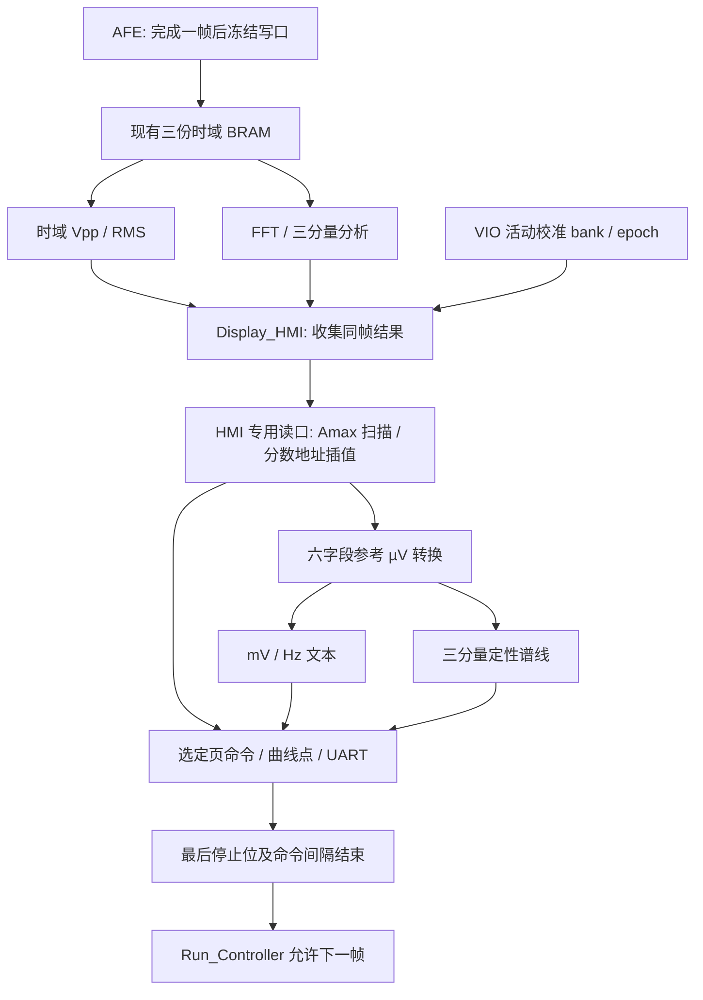

# P4 双页显示：FPGA 集成与手动构建交接

## 1. 状态与范围

2026-10-30上午后续：用户首次完整实现WNS=-4.383ns，未满足时序；已作分拍算术、逐字节命令构造和分组复位修订，行为回归通过，等待用户重新实现。原始失败数据与证据见[时序修订记录](../reports/display_timing_20261030/README.md)，不能把下面早期集成仿真通过视作硬件时序通过。

2026-10-29开始、10-30凌晨完成回归：显示准备模块已通过 `Display_HMI` 接入 `Capture_Calc_Subsystem` 和 `G_FPGA_Top`，源码默认 `ENABLE_DISPLAY=1`。本次完成 RTL、工程注册、端到端 UART 行为仿真；没有生成 IP、综合、实现、生成 bit 或烧写，也没有访问仪器/JTAG。板上原有 bit 仍是旧 raw 文本/单曲线逻辑，不能把源码行为当成已上机现象。

`docs/TJC_UART_FORMAT.md` 保留队友的协议草案，其中“当前仍为 t0..t3”“400点”“每帧 wave→fft 自动切页”等历史描述不再定义新源码行为。最终屏幕 spec 到位前，以下是可调整的实现约定。旧 `HMI_UART_Ctrl` 可用 `ENABLE_DISPLAY=0` 保留，便于对照。

## 2. 数据通路与所有权



- 不新建整帧缓存。时域计算、FFT、显示仍使用原三个读副本；显示读副本只由 `Display_Wave_Renderer` 使用，命令发送和文本格式化不竞争读口，因此不需要多主机读仲裁器。
- 收集器分别保存 time/peak 事件，等二者齐全再发布一次 `measurement_valid`。原始结果和帧编号先锁存；在外部观察到该 measurement 事件的同一个时钟沿，锁存活动增益和 epoch。`Runtime_Calibration` 在该沿优先处理测量，不能同时提交新 bank，避免 ILA 与显示贴上不同 epoch。
- 随后扫描同帧 Amax，再转换 Vpp/RMS/三个正弦峰值/Amax。扫描期间 live VIO 系数即使改变，也不能修改本显示帧；保持态重绘同样沿用旧 bank。更新系数后需取得新测量帧才能看到新电压值。
- 每次新 `capture_start` 立即取消旧帧的可重绘标记。显示 busy 期间，子系统把 AFE 的实际 capture permit 拉低。即使用户此时按 BtnD 请求重测，Run_Controller 的 arm 也要等待重绘完成才能写入 BRAM。
- renderer 接收最后一个像素不代表发送完成。每个命令包含实际 UART 的最后停止位和间隔；显示全部命令结束后，才拉高 `frame_release`、产生 `waveform_done`。原 `packet_finished` 还要求 HMI 不忙且 UART idle。

## 3. 操作约定

沿用板载控制：SW3 > SW2 > SW1 > SW0；SW0 调试最低优先，全关默认 A；SW15 连续/单次；BtnD 重测，BtnU 切换1/3周期，左右键循环四个诊断视图。

新增屏幕映射不占用新按键：诊断视图3（谱幅）选择 `fft` 页，其余视图选择 `wave` 页；从默认视图按一次左键即可到 fft，按右键回到 wave。`SCREEN_FFT_VIEW` 可修改此映射。板载数码管的 `view_active` 仍保持原来“下次测量事务锁存”的语义；屏幕使用独立导出的 view request，单次保持时可立即请求重绘，两者不要混为一个状态。

一帧只刷新当前选择的页面，不在每帧交替切到另一个页面。发送中按键改变请求，会先完成旧事务，再刷新最新请求；不会在半条命令中切页。单次保持的切页/周期重绘不产生新 `measurement_valid`，不增加测量 frame_id，也不改变原统计量。

上电首次有效显示前默认等待自 FPGA 复位起500ms，再发送三个 FF 同步解析器、`page <选定页>`、文本、`cle`、恰好 W 个 `add`。这三个 FF 可终止上次 FPGA 复位时中断的 ASCII 指令。之后仅切页或每16个显示批次重申当前页；不会自动在 wave/fft 之间轮播。TX-only 无法检测屏幕断电；连续测量可在后续周期重同步时恢复，单次保持则需切页/重绘或重新测量。不能把 UART 完成当成屏幕已经执行完毕的 ACK。

## 4. 屏幕工程契约

默认页面 `wave` / `fft`；两页各自曲线 ID 1、通道0；绘图区暂用240×160。名称区分大小写，动态文本必须真实存在：

| 页面 | 必需文本控件 | 内容 |
| --- | --- | --- |
| wave | tUpp、tUrms、tF1 | 一位小数 mV、mV、整数 Hz |
| wave | tWaveYTop、tWaveY0、tWaveYBot | +Amax mV、0、-Amax mV |
| wave | tWaveSpan、tWaveXLeft、tWaveXRight | 1T/3T、0T、1T/3T |
| fft | tF1、tA1、tF2、tA2、tF3、tA3 | 按频率升序排列的 Hz / 正弦峰值 mV |
| fft | tFftYTop、tFftY0 | 本帧范围内最大峰值 mV、0 |
| fft | tFftXLeft、tFftXRight | 10kHz、A模式200kHz或其余模式500kHz |
| 两页，可选 | tStatus | 默认不发送，DISPLAY_STATUS=1才启用 |

无信号的数值为 `--`，波形清除后绘中线、频谱绘零基线，避免保留旧噪声/旧幅值；有信号但未加载有效系数时仍显示频率和归一化形状，所有电压文本显示 `--`。缺失的分量槽为 `--`。可选状态按优先级显示 FAULT、NO SIGNAL、OVERFLOW、CAL、HOLD/RUN，来自该帧快照；没有新结果事件的采集超时仍由现有板载LED/错误码指示，并非本次新增实时屏幕故障通知。

纯 ASCII 指令，无 CR/LF；每条正文后追加三个真实 FF 字节。mV 例：`tUpp.txt="100.0mV"`；频率例：`tF1.txt="100000Hz"`。当前 Hz 整数文本可能较长，屏幕需预留字体宽度。本次不改队友的 spec 文件，也不生成屏幕 HMI/TFT 工程。

## 5. 集中配置位置与数值限制

`G_FPGA_Top.v` 的参数通过子系统传到显示链路：

| 参数 | 默认 | 作用 |
| --- | --- | --- |
| ENABLE_DISPLAY | 1 | 新双页；0回退旧 raw HMI |
| WAVE_POINTS / DISPLAY_HEIGHT | 240 / 160 | 两页共用绘图区宽/高，实际有效绘图区须核对 |
| DISPLAY_INVERT_Y | 0 | 默认发送逻辑正值向高Y映射；若实屏方向相反置1 |
| SCREEN_FFT_VIEW | 3 | 选中该诊断视图时显示fft |
| DISPLAY_STATUS | 0 | 两页是否存在tStatus |
| DISPLAY_STARTUP_CYCLES | 50,000,000 | FPGA复位后等待；并非已测得屏幕启动时间 |
| DISPLAY_COMMAND_GAP / DISPLAY_PAGE_GAP | 10,000 / 5,000,000 | 普通命令100µs / 切页50ms，均需实屏核验 |
| DISPLAY_PAGE_REFRESH | 16 | 周期性重申当前页；0关闭 |
| DISPLAY_CURVE_ID / DISPLAY_CHANNEL | 1 / 0 | 曲线组件ID、通道 |

页面名、全部文本控件名集中在 `Display_HMI.v` 参数区（每名最长16 ASCII字符），无需修改状态机。后续最终 spec 主要在这里适配。

波形按 `p*C*8192/((W-1)*bin)` 的Q12分数位置线性插值，端点包含估计周期的重复端点；Amax 为整帧最大绝对样本，可处理 -32768。H=160时逻辑零位80，正负满刻度159/1；翻转模式相应为0/158，零位79。实际方向、边框占用像素由屏幕联调确认。

仍以500Hz bin估计周期，尚无亚bin周期估计或复杂组合波的相位锁定；不能保证任意非整频/多次过零组合波都显示精确完整周期。频谱为最多三个已检测分量的定性谱线，不是4096bin噪声底。像素碰撞取最大幅值、范围外分量不挤到边缘；完整分量文本保留。内部 renderer 的 collision/out_of_range/window_clamped 仍可在仿真层观察，未新增 ILA 探针。

2026-10-30补充：已将实测Q16.16参考系数3623460/3701829/4194写入板级默认参数，上电/复位启用epoch=0，VIO开/关均能使用。在线覆盖仍有效，复位恢复默认bank；VIO暂存区不自动提交。设DEFAULT_CALIBRATION_ENABLED=0或显式禁用bank后，电压显示`--`。系数仍是发生器设定参考µV/raw，并非独立绝对输入标定。板载数码管保持raw，不能与屏幕mV逐位比较；详细行为见 `runtime_calibration.md`。

## 6. 离线验证与证据

最终通过 **17组XSim测试顶层和110项主机测试**：新串口事务3组、准备计算3组、既有contest9组、快照/板级接口2组。日志与摘要归档在[本次回归报告](../reports/display_integration_20261030/README.md)。没有综合资源/时序报告或新bit，不能把行为仿真PASS当成这些结果。

```powershell
.\scripts\run_display_hmi_sim.ps1
.\scripts\run_display_prepare_sim.ps1
.\scripts\run_measurement_debug_sim.ps1
.\scripts\run_contest_sim.ps1
.\.venv-hds\Scripts\python.exe -m unittest discover -s scripts/instruments -p 'test_*.py'
```

新增测试从实际 UART 引脚解码8N1，而不是只查看控制器内部字节：短帧64点/8像素、完整8192点/240像素、Y翻转与每2批次重同步三组；检查每条命令/三个FF/文本/全部曲线点、同页不乱切页、1/3周期、同帧raw/epoch/gain、HOLD重绘无新测量、无信号清除、未标定/缺失槽、A/B范围、复位取消、最后停止位后释放。原顶层端口检查覆盖VIO开/关、新旧HMI分支，并验证真实子系统的capture permit在显示busy时被屏蔽。顶层测试的厂商DSP IP仍为黑盒，不是完整ADC→FFT数值仿真。

本轮仿真使用缩放后的每bit10拍加速串口测试；生产100MHz仍复用已验证的UART_Tx（每bit868拍）。每页240点约2880～3360线缆字节，即约250～292ms，另有文本、命令间隔、切页、计算和屏幕执行时间。预算不是两秒实屏验收。

## 7. 用户手动构建与屏幕联调

1. 在当前GUI工程中执行 `source C:/Users/Joe/Documents/Verilog/G_FPGA/scripts/setup_display_prepare.tcl`，然后保存工程。它只幂等注册七个源码，不生成IP、不改top/generic、不启动任何run。若GUI仍持有旧source列表，直接重新综合可能再次出现module not found；只刷新磁盘xpr不等于GUI已读到新源。
2. 核对top仍为G_FPGA_Top、ENABLE_RUNTIME_CALIBRATION=1保留、原FIR/ILA/VIO配置不变；新代码不要求扩展ILA或生成新IP。
3. 由用户手动综合、实现，检查错误、资源、WNS/WHS和DRC，再生成bit及匹配LTX、烧写。旧版47/50 BRAM及WNS不能用作此版本签核；本轮没有实测新资源/时序。
4. 屏幕最终工程必须具有上表控件；核对实际绘图区和Y方向后调整参数。若尚未有匹配屏幕，可先不接屏幕，通过ILA做原测量链回归。
5. 新默认bank在复位后epoch=0已启用，无需先加载VIO；取新帧验证100kHz正弦的mV/Hz、正负方向、1/3周期、切页和HOLD。需要在线覆盖时再按标定指南提交VIO，并另取新帧。然后验证OFF、三分量、屏幕单独重启及新测量与重绘重叠。不要仅凭文字仿真宣布实屏稳定或≤5mV绝对精度通过。

本次没有更改或提交用户的 `G_FPGA_flash.mcs/.prm`，这些旧持久化文件不包含新显示逻辑。
