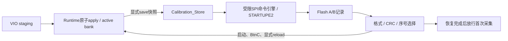

# 标定参数保存与自动恢复：P2实施及上机步骤

2026-10-30。源码和离线回归已完成；P2尚未手动综合、实现、下载或实板写入验证。本文取代P0/P1文档中的实施进度描述，记录格式仍遵循[格式1](flash_calibration_format_v1.md)。

## 已取得的实板信息

用户15:39:25构建并下载的bit支持P1只读诊断。通过独占JTAG会话读取状态，再显式触发一次新的SPI查询，两次均得到：

```text
JEDEC = C2 20 16
SR = 00
busy=0 ready=1 initialized=1 valid=0 source=0 error=3
第二次查询ack=1
```

JEDEC与用户提供的MX25L3233丝印及[Macronix资料](https://www.macronix.com/Lists/Datasheet/Attachments/8933/MX25L3233F%2C%25203V%2C%252032Mb%2C%2520v1.7.pdf)相符；ID本身不唯一确定完整型号后缀。SR读数表示当时WIP/WEL/BP/QE/SRWD均为0。没有有效标定记录，不等于整个参数区均为空白。本次会话没有执行WREN、擦除、编程、标定apply或FPGA下载。

该旧bit实现报告：WNS +0.092 ns、WHS +0.025 ns、TNS/THS 0；LUT 19163/20800、BRAM 48/50、DSP 90/90。**这些结论不覆盖新增P2源码**。新路径不增加乘法器，编码缓冲采用同步块RAM；实际资源、推断结果和时序必须重新检查。

## 运行机制



- `apply`仅修改活动系数，仍易失；`save`只保存已应用的bank及其epoch，不读取尚未提交的staging。
- 启动和BtnC恢复时先读Flash、选择记录，再在包间原子提交。无有效记录、冲突或读失败则使用RTL默认bank，并保留错误码；不会自动写入默认值。
- `probe`刷新保存记录状态，不应用bank；`reload`重新读取并应用。读取期间暂停新采集；已开始的测量先结束再提交恢复bank。
- 正常save期间已有系数继续服务测量；新apply被拒绝并重基准ack，不在save完成后自动重放。无并发请求队列。
- BtnC重置算法，但不重置MMCM或Flash控制器。正在进行的保存完成后再恢复；真正掉电则依赖A/B提交协议。POR由MMCM锁定和STARTUPE2 EOS建立。
- 默认bank保持：enabled=1，Vpp=3623460，RMS=3701829，FFT=4194；单位unsigned Q16.16 µV/raw，FFT代表正弦峰值。记录的saved_epoch是历史元数据；恢复后活动epoch重新递增，不要求与saved_epoch相等。

## Flash写入边界与故障处理

4MiB地址空间中，程序区为`000000–3DFFFF`，A槽为`3E0000–3EFFFF`，B槽为`3F0000–3FFFFF`。P2仅使用每槽最前面4KiB，64B正文在槽起点，16B提交在`+0x100`另一页。

每次真实save重新检查ID、状态和安全寄存器，预读目标4KiB；记录范围以外有非FF数据、或正文magic既非预期字符也非FF时拒绝擦除。使用非当前有效槽：WREN→检查WEL→20h擦除→轮询WIP→全4KiB空白验证→正文PP→逐字节回读→独立提交PP→完整CRC/元数据验证，最后才报告成功。相同bank不再擦写，也不更新保存epoch。序号支持32位回绕；半范围冲突和同序号不同内容拒绝自动择新。

底层仅允许9F/05/03/06/02/20/2B；写入必须位于参数保留区，PP不得跨256B页，擦除必须4KiB对齐。没有芯片擦除、程序区写入、保护位解锁或任意opcode接口。BP/SRWD、失败/保护安全状态会拒绝保存；QE不由本设计改写。WIP轮询有上限。

部分擦除可能留下不能识别为本项目magic的内容，此时会安全拒绝再次擦除，保留另一有效槽，需要人工诊断；没有强制清空命令。CRC降低损坏误用风险，不构成任意硬件故障下的数学保证。

## 用户手动构建一次

在已打开的本仓库Vivado工程的Tcl Console执行：

```tcl
source C:/Users/Joe/Documents/Verilog/G_FPGA/scripts/setup_flash_persistence.tcl
```

脚本注册RTL/XDC，生成`vio_flash_store`，保留其他generic并设置：

```text
ENABLE_RUNTIME_CALIBRATION=1
ENABLE_FLASH_PERSISTENCE=1
ENABLE_FLASH_READONLY_PROBE=0
```

保存工程后，由用户运行综合、实现，检查资源、WNS/WHS、DRC，然后生成并下载bit及配套LTX。脚本不启动这些步骤。已提交XPR包含新增RTL/XDC，但不会凭空生成VIO；必须执行上述注册脚本，防止GUI会话仍使用旧文件集。P2默认关闭，旧bit不会因为电脑脚本更新而获得写入能力。

## 首轮实板验收

仅在P2 bit与匹配LTX就绪后进行。GUI与命令行只允许一个JTAG操作者，停止其他ILA脚本或实验室自动任务。

在已经连接目标的Vivado Hardware Manager控制台执行：

```tcl
source C:/Users/Joe/Documents/Verilog/G_FPGA/scripts/flash_store_vio.tcl
rc_store_status
# 首次无记录：ready=1 saved_valid=0 error=3，活动bank为默认系数
rc_save
# 应返回SAVED_AND_VERIFIED，error=0 saved_valid=1 source=1
rc_export C:/Users/Joe/Documents/Verilog/G_FPGA/test_results/calibration_saved_01.json P2-build-identifier
rc_save
# 未改系数应返回UNCHANGED，序号不变
rc_reload
```

随后先用已有`rc_apply`流程修改并验证活动系数，**不save**，按BtnC确认回到已保存bank；再应用已验证新值并save，确认切换到另一槽、序号递增。重载及重新JTAG下载支持P2的bit后应恢复新bank，再进行真实断电测试。不要为测试故意保存未经验证的幅值系数。

也可用独占CLI（每次directory必须是新路径）：

```powershell
.\.venv-hds\Scripts\python.exe scripts/instruments/runtime_vio.py store_status --ltx G_FPGA.runs/impl_1/debug_nets.ltx --directory test_results/p2_status_01
```

同一入口支持`store_probe/store_save/store_reload/store_export`；export生成结果文件旁的JSON。JSON包含活动和保存bank、单位、版本、ID、序号、epoch、UTC时间及build标识；`record_crc_reconstructed`为依据已解码字段重建的CRC，不是原始Flash转储。GUI接口允许显式build标识，CLI默认unknown。

超时表示状态**未知**，不能自动重复save；先重新只读查询，核对bank、序号、busy和错误码。工具不自动重试写入。`rc_reload`在无有效记录时会返回默认回退状态和错误码，不能只看命令返回就认定恢复了Flash记录。

## 两种持久化需要区分

本功能保存的是**标定参数**。JTAG下载的FPGA逻辑断电仍会消失；要实现整机冷启动，还需用户把通过实现的程序镜像写入板载配置Flash，并按板卡要求设置Master SPI启动跳线。

镜像生成辅助脚本不连接硬件：

```tcl
source C:/Users/Joe/Documents/Verilog/G_FPGA/scripts/create_boot_mcs.tcl
rc_create_boot_mcs C:/Users/Joe/Documents/Verilog/G_FPGA/G_FPGA.runs/impl_1/G_FPGA_Top.bit C:/Users/Joe/Documents/Verilog/G_FPGA/test_results/p2_boot_01.mcs
```

按[AMD write_cfgmem文档](https://docs.amd.com/r/2023.2-English/ug908-vivado-programming-debugging/Creating-a-Configuration-Memory-File-for-FPGA-Devices)，`-size 4`单位为MiB。脚本生成SPIx1镜像并强制审计Intel HEX地址、64KiB擦除覆盖、bit哈希，只有全部位于参数区之前才发布最终MCS及JSON清单。输出禁止覆盖已有文件。

**MCS地址审计不能证明硬件编程器实际擦除策略。**升级配置镜像时不得使用Entire Device/整片擦除，必须只擦除文件涉及区域并保留`3E0000–3FFFFF`；升级前导出系数，升级后读取核对。此轮没有生成真实MCS或编程配置Flash，冷启动尚未验收。

## 状态与错误码

`store_status`位定义：0 busy，1 ready，2 saved_valid，4:3 source（0默认/1A/2B/3冲突），8:5 error，9 ack，10 initialized，11 dirty，12 saving，13 apply_block，14 rejected，15 panel_pending，23:16 SR，31:24安全寄存器。

| error | 含义 |
| --- | --- |
| 0 | 成功 |
| 1 / 2 | WIP超时 / ID不匹配 |
| 3 / 4 | 无有效记录 / 序号或内容冲突 |
| 5 / 6 | 命令引擎拒绝或失败 / 保护或WEL检查失败 |
| 7 / 8 | 系数bank不合法 / apply待处理或换算忙 |
| 9 | 目标扇区存在陌生内容 |
| 10 / 11 / 12 | 擦除验证 / 正文回读 / 提交验证失败 |
| 13 / 14 | 安全寄存器拒绝 / 非法命令 |

Runtime VIO flags新增7 ready、6 commit_rejected、5 apply_block；低5位保持原有定义。

## 离线验证与尚待确认

`run_calibration_store_sim.ps1`覆盖真实SPI线级NOR模型、A/B提交前后掉电、BtnC写中恢复、序号回绕、保护/安全失败、陌生扇区、回读损坏、相同bank无磨损、底层地址/页界限、80B编码黄金向量、包间恢复原子性及真实顶层首次采集门控。顶层算法IP使用黑盒，此项不是DSP数值回归。

主机侧147项测试通过，包含VIO拒绝/未知超时/JSON、MCS审计强制执行、重复注册。NOR Python模型改为与RTL一致的4KiB擦除，三组保存共303个掉电检查点；旧P1文档1023点来自当时64KiB参考模型，不能混用。

尚待用户手动实现确认资源和SPI时序、P2实板save/reload、真正断电恢复及配置镜像升级保留参数。Flash外部时序预算仍需核对实际连线/器件参数；旧bit的正WNS不覆盖新路径。
