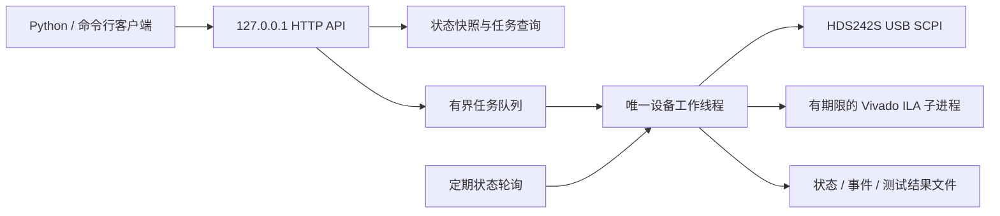

# 自动化联调服务与接口（2026-10-23 更新）

非整频点实测后修订：OFF只写一次，若立即回读合法ON/1，在0.5秒窗口内只读重查；窗口外仍可能有一个正在执行的有超时USB事务。未知回复/污染流不确认成功。`off_confirmation`增加queries和last_observed，仅为观测记录，不能将sent=true当作acknowledged=true。本地原子JSON替换遇Windows5/32/33可有界重试，总退避最多230ms；它不会重放仪器操作，永久磁盘错误仍会抛出。

新增 `configure_scope` 任务：参数为 `channel`（整数 1/2）、`probe`（1X/10X）、`coupling`（AC/DC）、`scale`、`timebase`。量程和时基必须通过驱动白名单校验，禁止任意 SCPI 字符串。任务在唯一设备队列内先关闭发生器，再设置通道显示、倍率、耦合、量程、时基、SAMPle 和 8K；回读核对倍率、耦合、量程及时基。不表示已核验所有采集设置或已获得新波形。

最近一次配置记录于 `scope_configuration` 和 `scope_observed_at`，不是持续轮询的实时示波状态；实际采集应以该次结果中的 header 为准。真实同轴连接请用 1X，不能沿用面板 10X 探头倍率。首次配置后可能读到尚未更新的屏幕缓冲，不能仅按 API 返回成功判定新波形有效。

该服务为后续电脑控制 HDS242S、读取 FPGA ILA、执行测试计划提供常驻接口。默认模拟模式，不需要接线，也不访问 USB/JTAG。真实仪器通信与固件单位的先前验证见 [HDS242S 指南](hds242s_automation.md)。

## 1. 接线与参考值

最小实测链路只需要：HDS242S OUT → 模拟滤波器 → ADC → FPGA，再由电脑通过 Basys 3 的 USB/JTAG 回读 ILA。**CH1/CH2 探头可完全不接**；计划中 `scope_channels: []` 表示不调用示波采集接口，不要求额外探测点。

若以后需要检查模拟链路，可以使用适配连接器的三通进行并联测量，或分阶段断开链路测量，但不作为本服务运行的前提。不接示波参考时，记录的是发生器设定值与 FPGA raw 结果；不能据此独立证明 ADC 输入实际电压或 ≤5 mV 精度。

## 2. 软件结构与并发规则



- HTTP 请求线程不直接操作设备。提交采集或扫频只返回任务 ID，随后查询任务；状态查询不等待采集结束。
- HDS242S 的整个连接期持有跨进程 OS 锁。旧版 CLI 与服务使用同一把锁，不能同时抢 USB。设备内部的锁保证同一进程内 query 的命令与响应配对。
- FPGA ILA 抓取也持有跨进程锁，每次都重新触发 measurement_valid；禁止拿旧 CSV 当新结果。
- 普通等待队列默认最多 8 项；队满返回 HTTP 409。停止输出命令清除待执行任务、取消当前任务，再优先关闭输出，避免后排的 ON 命令重新启用发生器。
- “不阻塞”指提交、查询和取消接口不等待硬件。实际 USB 事务仍同步执行并设超时；取消不能中断已经进入驱动的那一个事务。真实 USB 默认单事务超时 1.5 秒，等待稳定阶段可立即取消。ILA 子进程取消/超时后终止自身进程树并释放采集锁。
- 锁约束本仓库的程序，不能强制禁止厂家软件或人在面板上操作。真实联调时关闭厂家软件，避免手动修改设置；服务会查询回读并检测可观察到的变化。

## 3. 状态的含义

`GET /v1/status` 返回内存中的一致快照。关键字段：

| 字段 | 含义 |
| --- | --- |
| simulated | true 表示模拟数据，绝不能作为板测证据 |
| link | disconnected / connected / faulted |
| phase | idle / running / stopped（严重工作线程异常可能先记录 failed） |
| output | on / off / unknown；unknown 不等于已关闭 |
| generator | 最近有效回读的 hz、vpp、offset_v、waveform、load、output；连接失效时清空 |
| observed_at、age_s | 最近一次完整设置查询的时间与年龄 |
| stale | 未连接、无观测或观测过期时为 true |
| verified | 参数设置后已回读核对；任何可观察到的参数变化都会使其失效 |
| revision | 快照版本号，更新时递增 |
| active_job、queue_depth | 当前任务与等待队列长度 |
| worker_alive、closing | 工作线程和服务关闭状态 |
| last_error、off_confirmation | 最近任务错误及 OFF 发送/确认结果 |
| fpga_status、fpga_result | FPGA 采集状态与最近成功结果；采集中/失败/拒绝关联时清空结果，避免旧值被误当新值 |
| fpga_observed_at、fpga_error | FPGA 结果时间或采集错误，与 USB 仪器连接状态分开记录 |

默认空闲时约每 2 秒轮询。超过 `max(1秒, 3×poll_s)` 未成功同步就标记 stale。长时间 ILA 采集时工作线程不会并发插入另一个 USB 任务，状态年龄继续增加；接口仍可查询和请求取消，不假装状态是实时的。

开启输出前必须立即重新读取仪器设置，且与已核验配置一致。扫频采集前后也检查设置；若检测到频率/幅值等被改动，拒绝把这次采集写成成功结果。该机制不能发现两次查询之间发生又恢复的瞬态变化，也不是示波器与 FPGA 的同步触发。

断线/协议错误后清空有效状态与参数验证，取消待执行任务，尝试 OFF 后释放连接。重新连接必须显式提交 connect；不自动重放 ON 或未完成的计划。服务重启也不从磁盘恢复为“输出已开启”。

## 4. 无接线的一键演示

工程根目录执行：

```powershell
.\.venv-hds\Scripts\python.exe scripts/instruments/lab_demo.py
```

演示会启动临时本地 HTTP 服务，连接模拟仪器，执行 50/100/200 kHz 三点、每点两次模拟 FPGA 采集，保存结果，确认模拟 OUT OFF 后关闭服务。约数秒完成；不会连接真实设备。输出目录内所有结果都带 `simulated: true`。

离线回归：

```powershell
.\.venv-hds\Scripts\python.exe -m unittest discover -s scripts/instruments -p 'test_*.py' -v
```

最新离线回归 36 项测试通过；2026-10-15 另完成 6 次模拟采集的 HTTP 集成演示，详见[软件验证记录](lab_software_verification.md)。2026-10-16 的真实 JTAG 闭环与 RTL 修复见[实板调试记录](hardware_debug_20261016.md)。模拟模式只使用 Python 标准库，可用普通 Python 3.12 执行；真实 USB 模式才需要 PyUSB 和已安装的驱动。

## 5. 常驻服务与命令行

一个 PowerShell 启动模拟服务：

```powershell
.\.venv-hds\Scripts\python.exe scripts/instruments/lab_server.py --mode simulate
```

另一个 PowerShell 查询或提交任务：

```powershell
.\.venv-hds\Scripts\python.exe scripts/instruments/lab_client.py capabilities
.\.venv-hds\Scripts\python.exe scripts/instruments/lab_client.py status
.\.venv-hds\Scripts\python.exe scripts/instruments/lab_client.py submit connect
.\.venv-hds\Scripts\python.exe scripts/instruments/lab_client.py jobs
.\.venv-hds\Scripts\python.exe scripts/instruments/lab_client.py job <任务ID>
.\.venv-hds\Scripts\python.exe scripts/instruments/lab_client.py wait <任务ID> --timeout-s 15
.\.venv-hds\Scripts\python.exe scripts/instruments/lab_client.py cancel <任务ID>
.\.venv-hds\Scripts\python.exe scripts/instruments/lab_client.py stop
.\.venv-hds\Scripts\python.exe scripts/instruments/lab_client.py shutdown
```

`<任务ID>` 替换为返回的 id。客户端 wait 超时只结束客户端等待，**不会自动取消服务端任务**；有需要时显式 cancel/stop。shutdown 请求服务关闭并停止工作线程，不等于 HTTP 响应返回时硬件已经完成关闭；最终以输出确认和 stopped 状态/日志为准。Ctrl+C 也会走清理流程。

真实服务以后使用：

```powershell
.\.venv-hds\Scripts\python.exe scripts/instruments/lab_server.py --mode hardware --vivado C:/AMDDesignTools/2025.2/Vivado/bin/vivado.bat --ltx G_FPGA.runs/impl_1/G_FPGA_Top.ltx
```

启动 hardware 服务本身不连接 USB，也不启用输出；connect 才连接并查询。启用发生器须先配置并回读验证，再明确给出 connections_confirmed。没有接线时继续用模拟模式即可。

服务只监听 127.0.0.1，默认端口 8765。可用 `--port 0` 自动选空闲端口。启动信息写在忽略版本管理的 `test_results/lab_client.json`，含随机令牌；客户端自动读取，不需要手工抄令牌。服务结束会把 manifest 标为 stopped。不要将令牌文件提交到仓库。

## 6. HTTP 接口

所有请求均需 `X-Lab-Token`，POST 使用 JSON Content-Type，不接受浏览器 Origin。没有任意 SCPI 转发、shell 执行或无检查输出接口。

| 方法/路径 | 功能 |
| --- | --- |
| GET /v1/capabilities | 动作列表、模拟标记、轮询与队列配置 |
| GET /v1/status | 状态、年龄、过期标记、当前任务 |
| GET /v1/jobs | 最近最多 128 项任务 |
| GET /v1/jobs/ID | 单项任务、结果或错误 |
| GET /v1/events?after=N | 增量事件与 cursor；缓存不足时返回 truncated=true |
| POST /v1/jobs | 提交 `{action, params}`，正常返回 202 和任务 ID |
| POST /v1/jobs/ID/cancel | 请求取消，body 为 `{}` |
| POST /v1/plan/validate | body 为 `{plan: ...}`，只验证计划结构与限值，不访问硬件 |
| POST /v1/shutdown | 请求关闭服务，body 为 `{}` |

任务状态：queued → running → completed / failed / cancelled；运行中取消可能先显示 cancelling。HTTP 202 只代表提交成功，实际操作是否成功要看最终任务状态。

重复提交可带 `Idempotency-Key`：同一个键、相同动作与参数返回同一个任务 ID；同键不同参数拒绝。有效期为本服务本次运行且任务尚在最近历史中，不能作为跨重启的重试凭据。客户端不自动重试 POST，避免网络超时后重复动作。

### 动作与参数

| action | params 示例/说明 |
| --- | --- |
| connect | `{}`：连接并同步；已连接时只刷新状态 |
| disconnect | `{}`：尝试关闭输出、释放 USB |
| sync | `{}`：排队进行一次仪器设置回读 |
| configure_generator | `{point:{hz:100000,vpp:0.1,offset_v:0}, limits:{max_vpp:0.1,min_output_v:-0.05,max_output_v:0.05}}`：输出关闭时配置正弦并核对 |
| set_output | `{enabled:true,connections_confirmed:true}`：使用刚核验且未变化的设置开启；enabled=false 关闭 |
| output_off | `{}`：优先停止，取消当前任务与所有等待任务，尝试关闭 OUT |
| capture_scope | `{channels:[1]}` 或 `[1,2]`：可选示波器原始采集，不要求其他计划启用它 |
| capture_fpga | `{}`：独立新 ILA 采集，不要求真实 HDS 已连接 |
| run_plan | `{plan: ...}`：执行计划，结束或中断时尝试关闭输出 |

单点配置与计划限值单位都采用 Hz、Vpp、V。此版本仅允许 SINE、10～500 kHz、零偏置，使用本机已核验的固件单位。2026-10-16 已现场确认 LOAD ON 对应高阻、LOAD OFF 对应 50 Ω；计划使用 `load: "HIGHZ"`。实际输出电压尚需参考测量，不把控制回读等同于电压实测。

## 7. Python 接口与纯 FPGA 读数计划

可复用 `LabClient`，不必每次启动新进程：

```python
from pathlib import Path
import json
from lab_client import LabClient  # 将 scripts/instruments 加入 Python 导入路径

lab = LabClient()
connected = lab.submit("connect")
result = lab.wait(connected["id"], timeout_s=10)
assert result["status"] == "completed", result

plan = json.loads(Path("scripts/instruments/sweep_fpga_only.json").read_text())
# 仅在模拟演示或真实接线/量程确认完成后改为 True。
plan["connections_confirmed"] = True
job = lab.submit("run_plan", {"plan": plan}, request_id="my-test-001")
print(job["id"])
print(lab.status())  # 不等待扫频完成
# lab.cancel(job["id"])
# lab.submit("output_off")
```

`sweep_fpga_only.json` 默认 connections_confirmed=false、100 mVpp、零偏置、8 个频点、每点 3 次 FPGA 采集，不使用 CH1/CH2。不接探头也能做频率识别、连续刷新及 raw 幅值趋势测试。正式连接前不更改真实计划的确认标志。

命令行的 `submit --params 文件.json` 读取的是 params 对象；run_plan 的参数文件应包装为 `{"plan": <计划对象>}`，不要直接把裸计划当整个请求发送。现有同步 CLI `hds242s.py sweep ...` 仍可读取单次采集的裸计划；多次采集计划仅由常驻服务执行，旧 CLI 会在连接硬件前拒绝，避免静默忽略 samples_per_point。后续联调优先使用常驻服务。

## 8. 结果、异常与恢复

每次服务运行有独立目录。state.json 原子替换，events.jsonl 为事件流，scpi.jsonl 保存命令回读；每个任务目录有 job.json。计划还会生成 plan.json、index.csv 及逐次 result.json；真实 ILA 原始 CSV、Vivado 输出保留在采集子目录。结果目录均被 Git 忽略；源码、样例计划、测试与文档提交到仓库。

模拟和真实结果始终带 simulated 标记。失败/取消任务不会写成 completed；外部设置变化时不发布该次 result.json。已经成功完成的前面频点可以保留，不能据这些文件把整批失败的计划判为成功。

设备锁依赖 OS 文件锁，进程退出后自动释放，不通过删除锁文件来“解锁”，也不要在占用期间手工删除锁文件。厂家软件不遵守本仓库锁约定，仍需手动关闭；本服务不能保证与其共同使用 USB。

OFF 发送成功不代表物理输出必定关闭。若串口/USB 已失去封包同步，仅尝试发送 OFF，不消费未知旧响应；output 保持 unknown，需现场查看仪器。服务无法保证进程被强杀、电脑断电或 USB 拔除后关闭外部发生器。

真实硬件验收仍包括：输出幅值与负载、FPGA ltx/bit 匹配、断线恢复、实际采集时延和长时间运行。当前 ILA 只含测量结果，没有 ADC/FIR 原始波形，不能用接口直接读取未部署的内部信号。
