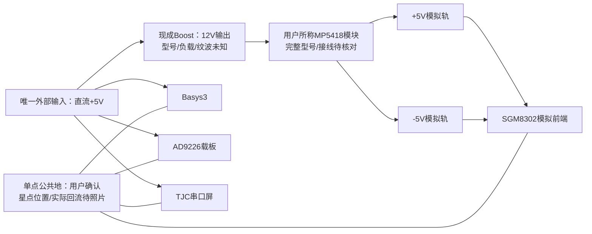
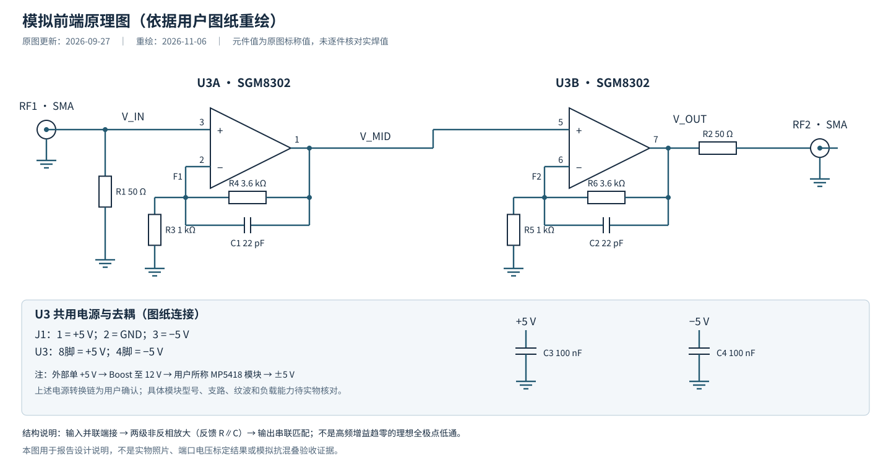
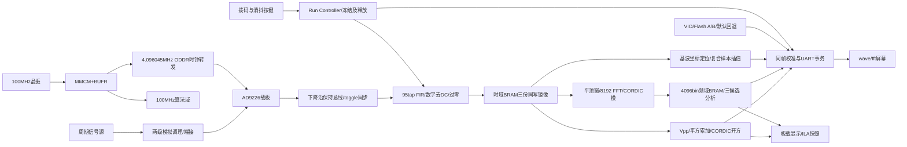
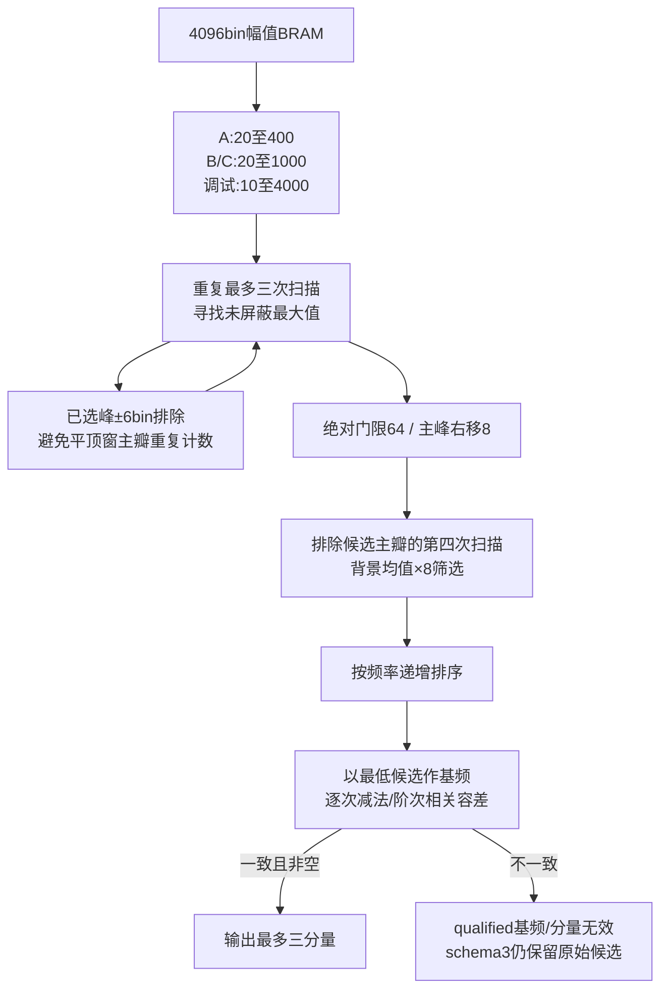
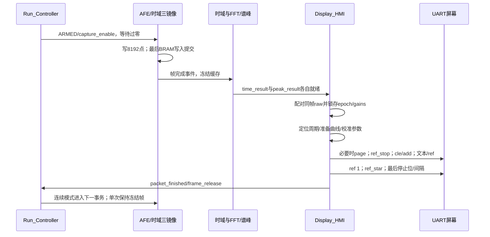

# 2026年G题工程事实审计与设计报告素材

审计截止：2026-11-06；目标是为中文摘要≤300字、摘要独页、正文≤8页的LaTeX报告提供事实与待测表。本文件不是正式报告，不将项目调整写成官方豁免，也不将设计/仿真写成完整实板验收。篇幅限制来自本次用户提供的报告任务，未独立核验官方排版通知。

**离线边界：本轮所有设备已脱机，只读取现有源码、文件和用户陈述；未连接JTAG/VISA，未启动信号源、烧写Flash、改变电源或新增实物实验。** 截止时的板上活动状态无法实时读取，下文“当前系数”均指最近一次已验证并保存的记录。

## 阅读与证据分级

| 标记 | 含义 | 写进正式报告时的措辞 |
| --- | --- | --- |
| RTL/IP | 当前生产RTL、XCI和XDC可核对 | “实现了/配置为”，不自动等于实板通过 |
| BUILD | 同轮Vivado产物和报告 | “在所施加约束下实现通过”，说明IO约束边界 |
| HW-11/06 | 11月6日既有实板新帧、VIO或保存记录 | 限于给定源、接线、模式和参考定义 |
| HW-历史 | 旧bit/旧系数/旧显示路径的实验 | 明确日期和版本，不能移作新程序验收 |
| USER | 用户现场确认或本次更正 | “据用户确认”；未附照片/计量时注明 |
| DERIVED | 根据图纸、系数或公式离线推导 | “理想模型/计算值”，不能称实测 |
| TODO | 无足够证据 | 填“待测/待核对”，保留占位符 |

主要证据入口：

- E01：[归档赛题原文](requirements/2026年G题.md)，由用户提供，仓库未保存可验证的官方发布凭证；原文不修改。
- E02：[当前状态](project_status.md)、[MCS清单](../reports/boot_mcs_20261106/image.audit.json)、[本次审计manifest](../reports/report_audit_20261106/manifest.json)。
- E03：[生产RTL目录](../sources/rtl)、[IP配置](../sources/ip)、[板级XDC](../sources/constraints/Basys3_Pinout.xdc)。
- E04：[同轮资源/时序/DRC报告归档](../reports/report_audit_20261106/README.md)，本轮从本地生成目录复制入库，避免其他AI只能看到旧报告。
- E05：[接头重新连接前候选](../reports/single_tone_candidates_20261106/README.md)、[重新连接后四点复测](../reports/single_tone_reseat_20261106/README.md)。
- E06：[AFG1022多点标定及保存](../reports/afg_calibration_20261106/README.md)，含八份CSV、完整JSON、175mVpp实际VIO输出、保存/导出记录。
- E07：[11月5日旧A槽恢复与冷启动](../reports/flash_persistence_20261105/README.md)。
- E08：[10月24日三分量](component_amplitudes_hardware_20261024.md)、[高频/相位/非格点](highband_multitone_hardware_20261024.md)，历史实验。
- E09：本地原图`C:/Users/Joe/Desktop/d393d354-d0aa-4f82-bd98-059d3b6bbc2f.pdf`，图纸更新日期2026-09-27；本轮已本地渲染核对，参数与推导在C.2完整摘录。原PDF及渲染位图未纳入Git，仅保存在本地忽略目录；用户随后明确授权“用非二进制格式重画并上传”，故已提供[可编辑SVG](report_assets_20261106/analog_frontend_schematic.svg)和[文字连接表](report_assets_20261106/analog_frontend_schematic.md)。来源与重绘hash见审计manifest。不等于当前实焊逐件核验。
- E10：本次用户供电更正（见C.1逐条转录）；此前屏幕实测反馈（见C.4），证据类别USER，不冒充照片/自动采样。
- E11：[窗ROM真实IP/背压回归](../reports/fft_window_alignment_fix_20261106/README.md)、[旧显示集成回归](../reports/display_integration_20261030/README.md)。

## A. 工程基线

### A.1 四种版本不能混淆

| 层次 | 截止本次审计的事实 |
| --- | --- |
| 生产RTL/IP/XDC功能基线 | `e733a9e`：修复FFT平顶窗ROM读取使能时序；已包含此前schema3诊断 |
| 审计前Git HEAD | `06f43f1`；`git diff e733a9e -- sources/rtl sources/ip sources/constraints`为空，后续提交为实验数据/文档等，不是新综合版本 |
| 当前工程 | `G_FPGA.xpr`，top=`G_FPGA_Top`，part=`xc7a35tcpg236-1`，board=`digilentinc.com:basys3:part0:1.2`；board-store路径记录不等于在其他电脑一定可用 |
| sources_1有效generic | `ENABLE_RUNTIME_CALIBRATION=1`、`ENABLE_FLASH_PERSISTENCE=1`、`ENABLE_FLASH_READONLY_PROBE=0`；顶层参数缺省0不代表该工程功能关闭 |
| 最近构建 | Vivado 2025.2 Build6299465，bit于11月6日08:33:21、LTX于08:33:22生成 |
| 程序启动镜像 | `test_results/p2_boot_20261106_romfix_e733a9e.mcs`，用户确认已烧写并成功加载；不是11月5日的`p2_boot_01.mcs` |
| 最新标定 | 已在线apply并保存至B槽，不需重新生成bit/MCS；本轮离线不能声称刚刚又读到了硬件 |
| 未提交XPR差异 | Vivado自动登记`utils_1/imports/synth_1/G_FPGA_Top.dcp`与IncrementalCheckpoint引用；不是用户手改，也没有本轮新generic变更；本次保留、不提交该差异 |

程序、探针和镜像SHA256：

```text
bit  1b7bbc35dad18f18bfef5151cc301771b2401476d1b674b133562e60156a48bd
LTX  3b704948864e919c99e849f1ca708592239c449f3e0aa59fa3b2e7e5377ef4c2
MCS  1fdde9a6568f37c9d3f415a4696e594697683f404afc633cf87ad2530228daa4
```

这是本地文件哈希及用户烧写对应记录，不是通过器件配置位读回计算的哈希。MCS/bit是忽略版本管理的本地产物，不能指望克隆后自动存在。审计manifest保留证据。

### A.2 标定、启动和默认回退

| 项目 | 最新活动/Flash保存bank | RTL默认回退bank | 输出定义 |
| --- | ---: | ---: | --- |
| Vpp | 3576768 | 3623460 | 峰峰值；显示Amax也使用该量纲比例 |
| RMS | 3601627 | 3701829 | 时域真RMS |
| FFT | 4079 | 4194 | 各正弦分量峰值，非Vpp/非RMS |

格式均为unsigned Q16.16 µV/raw。最近保存：source2/B槽、sequence1、saved_epoch2、dirty0、error0、`SAVED_AND_VERIFIED`，97位bank=`79294142238186840429235802095`。保存与活动值一致，导出记录重建CRC=`2836716588`（由字段重建，不是原始SPI转储）。最近活动epoch为2；再次恢复后epoch可变，不要求与saved_epoch一致。

启动/BtnC优先恢复有效Flash记录，无记录/错误才回退RTL默认。VIO apply是易失更新，save才持久化；程序MCS与标定记录是不同区域。新B槽保存已核对，**新B槽在这轮尚未做断电再上电验证**。不能把旧A槽11月5日的恢复证据移给新B槽。

## B. 赛题要求与实际实现对照

输入源输出阻抗与电缆按归档原题为50Ω，输入为基波加1或2个谐波；不是任意非谐波三音。原题A/B/C各四项、每项启动后≤2s。下表将原要求与现有证据分开。

| 要求 | 原题指标 | 当前实现/证据 | 审计状态 |
| --- | --- | --- | --- |
| 外部供电 | 单路+5V | 用户确认只有一个直流+5V输入，内部升压12V再经所称MP5418模块产生±5V；无USB供电 | 用户确认原则满足；支路连接/模块实物待核对，不再列为项目排除项 |
| 屏幕尺寸 | ≥6英寸 | 当前TJC3224T128_011系列；同系列规格为2.8英寸 | 用户允许项目范围调整；不满足原文字面尺寸，不是官方豁免 |
| 频率分辨率 | 500Hz | 4.096MSPS/8192，名义500Hz/bin | RTL/IP支持；平顶窗主瓣宽度使“两条相隔500Hz一定可分辨”不能据此断言 |
| A输入 | 100～250mVpp，各分量10～200kHz | A搜索bin20～400；新标定覆盖100kHz四个幅值点 | 单音/标定有当前实板证据，完整复合A输入未完成本版验收 |
| B输入 | 50～250mVpp，各分量10～500kHz | B搜索bin20～1000 | 逻辑支持；有旧版频带/多音证据，新版50mVpp及全频带矩阵待测 |
| C输入 | B信号加200mVpp、fJ≥1MHz单音干扰 | B/C共用10～500kHz搜索；靠采样前模拟及数字FIR抑制干扰，不是第二套C专用分离器 | 无完整实板抗干扰证据；任意≥1MHz抗混叠无法判定 |
| 1/3周期真实波形 | 按键选择完整周期 | 复合BRAM样本、基波相位/周期定位、16抽头插值 | 逻辑/仿真支持；当前实屏1T/3T完整验收待补 |
| Vpp与真RMS | 各≤5mV绝对误差 | 实采样最值、均方根，AFG设定参考验证误差小 | 设定参考一致性通过若干点；端口独立绝对精度未认证 |
| 基频 | ≤1kHz误差 | bin×500Hz；新四点频率正确、历史半格点误差≤250Hz | 指定点有证据，不能外推所有组合/弱基波 |
| 定性正频率谱 | 位置/根数/相对长度 | 最多三条候选分量渲染，不发送完整4096bin噪声谱 | RTL/UART仿真支持；历史实屏FFT反馈证明曾部署，最终效果待测 |
| 各分量幅值 | ≤5mV绝对误差 | 32bit raw幅值共用FFT增益 | 新版单音校准、旧版三音可支持有限结论；新版多音绝对精度待测 |
| 完成时间 | 每项≤2s | 控制器2s超时、采样约2ms、UART分时发送 | 设计预算/计数器不等于可见端到端实测；未验收 |
| BNC输入 | 源/装置BNC端口 | 用户实际BNC/SMA转接链，有接触故障前后对照；原图RF1/RF2标SMA | 外部整机BNC座、固定方式及线缆需照片确认 |
| 无MCU | 本项目架构约定 | 所有装置采集/DSP/换算/HMI由FPGA完成；PC仅调试/控源 | RTL/工程结构支持；不是声称TJC屏内部没有控制芯片 |

可直接用于正式报告的范围声明：“本装置采用单路+5V外部供电，并在内部转换出模拟电路所需的正、负电源轨。本文项目采用现有小尺寸串口屏，屏幕尺寸要求经项目用户允许放宽；未取得竞赛官方尺寸豁免文件。”前一句仍需在最终实物照片/支路核对后注明完整程度。

## C. 实际硬件组成与供电结构

### C.1 用户更正、模块与电源关系

本次用户明确提供：①外部独立输入仅1路；②以直流电源输入+5V；③先用现成Boost升至12V，再接所称“MP5418”；④模块输出确为+5V/-5V；⑤单点共地；⑥没有额外独立供电，电脑USB不参与供电。设备已脱机，本轮未实测或查看新接线照片。

“MP5418”在本次仅作为用户给出的模块标识，未取得该模块铭牌/原理图或数据手册对应关系，不能由型号字符串推断其隔离、拓扑、输入范围、输出电流或纹波。Boost具体型号也未知。

| 模块 | 上游电源 | 工作电压/轨 | 供电连接方式 | 证据 | 核验状态 |
| --- | --- | --- | --- | --- | --- |
| 整机输入 | 一路直流稳压电源 | +5V | 外部输入接口类型/额定电流未知 | 本次USER | 用户确认单输入，物理接口待照片 |
| Boost模块 | 外部+5V | 输出12V | 具体模块及端子未知 | 本次USER | 转换关系确认，硬件/负载待核对 |
| 所称MP5418模块 | Boost的12V | 输出+5V、-5V | 完整模块型号/拓扑未知 | 本次USER | 输出轨用户确认，无纹波/电流证据 |
| SGM8302及模拟前端 | 内部±5V转换输出 | ±5V | 原图J1为+5V/GND/-5V三针 | USER、E09 | 用户确认轨与图纸一致；实物端子/去耦待核对 |
| Basys3 | 外部 +5 V | +5 V | 直接接外部电源支路 | 用户补充 | 供电支路已确认 |
| AD9226成品模块 | 外部 +5 V | +5 V | 直接接外部电源支路 | 用户补充 | 供电支路已确认 |
| TJC屏 | 外部 +5 V | +5 V | 直接接外部电源支路 | 用户补充 | 供电支路已确认 |
| 地系统 | 所有模块 | 共参考地 | 用户称单点，位置/回流走线未核对 | 本次USER | 尚无接地拓扑照片/地电位测量 |
| PC USB | 不供电 | 不适用 | 用户明确否认USB参与供电 | 本次USER | 不画成第二电源输入；历史JTAG测试不自动代表本次独立电源数 |

Basys3、AD9226 载板和 TJC 串口屏直接接外部 +5 V。转换后的 ±5 V 仅供 SGM8302 运放。



无输出纹波、带载能力、转换效率、隔离属性实测数据；不填典型值冒充实测，不把Vivado功耗估算当整机功耗。单+5V外部输入与内部±5V并不矛盾，先前“±5V即违反单路供电”的解释错误。

### C.2 模拟前端：图纸、理想计算与实物边界

原图已在本地核对。按用户明确授权重绘的非二进制矢量图如下，原PDF及渲染位图不随本次提交；元件/引脚连接还可查[文字连接表](report_assets_20261106/analog_frontend_schematic.md)。



原图可辨认：双运放标注SGM8302YS8G/TR；两级非反相放大，R3/R5各1kΩ接地，反馈R4/R6各3.6kΩ，并联C1/C2各22pF；R1=50Ω输入并联至地，R2=50Ω输出串联；±5V处C3/C4各100nF。两个射频连接器标SMA。用户先前口述实焊电阻可能为50或51Ω，不能把原图50Ω写成已测实焊精确值。

对于**理想运放、按图标称值、忽略寄生**的一段：

\[
H_1(s)=1+\frac{R_f/R_g}{1+sR_f C_f}
      =\frac{4.6+s\tau}{1+s\tau},\quad
\tau=3.6\,\mathrm{k\Omega}\times22\,\mathrm{pF}.
\]

每级低频增益4.6，两级21.16；每级极点约2.010MHz、高频增益趋于1（两级也趋于1），**不是在高频趋零的理想全极点低通**。可描述为“带反馈电容的两级非反相放大/高频增益滚降调理”。理想两级相对低频增益：500kHz约-0.496dB、1MHz约-1.821dB、2MHz约-5.582dB，均是图纸计算，不是实际频响。电路总-3dB带宽也不能把这个每级极点直接当作实测截止频率。

50Ω源内阻与输入端50Ω构成约1/2分压；输出串联50Ω遇ADC约50Ω又约1/2。在上述理想条件下，发生器开路电压到ADC模块输入的低频比例约21.16/4=5.29；这只是标称电阻网络计算，实际运放频宽、模块前端、线缆/端接和校准链都会改变结果，不能直接用它替代实测增益。

| 硬件问题 | 可核实事实 | 未知/禁止外推 |
| --- | --- | --- |
| 滤波器类型 | 自焊SGM8302两级调理；图纸见上 | 无商品模块型号；不称已测600kHz模拟低通 |
| 实际频响 | 历史整链单音与FIR均衡数据存在 | 无独立模拟前端扫频、实际截止/阻带指标 |
| 放大/衰减 | 图中两级非反相放大+输入/输出50Ω网络 | 实焊值与额外载板级尚未逐件核对 |
| 隔直/偏置 | 本图未画串联隔直或ADC偏置；FPGA后级数字去DC | ADC模块内部可能另有耦合/偏置，未取得内部图 |
| ADC端共模/满量程 | 用户称成品AD9226模块可读AC且有负电源 | 具体载板型号、跳线、输入满量程/共模未知；不由AD9226芯片典型量程推定模块BNC/SMA口量程 |
| 端接 | 用户确认滤波器输入并联约50Ω、输出串联约50Ω、ADC约50Ω | 未独立测量阻值；不能额外并联一个50Ω而不重算 |
| 连接链 | AFG CH1→滤波器→ADC→FPGA，BNC/SMA转接 | 无完整照片，不声称所有接头规格/线长/板级BNC座已核实 |
| C抗干扰 | 有数字FIR设计与有限历史信号测试 | 没有ub+200mVpp且fJ≥1MHz的完整本版验证；采样后FIR不能消除已折叠入通带的混叠 |

AFG的HIGHZ/50Ω是幅值显示与负载换算设置，不把物理源输出内阻从50Ω变为无穷大。本次校准目标是HIGHZ显示设定参考，不能写“ADC输入恰为发生器设定Vpp”。约189～192kHz干扰曾因BNC/SMA接触恢复而不再进入候选；频点接近本身不能证明具体自激机理，不能改写为已经定位某个运放故障。

### C.3 ADC、PMOD与外部时序

ADC芯片AD9226，载板完整型号未知；生产RTL默认12bit offset-binary（中点2048），功能正常的实板数据支持该解释，但没有载板格式配置引脚/照片的独立核验。FPGA ADC输入/输出时钟约4.096045MHz，数据在**下降沿**捕获，再通过保持总线与两级toggle同步送到100MHz域。

| 端口 | PMOD | Artix-7封装脚 |
| --- | --- | --- |
| adc_clk_out | JB1 | A14 |
| data[0]/[1]/[2] | JB2/JB3/JB4 | A16/B15/B16 |
| data[3]/[4]/[5]/[6] | JB7/JB8/JB9/JB10 | A15/A17/C15/C16 |
| data[7]/[8]/[9]/[10]/[11] | JC1/JC2/JC3/JC4/JC7 | K17/M18/N17/P18/L17 |
| uart_tx→屏幕RX | JA1 | J1 |
| sys_clk | 板载晶振 | W5 |
| BtnC/BtnU/BtnD/BtnL/BtnR | 复位/周期/启动/视图 | U18/T18/U17/W19/T17 |

IOSTANDARD为LVCMOS33；PMOD 5/11是GND，6/12是3.3V。**约束配置为3.3V不证明ADC载板输出电平已量测**。该独立电平及载板数字电源证据仍缺。

XDC当前对ADC输入用关联ADC时钟的input_delay min0ns/max8ns，属于待按具体器件速度级、板级延迟校正的占位预算。`set_false_path -from clk_adc -to clk_out1_mmcm_top_wiz`用于bundled-data CDC，而不是逐位握手闭环；下降沿保持总线约24个算法周期，设计依赖总线稳定窗口。时钟本身相关，但例外按此传输协议设置；methodology也报告同步时钟之间例外警告。无实测tCO/板间偏斜/建立保持眼图或完备CDC签核证据。内部正WNS仅说明所施加约束下通过。

### C.4 屏幕、按键和实屏证据

| 项目 | 当前证据与边界 |
| --- | --- |
| 实物型号 | 用户称TJC3224T128_011；完整触摸/版本后缀未拍照确认 |
| 尺寸/像素 | 同系列TJC3224T128_011R_Z01原厂规格：2.8英寸，320×240可旋转240×320；是同系列资料，不把后缀直接当已核对实物 |
| 供电与串口 | 旧人工表填5V；同系列规格推荐5V、3.3V TTL、8N1。当前FPGA为115200bps，仅TX，无ACK/RX |
| HMI工程 | 本次未在仓库（含本地搜索）发现.hmi/.HMI/.tft文件；仅有屏幕spec、示例指令和RTL，不能核验最终控件属性 |
| 逻辑绘图区 | 当前顶层WAVE_POINTS=240、DISPLAY_HEIGHT=160，两页曲线ID1/通道0；不是整个液晶分辨率 |
| 控件契约 | wave：tUpp/tUrms/tF1及时间/幅值轴；fft：tF1～3/tA1～3及频谱轴；[spec](TJC_UART_FORMAT.md) |
| 已有实屏部署证据 | 此前用户明确反馈wave阶梯/刷新、fft谱线左右反向及高频折线；能证明当时确实连接并观察过两页，属于人工反馈，日期/bit/照片未完整配对 |
| 当前实屏通过范围 | 后续RTL修订进入当前bit且有UART仿真；没有本轮各页1T/3T、数字/轴/刷新、两秒完成的成组照片/视频/捕获验收 |
| 1T/3T | 按键与数据通路有实现、离线回归；10月29日板载交互不含实屏。不能把切换LED通过写成真实波形1T/3T显示通过 |

原厂同系列规格：[TJC规格书](https://offer-product.oss-cn-beijing.aliyuncs.com/product/offer/attachment/3041029078/file/subPdf_163438_79458_20211221-164550582.pdf)，页1型号/对角线、页3分辨率/电源、页4TTL/8N1。本轮只核对资料，不由典型电流推定整机实测功耗。

板载控制：SW3(C)>SW2(B)>SW1(A)>SW0(调试)，全关默认A；SW15=0连续/1单次，BtnD请求测量；BtnU请求1T/3T；BtnL/R循环板载诊断视图，默认映射谱幅视图为fft，其余wave。LD9:8=A00/B01/C10/调试11，LD10单次、LD11三周期；频率数码管以kHz一位小数显示，Vpp/RMS/谱幅数码管视图仍为raw，不是mV。

## D. FPGA数字处理架构与可直接使用的理论素材

### D.1 总体结构（图1素材）



下表列明报告中的“实现”可追溯到什么符号，避免把早期设计设想当成当前代码：

| 环节 | 源码/配置 | 关键符号或实际行为 |
| --- | --- | --- |
| 顶层、复位、时钟/引脚 | [G_FPGA_Top](../sources/rtl/G_FPGA_Top.v)、[MMCM_Top](../sources/rtl/MMCM_Top.v)、E03 XDC | u_mmcm_top/u_adc_clock_oddr、g_flash_persistent、g_runtime_calibration |
| ADC同步/滤波/触发 | [ADC_Input_CDC](../sources/rtl/ADC_Input_CDC.v)、[AFE_Capture](../sources/rtl/AFE_Capture.v) | sample_toggle_adc、ADC_OFFSET_BINARY、DC_TRACK_SHIFT、ST_WAIT_CROSS/CAPTURE/HOLD |
| 时域 | [Time_Domain_Calc](../sources/rtl/Time_Domain_Calc.v) | SUM_WIDTH=44、sample_square_reg、ST_ACCUMULATE、RMS_DIV_SHIFT=13 |
| FFT/窗/模 | [FFT_Processor](../sources/rtl/FFT_Processor.v)、[FlatTop_Window_ROM](../sources/rtl/FlatTop_Window_ROM.v)、[生成窗脚本](../scripts/generate_flattop.py) | ST_READ_WAIT、FFT_FORWARD_CONFIG=01、cordic_x_s/y_s、freq_wr_data |
| 谱峰判定 | [Component_Analyzer](../sources/rtl/Component_Analyzer.v) | EXCLUDE_BINS、RELATIVE_FLOOR_SHIFT、NOISE_RATIO_SHIFT、quantization_tolerance |
| 波形定位/重建 | [Display_Fundamental_Aligner](../sources/rtl/Display_Fundamental_Aligner.v)、[Display_Bandlimited_Interpolator](../sources/rtl/Display_Bandlimited_Interpolator.v)、[Display_Wave_Renderer](../sources/rtl/Display_Wave_Renderer.v) | bin_q20、period_q12/start_q12、BANDLIMITED、phase/tap |
| 帧一致性/控制 | [BRAM_TimeDomain](../sources/rtl/BRAM_TimeDomain.v)、[Run_Controller](../sources/rtl/Run_Controller.v)、[Display_HMI](../sources/rtl/Display_HMI.v) | mem_calc/fft/hmi、have_time/have_peak、frame_release、packet_finished |
| 换算/保存 | [Runtime_Calibration](../sources/rtl/Runtime_Calibration.v)、[Display_Frame_Calibrator](../sources/rtl/Display_Frame_Calibrator.v)、[Calibration_Store](../sources/rtl/Calibration_Store.v) | active_*_gain、epoch、包间原子提交、正文/提交记录及回读验证 |

### D.2 时钟与采样

MMCM VCO=725MHz，算法输出100MHz；辅助输出725/59≈12.2881356MHz，再用Artix-7 BUFR /3获得fs≈4.0960452MHz（比4.096MHz高约11ppm）。ODDR D1=1/D2=0向ADC转发时钟，不直接把内部普通逻辑网络作为时钟输出。8192点采样约2ms；名义Δf=fs/N=500Hz，实际约500.0055Hz。晶振/输出抖动、频率准确度尚未独立实测。

### D.3 ADC输入、FIR和数字去DC

12bit默认offset-binary，使用扩展后的有符号减法并左移4位：`x0=(adc_code-2048)<<4`，范围[-32768,32752]。FIR、DSP及BRAM实际都在100MHz算法域，由CDC有效脉冲按约4.096MSPS推进；并非把所有DSP放在区域ADC时钟域。

当前FIR XCI为单速率、95个对称系数、16bit输入/16bit输出、系数16bit、fractional bits=16、Truncate_LSBs、Systolic Multiply Accumulate。它是10月23日选用的对称频响均衡候选，不是最早未均衡COE。**XCI的Clock_Frequency与Sample_Frequency仍各写4.096MHz，而实际aclk接100MHz**；应分别报告GUI元数据与RTL时钟，不能声称XCI也已设100MHz。本轮不改IP，该差异和长期无丢样条件应保留为审查点。

以XCI实数向量、fs=4.096MHz做离线DTFT得到下表（不含模拟/ADC、不替代实际IP定点量化或整链测量）：

| 频率kHz | 10 | 100 | 200 | 500 | 600 | 900 | 1000 |
| --- | ---: | ---: | ---: | ---: | ---: | ---: | ---: |
| 计算增益dB | -0.025 | 约0 | +0.073 | +0.579 | +0.815 | -63.155 | -85.574 |

向量和约0.9970703，95tap线性相位群延迟理想为47/fs≈11.47µs。不能据早期脚本“Q1.15”描述覆盖当前XCI小数位16；历史实板记录已注意到量化MIF与原候选整数比例不同。当前幅值增益由整链参考标定吸收，不能声称仅由FIR理论增益即可推得端口电压。

FIR输入只有一级valid/data保持寄存器；若寄存器满且FIR不ready，又来了不可回压ADC样本，则保留旧样本，新样本不会进入。正常配置预期在24～25算法周期内排空，不能写成“任意长背压下ADC数据绝不丢失”的无条件结论。

数字直流跟踪：`dc[n+1]=dc[n]+(x[n]-dc[n])/4096`，状态保留16小数位，输出`ac=x-dc`并饱和到signed16。预热4096个采样约1ms，然后检测非正到正过零，开始8192点帧。时间常数约1ms，一阶拐点约159Hz；这不等于逐帧精确减均值，测量目标是去DC后的AC信号。

### D.4 Vpp与真RMS

对去DC后的未加窗样本xi：

\[
V_{pp,raw}=\max_i x_i-\min_i x_i,\qquad
R_{raw}=\sqrt{2^{-13}\sum_{i=0}^{8191}x_i^2}.
\]

signed16最值相减用17bit，无符号输出；16×16平方32bit寄存后加到44bit无符号累加器（最大总和2^43，可容纳），右移13生成32bit均方量。每点READ_REQUEST→PROCESS→ACCUMULATE，断开BRAM→乘法→宽加法的组合长路径。CORDIC Square_Root配置UnsignedInteger、32bit输入、自动派生17bit输出、Nearest_Even、Blocking/ready；AXI输出总线有字节填充。RTL取低16bit为RMS，signed16样本RMS最大32768可容纳，不能在报告中误写为IP只输出16bit。

它是平方平均开方的真RMS，不是利用正弦Vpp/(2√2)估算任意复合信号。有限2ms窗口未必包含整数基波周期，近半bin/低频时的有限记录误差需另测。

### D.5 五项平顶窗、FFT与幅值

N=8192，n=0…8191：

\[
w[n]=a_0-a_1\cos\theta+a_2\cos2\theta-a_3\cos3\theta+a_4\cos4\theta,
\quad\theta=\frac{2\pi n}{N-1},
\]

`a=(0.21557895,0.41663158,0.277263158,0.083578947,0.006947368)`。采用对称N-1形式，不是周期N形式；量化`round(w·32768)`饱和到signed Q1.15，当前COE范围-2312…32767，量化相干增益均值约0.21555246。含负系数，不能按unsigned ROM解释。

`xw=sat16((x×w_q15)>>>15)`，乘积signed32。加窗改善非整频幅值稳定性，但扩大主瓣、不能承诺任意近邻线分辨。e733a9e对同地址连续两拍ROM使能后捕获匹配样本/系数，修复原语输出寄存器因ENA未推进导致前一地址系数错位；只ENA=0空等一拍无效。此独立RTL缺陷已修复，**不是本次BNC接触故障恢复原因**。

| IP/数据段 | 当前配置 |
| --- | --- |
| XFFT9.1 | 8192、Radix-4 Burst I/O、Fixed Point、Unscaled、自然顺序、nonrealtime，输入/旋转因子16bit；无scaling schedule |
| 配置/输入AXI | config=8'h01正变换；32bit={虚16=0,实16}，最后点TLAST；仅valid&&ready推进 |
| FFT输出 | 有效实/虚各30bit，按32bit字段对齐到64bitTDATA |
| Translate CORDIC | SignedFraction输入30bit、输出31bit、Nearest_Even、Embedded_Multiplier补偿 |
| CORDIC对齐 | I/Q各算术右移1送Q2.28类接口，31bit Q2.29类输出使raw模接近原FFT整数标度；不是额外丢掉一个不可补偿的1/2增益 |
| 频域缓存 | 4096×32bit，保存正频率bin0…4095；依旧消耗全部8192个输出，避免负频率尾流阻塞下一帧 |

输出寄存级skid buffer通过`!valid || ready`反压FFT；CORDIC输出始终ready。Translate相位输出未作为谐波相位测量发布；显示定位用的是独立基波投影，不应宣称已测每个分量相位。输出幅值近似`M[k]=sqrt(I²+Q²)`，写缓存时零扩到32bit。理想单音幅值理论关系为`A≈2M/(N·CG)`，但生产实现使用实测Q16.16 FFT系数换算，不另乘一个独立固定MAG_SCALE_FACTOR补偿一遍窗增益。

### D.6 谱峰筛选、谐波与模式边界（图2素材）



具体常数：`EXCLUDE_BINS=6`；首峰需≥absolute64且非0，后续候选需≥max(64,Mmax>>8)；背景过滤需严格大于8倍均值。背景是幅值均值，不是功率dB或统计噪声标准差。每次仍选剩余最大值，不是逐bin按“第一个显著峰”宣布基频，也不是最强峰必为基频。

候选按频率排序后，最低频作为基频。其他候选相对该bin逐次减法得到阶次q与余数r，容差t=(q>>1)+2；r≤t或fbin−r≤t才近似整数倍，q=0不通过。不做严格GCD，也不能在基波完全缺失时自动恢复隐含基频。`qualified=spectral_valid && vrms_raw>=64`；**无Vpp<100mV或>250mV硬拒绝**。显示坐标越界标记、数字换算饱和与题目输入范围是不同边界。

### D.7 波形定位与插值

先扫描全帧得到Amax，再对两半帧各作Hann加权基波投影，通过相位差细化显示用bin并确定基波相位起点。相位一整周编码2^32，bin_q20和样本坐标Q12，使用时分乘法、正弦ROM、迭代向量CORDIC及串行除法。低置信度回退粗FFT格点跨度；不改变对外bin×500Hz测量值，也不把精细显示周期写成更高测频分辨率。

240像素的采样坐标按起点与1或3倍周期均分：`sj=s0+j·L·P/(W-1)`。每像素读取周围16个真实BRAM样本，通过64相位windowed-sinc系数、单个时分16×16乘法器和36bit累加器，按14小数位舍入/饱和重建。它是复合AFE波形的带限插值，**不是仅合成一条纯基波正弦**，也不凭插值增加ADC真实采样率。边界读作钳位，不假称无限环形真实采样。

纵轴以全帧Amax及插值点最大值设置对称范围，映射0…159。绘图仍是冻结帧的分批清除/重绘事务，经暂停刷新来降低可见闪烁；没有实现示波器持续环形滚动采集/显示。

### D.8 三份BRAM、测量事务和UART（图4素材）

`BRAM_TimeDomain`为三份8192×16同写镜像，逻辑存储总393216bit，各有一个独立同步读口：时域统计、FFT、显示。并非三帧乒乓缓存，也不是一块物理BRAM天然同时有三个读口。板级接法中写/读均为100MHz，ADC域仅负责源捕获/CDC。



Run_Controller为IDLE/ARMED/RUN/DRAIN/FAULT，超时计数200000000拍（2s）不是“两秒内显示保证”。忙时最多排队一个启动请求；单次保持可切页/周期重绘同一帧，但不覆盖源帧。Display_HMI先缓存time/peak结果，原子发布measurement_valid，并在同一消费边界捕获活动系数/epoch；VIO提交遇采样优先，防止同帧跨版本。frame_id复位后重计，非永久唯一。

UART为115200/8N1，每bit868个100MHz周期。仅首次/真正切页发送page，默认同页不重复；`ref_stop→cle 1,0→240条add→同帧文本及逐项ref→ref 1→ref_star`，命令后FF×3，无CR/LF。命令间隔10000拍、page间隔5000000拍、启动等待50000000拍；都是程序预算，非实屏可见完成测量。没有UART RX，不能获得屏幕ACK或精确显示完成时间。

### D.9 校准、VIO和Flash

三增益乘法/舍入/饱和将raw转µV；屏幕侧和VIO按包锁存bank，旧帧不会被新bank重新解释。VIO暂存完整bank后单独翻转request，等待ack和活动值回读，不能并发覆盖未确认请求。DEBUG_RAW_CANDIDATES仅改变诊断观测，不改变功能有效性判定。

4MiB MX25L3233（用户丝印，JEDEC C22016）Flash：程序区0x000000～0x3DFFFF；A槽0x3E0000、B槽0x3F0000，各保留64KiB，当前每槽只用首4KiB。64字节正文与+0x100处16字节提交分离，CRC/兼容版本/序号决定记录有效性。保存到非当前槽，执行检查ID/保护→擦除/空白验证→正文回读→独立提交→完整核验，成功才切为新记录。相同bank免重写；启动/BtnC/reload读取并选择有效较新记录，出错回退默认并报告。

SPI经STARTUPE2使用配置时钟资源；参数写入引擎限制地址、4KiB擦除和256B页边界，不提供整片擦除或任意指令接口。该机制及仿真不能替代真实写中断电验收。升级MCS须use_file保留0x3E0000～0x3FFFFF；MCS地址审计不证明编程器实际擦除策略。


## E. 有据可查的实验结果与可用结论

### E.1 同轮实现结果（BUILD，不含模拟/外部接口验收）

| 指标 | 11月6日本轮结果 | 报告状态/时间 |
| --- | ---: | --- |
| LUT | 19887 / 20800（95.61%） | Fully Placed，08:28:08 |
| FF | 28675 / 41600（68.93%） | 同上；无Latch |
| Block RAM Tile | 48.5 / 50（97.00%） | RAMB36=32、RAMB18=33 |
| DSP48E1 | 90 / 90（100%） | 同上；不声称尚有DSP余量 |
| WNS / TNS | +0.280ns / 0 | Fully Routed，08:32:08 |
| WHS / THS | +0.011ns / 0 | 同上；setup/hold failing endpoints均0 |
| routed DRC | 52个Warning检查项，表内无Error/Critical Warning | 08:31:19；不是“全工程零警告” |
| methodology | 90个Warning检查项 | 08:31:58；与DRC表不同，不把两者相加当去重总量 |
| no_clock / unconstrained_internal_endpoints | 0 / 0 | check_timing |
| no_input_delay / no_output_delay | 11 / 29个端口 | check_timing；不能写成所有IO约束完整 |

DRC主要为DSP输入/输出寄存级、LUT方程、BRAM异步控制和无路由负载；methodology另有TIMING-18缺输入输出延迟、TIMING-47同步时钟之间例外等。route status另显示43804条可路由net全部已布线、routing errors=0。报告均在E04归档，原文件SHA256在manifest。placed资源与routed时序来自同一轮构建，但本轮**没有新跑post-route report_utilization**；不能隐去这个阶段差别，也不能用11月5日旧资源表替换。

报告可写：“目标器件上完成实现，在当前约束下建立/保持时序收敛；LUT与BRAM使用率超过95%，DSP全部使用。外部接口约束仍有待完善项目。”不写“无任何时序风险”“所有IO均经验证”或“低资源占用”。

### E.2 当前版单音接触恢复前后（HW-11/06）

AFG1022 SN1931131/V1.2.4、CH1原生SIN/CW、HIGHZ、200mVpp、0V；A连续。每点一个新measurement_valid，源前后查询一致；raw不是mV。重新连接前活动gain=3623460/3701829/4194，epoch1；恢复后也未改RTL/门限/系数。

| 输入kHz | 重接前候选bin/幅值raw | 前qualified | 重接后候选bin/主幅raw | 后qualified |
| --- | --- | --- | --- | --- |
| 100 | [200,378] / [1605840,14985] | 0 | [200] / [1606478] | 1 |
| 42 | [84,379] / [1605887,15102] | 0 | [84] / [1606552] | 1 |
| 11 | [22,379] / [1605762,9614] | 1 | [22] / [1606056] | 1 |
| 12 | [24,378] / [1605745,10230] | 1 | [24] / [1606481] | 1 |

重接后四帧Vpp raw分别3666/3663/3662/3657，RMS raw1287/1287/1286/1286，frame_id1740/1810/1886/1956，单峰频率误差相对源设定均0Hz。证据：[恢复前JSON](../reports/single_tone_candidates_20261106/results.json)、[恢复后JSON](../reports/single_tone_reseat_20261106/results.json)及各目录同名原始CSV。

重接前约189kHz弱峰为主峰的0.60%～0.94%，超过候选门限；100/42kHz因非谐波关系被拒绝，11/12kHz恰被高阶容差接受。只改变接触条件后四点均单峰通过，有力支持该次失效与模拟连接接触相关，不能说是FFT主峰消失。也不能断言189kHz所有能量为0，候选表不是完整频谱。

恢复后error_code=1仍为历史锁存；新帧完整有效、未复位，不能把锁存码写成四帧均超时。10月23日有另一次约5.2µs背景/BNC松动恢复记录，但只作经验佐证，不把两个噪声频率说成精确一致。

### E.3 当前版100kHz多点标定及独立检查（HW-11/06）

设定参考：AFG1022 HIGHZ的Vpp；正弦RMS参考=Vpp/(2√2)，FFT峰值参考=Vpp/2。连接仍为滤波器→ADC→FPGA，A连续、0V偏置。100/150/200/250mVpp用于拟合，125/225mVpp不参与拟合；10/200kHz的200mVpp只检查频带变化。八帧均为正确单候选有效帧，原始CSV见E06。

八帧raw采集时仍使用旧bank/epoch1，下面误差是**以新系数对同帧raw作离线换算**，不是八次屏幕/VIO实际显示读数；实际应用后的VIO测量见下一表。公式：`δVpp = Vpp_hat−Vpp_ref`，`δRMS = RMS_hat−Vpp_ref/(2√2)`，`δA = A_hat−Vpp_ref/2`。表中mV误差保留正负，不用百分比代替题目的绝对值阈值。

| 用途 | kHz | 设定mVpp | Vpp raw | RMS raw | FFT raw | δVpp mV | δRMS mV | δA mV |
| --- | ---: | ---: | ---: | ---: | ---: | ---: | ---: | ---: |
| fit | 100 | 100 | 1845 | 644 | 804185 | 0.6948 | 0.0366 | 0.0530 |
| fit | 100 | 150 | 2752 | 966 | 1205778 | 0.1963 | 0.0549 | 0.0483 |
| fit | 100 | 200 | 3665 | 1286 | 1606482 | 0.0252 | -0.0367 | -0.0116 |
| fit | 100 | 250 | 4573 | 1608 | 2007844 | -0.4187 | -0.0183 | -0.0306 |
| verify | 100 | 125 | 2305 | 805 | 1004975 | 0.8003 | 0.0458 | 0.0502 |
| verify | 100 | 225 | 4120 | 1447 | 1806934 | -0.1421 | -0.0275 | -0.0353 |
| frequency | 10 | 200 | 3660 | 1286 | 1605629 | -0.2476 | -0.0367 | -0.0647 |
| frequency | 200 | 200 | 3673 | 1289 | 1609837 | 0.4619 | 0.1282 | 0.1972 |

四点过原点拟合所得gain=3576768/3601627/4079，最大训练残差分别0.6948/0.0549/0.0530mV；自由截距仅诊断，未写入RTL。125/225mVpp独立点最大|δ|分别0.8003/0.0458/0.0502mV。频带检查只测10/200kHz两点，不是完整幅相扫描。

在线apply确认epoch2，随后另开100kHz、175mVpp新输入，VIO读取两次结果计数1694→1695，最终valid1：

| 量 | 源设定推导参考mV | 实际VIO回读mV | 误差mV |
| --- | ---: | ---: | ---: |
| Vpp | 175.000 | 175.193 | +0.1930 |
| RMS | 61.871843 | 61.881 | +0.009157 |
| 正弦峰值 | 87.500 | 87.518 | +0.0180 |

原始证据：[calibration.json](../reports/afg_calibration_20261106/calibration.json)、[live_validation.json](../reports/afg_calibration_20261106/live_validation.json)、[VIO文本](../reports/afg_calibration_20261106/live_validation_result.txt)。每点只记录一帧/一个新包，不提供重复性标准差、长期漂移或置信区间。

能支持：给定接线和HIGHZ设定参考下多幅值比例换算准确、实际FPGA新bank输出与参考一致；10/200kHz两点未见大幅偏离。不能支持：连接器实际电压已由独立仪器校准、ADC输入恰等于HIGHZ设定值、全B/C幅度和所有频点均≤5mV、实屏读数已逐项核验。

### E.4 参数保存与启动记录

| 日期/程序 | 动作 | 结果 | 可支持与边界 |
| --- | --- | --- | --- |
| 11月5日22:27旧程序、旧bank | 首次save | A槽source1、seq0、saved_epoch1、error0/dirty0 | 有用户回传；不是本轮新B槽 |
| 同上 | 相同bank再次save | UNCHANGED、seq不变 | 免擦写分支另有仿真；未用SPI探针独立数擦除指令 |
| 同上 | 临时apply后reload/BtnC | 恢复旧已保存bank | 原子恢复指定用例通过 |
| 同上 | JTAG重配/断电、配置MCS后冷启动 | 原A槽bank恢复、1ILA/2VIO匹配 | 用户执行并反馈，无电源波形/启动耗时测量 |
| 11月6日当前程序 | 用户写新MCS并加载 | 用户确认成功 | 不是对所有供电/USB组合的完整启动可靠性试验 |
| 11月6日当前程序、新bank | apply/175mV验证/save/export | B槽source2、seq1、saved_epoch2、SAVED_AND_VERIFIED、dirty0/error0 | 保存与活动系数及导出CRC一致；新B槽断电恢复待测 |

原始文本及导出：[save_result.txt](../reports/afg_calibration_20261106/save_result.txt)、[export_result.txt.json](../reports/afg_calibration_20261106/export_result.txt.json)，旧A槽详细回传见E07。配置Flash机型为用户丝印MX25L3233，Vivado使用兼容profile `mx25l3273f-spi-x1_x2_x4`；不把PIC24芯片误当Flash。

### E.5 历史频带、多音与交互（必须标旧程序/旧标定）

下列均不是11月6日当前bit+新bank的完整验收，不能在正式报告中删除日期后与E.3混排。

| 证据 | 旧程序/条件 | 已有结果 | 原始来源/边界 |
| --- | --- | --- | --- |
| 10月23日FIR均衡频带 | 22:46:24 bit，HDS、100mVpp HIGHZ、B连续、旧gain；屏幕未接 | 100/250/375/500kHz各2帧频率误差0；最大Vpp/RMS/峰值设定参考偏差1.142/0.05234/0.070mV | [频带报告](fir_equalization_hardware_20261023.md)、[分析JSON](fir_equalization_20261023_analysis.json)；主机离线换算 |
| 10月23日非格点 | 均衡前当时bit、100mVpp HIGHZ、旧gain | 10.25/50.25/100.25/199.75kHz各2帧，各基频≤250Hz误差 | [非格点报告](offbin_hardware_20261023.md)；原八帧计划OFF回读异常导致整体failed，不能抹去；后续单点完整事务复测通过 |
| 10月24日三分量 | `66632a3`，00:33:02 bit；UTG CH1、旧gain、B连续、屏幕未接 | 单音100k；三音50/150/200kHz，普通/弱基波各2帧；六帧最大分量峰值偏差1.243mV、Vpp1.622mV、RMS0.85167mV | [六帧报告](component_amplitudes_hardware_20261024.md)、[分析JSON](component_amplitudes_20261024_analysis.json)；离线换算，非实屏或独立绝对电压 |
| 10月24日高频/相位/半格点 | 同上；UTG、高阻、满量程包络100mVpp、B连续 | 125/375/500kHz、相位改变、弱基波、124.75/374.25/499kHz各2帧 | [八帧报告](highband_multitone_hardware_20261024.md)、[分析JSON](highband_multitone_20261024_analysis.json) |
| 10月29日板载交互 | 当时已下载版本；UTG100mVpp；无实屏 | 优先编码、单次启动/保持/再测、连续更新等由用户逐项确认 | [交互记录](interactive_controls_20261029.md)；无视频/秒表，不能证明≤2s或1T/3T实屏 |

用于报告“指定案例验证”的历史三音数据（幅值均为正弦峰值，mV）：

| 案例 | 各分量参考频率kHz | 各峰值参考 | 两帧峰值结果 | 理论总Vpp / RMS | 两帧总Vpp / RMS |
| --- | --- | --- | --- | --- | --- |
| 普通三音 | 50/150/200 | 30/12.5/7.5 | 30.534/12.714/7.655；30.520/12.710/7.636 | 68.52053 / 23.58495 | 69.167/69.665；RMS24.006 |
| 弱基波/强谐波 | 50/150/200 | 5/25/20 | 5.105/25.411/20.308；5.104/25.398/20.330 | 87.75462 / 22.91288 | 88.298/88.408；RMS23.272 |
| 高频三音 | 125/375/500 | 30/12.5/7.5 | 30.776/12.773/7.731；30.770/12.762/7.704 | 68.52053 / 23.58495 | 69.665/69.941；RMS24.176 |

普通三音的相位为0/0/0，弱基波案例为0/90/0。高频相位对照保持幅值，只将三次谐波从0°改90°：理论Vpp68.52053→78.76679mV、RMS不变；实测两组平均Vpp69.803→80.142mV、RMS24.176mV不变。只能支持指定案例对真RMS/相位敏感Vpp的行为，不是独立模拟相位响应计量。

历史非格点三音124.75/374.25/499kHz两帧bin分别[249,749,998]与[249,748,998]，相对源各误差[-250,+250,0]和[-250,-250,0]Hz；测量输出仍500Hz格点，不能写成250Hz FFT分辨率。

历史多音JSON记录了每帧数据/引用的本地CSV路径；部分原始test_results仅在本机、未纳入Git。若某个旧CSV实际不可得，应标“已归档分析摘要、原始记录可用性待核对”，不伪造原始图。新11月6日八份标定CSV与四份恢复CSV已纳入Git。

### E.6 仿真、实板和照片必须分层

| 验证 | 证据及范围 | 不支持的外推 |
| --- | --- | --- |
| ROM/FFT真实IP | E11真实ROM+XFFT+Translate三帧24576个输入golden、每帧4096频域写入、TLAST/复位检查通过 | 不是逐bin独立电压golden，也不是实板采样时序证明 |
| 强制背压 | 实际ROM与生产包装器，FFT输入端替身；24576个golden输入、98295停顿周期，旧版负对照失败符合预期 | 替身不计算FFT，不能称真实FFT输出数值回归 |
| 显示UART | [显示集成](../reports/display_integration_20261030/README.md)、[显示稳定性](../reports/display_stability_20261030/README.md)、[显示修订](../reports/screen_spec_20261030/README.md) | 字节/坐标/握手检查不等于TJC固件执行或可见无闪烁 |
| Flash掉电/异常 | [P2离线报告](../reports/flash_persistence_20261030/README.md) | NOR模型覆盖掉电检查点，不等于实板写中拔电测试 |
| 板载人机交互 | E.5人工反馈 | 不等于实屏1T/3T或完整启动延迟测量 |
| 实物图/实屏截图 | 模拟原图本地核对，已发布用户授权重绘的SVG；未取得当前整机照片/HMI工程/成组屏幕截图 | 不得用示意图/仿真曲线冒充拍摄图 |

## F. 尚需补齐的实验与填表模板

**以下全部是离线待测计划/占位符，不是本轮执行授权或测试结果。** 实物恢复上线后，先确认接线、量程、源负载、输出关闭和参考仪器，再由用户安排。C高频叠加需确认合成/叠加及端接方式，不能把两路输出直接短接，也不能在资料审计中自动开启。

### F.1 A/B/C逐项状态矩阵

状态：当前实板部分通过／仅仿真或逻辑支持／仅旧版证据／未测试／历史异常已恢复。没有将“部分”提升为“完整通过”。

| 项目 | A | B | C | 最少补证据 |
| --- | --- | --- | --- | --- |
| 1T/3T完整真实波形 | 逻辑/仿真；旧实屏反馈存在但未定版验收 | 同左 | 未做带干扰实屏 | 两模式周期各照片/视频，标注总Vpp、f1、谐波/相位、帧版本 |
| Vpp/真RMS≤5mV | 当前单音设定参考部分通过；复合/独立电压待测 | 仅旧频带/多音；新版50mV及边界待测 | 未测试 | 输入端独立参考、多音相位变化、上下幅度边界 |
| f1≤1kHz | 当前11/12/42/100k及10/200k标定点通过 | 旧版高频/半格点通过，新版待重测 | 未测试 | 当前版非格点/弱基波/边界逐case |
| 定性频谱图 | 逻辑/UART仿真；历史反向异常有修订，当前实屏待测 | 同左 | 未测试 | 谱线根数、从左到右频率、相对高度对照 |
| 全部分量幅值≤5mV | 新版仅单音；旧版三音有证据 | 仅旧高频三音有证据 | 未测试 | 同帧各分量峰值表，明确Vpp/peak区分 |
| 各项≤2s | 未测可见端到端 | 未测 | 未测 | 操作/启动与稳定画面的统一时间基准 |
| 频带边界/近频 | 当前少量格点；完整矩阵未测 | 旧版500k/半格点，当前待测 | 未测试 | 10k/200k/500k附近，保证每条被测成分都在题目范围 |
| 弱基波与强谐波 | 仅旧版指定案例 | 同左 | 未测试 | 当前gain、多个幅比和相位，记录漏检/拒绝 |
| 长期/重复性 | 未测 | 未测 | 未测 | 每点多帧统计、热稳定、时间戳/失败率 |
| 189k背景/接触故障 | 历史异常，当前四点重接恢复 | 不能外推全部场景 | 不能当作1MHz干扰测试 | 固定接头、OFF噪声与ON基线、失败样本原样留存 |

此外：新B槽真实断电恢复、完整电源支路照片、ADC实际电平/输入量程/共模、模拟独立频响/抗混叠、实屏HMI版本均待补。没有任何新测量正在执行；“准备中”仅指离线模板可用。

### F.2 建议测试案例表（留空，不捏造数值）

| Case | 条件（最终以源及量程核对） | 要记录的参考/结果 | 判据 | 数据/结论 |
| --- | --- | --- | --- | --- |
| A-COMP | 基波+三/四次谐波，全部10～200kHz，总Vpp100/175/250mV | f/A/phase各分量、独立Vpp/RMS、屏幕/ILA、epoch | 电压绝对误差≤5mV，f1≤1kHz | 待测；____ |
| A-LOW | 总Vpp接近100mV，弱基波/强谐波，多相位 | 同上及被拒候选/背景 | 记录漏检；不因测得99.xmV硬拒绝 | 待测；____ |
| B-BAND | 总Vpp50/150/250mV，各分量涵盖10～500kHz | 高频幅值/谐波辨识、波形、f误差 | 同上 | 待测；____ |
| OFFGRID | 有效复合频率偏离500Hz格点，如半格点；每成分不越题目边界 | 源f、bin、M、相位、端口参考 | f1≤1kHz；不以“某边bin抖动”直接判失败 | 待测；____ |
| C-1M | ub加fJ=1MHz、uJ=200mVpp（参考/负载明确） | 加干扰前后ub参数差、独立波形、原始FFT、削顶 | 同题目电压/频率及2s要求 | 待测；____ |
| C-ALIAS | ≥1MHz多个干扰频点，含可能折叠到10～500kHz区域的点 | 前端频响、实际叠加端口电压、采样混叠 | 不由单1MHz通过外推全部≥1MHz | 待测；____ |
| SCREEN | wave/fft，A/B/C，1T与3T，单次保持与连续 | .hmi/.tft哈希、控件尺寸、照片/视频、UART捕获 | 稳定完整周期/根数/位置/比例、文字同帧 | 待测；____ |
| LATENCY | 启动、BtnD、切页分别测，按实际评测定义 | 同一时间轴：动作、测量完成、最后字节、可见稳定 | 每项≤2s，以可见终点为准 | 待测；____ |
| POWER | 单外部+5V、所有模块工作 | 电源分支照片、电流、±5V/纹波/温升 | 单输入；电压/负载按实际模块规范 | 待测；____ |
| RESTORE-B | 当前新B槽断电上电，不先手工apply | 启动方式、active/saved bank、seq、dirty/error | 新gain恢复一致并可测新信号 | 待测；____ |

总复合Vpp不是各分量Vpp之和，参考应取复合波形极值/独立仪器结果。测完一个漂亮样本不删失败样本；发生安全/通信异常需单独记录整体事务状态。

### F.3 通用记录与误差公式

| 字段 | 记录占位 |
| --- | --- |
| 日期/操作者/Case ID | ____ |
| bit/LTX/MCS哈希、启动方式、源码功能基线 | ____ |
| 当前/保存gain、epoch、mode、single、frame_id | ____ |
| 源型号/SN、CH、HIGHZ/50Ω、f/Vpp/DC、上传表hash | ____ |
| 各分量峰值/频率/相位、实际总Vpp | ____ |
| 输入端参考仪器/校准状态、探头倍率/输入阻抗/接法 | ____ |
| 参考Vpp/RMS/Ai/fi、测得值、正负误差与绝对值 | ____ |
| 原始CSV/SCPI/照片/视频/时间标记路径 | ____ |
| 失败/异常、复测变化条件、结论（通过/失败/无法判定） | ____ |

对一般复合信号`u=ΣAi sin(2πmif1t+φi)`，完整基周期理想RMS为`√(ΣAi²/2)`（不同整数谐波正交、无DC），Vpp需对完整周期求max−min；有限采集窗口RMS不一定严格等于完整周期值。

\[
\delta U_{pp}=\widehat U_{pp}-U_{pp,ref},\quad
\delta U_{rms}=\widehat U_{rms}-U_{rms,ref},\quad
\delta A_i=\widehat A_i-A_{i,ref},\quad
\delta f_1=500\widehat k_1-f_{1,ref}.
\]

验收分别检验`|δUpp|,|δUrms|,|δAi|≤5mV`、`|δf1|≤1kHz`；参考若只有发生器设定值，结果标题必须注明“设定参考一致性”，不能标“独立绝对校准”。时间为`Tvisible=t稳定可见−t规定启动/按键`，所有事件同一时间基准，PC启动Vivado的耗时不属于装置内部处理时间。

## G. 建议用于正式报告的六张图与表格

| 图号 | 素材 | 当前可用内容 | 仍须补齐/图注限制 |
| --- | --- | --- | --- |
| 图1 | 系统总体框图 | D.1 Mermaid，电源/模拟/ADC/FPGA/屏幕关系 | 不画MCU参与测量；PC画调试旁路 |
| 图2 | FFT与谱峰筛选 | D.6 Mermaid及D.5公式/格式 | 非完整频谱实测图，标“处理流程示意” |
| 图3 | 实际硬件与供电连接 | C.1部分电源树+C.2原图 | 待整机/模块/星点/端子照片；虚线不是已核实导线 |
| 图4 | 冻结帧与事务时序 | D.8 sequenceDiagram | 示意事件关系，不附虚构ns/µs测量刻度 |
| 图5 | wave页面实屏 | 控件/240×160契约、预期1T/3T | 当前有效版照片/视频待补：`[图5待补：频率、谐波、Vpp、epoch、1T/3T、拍摄日期]` |
| 图6 | fft页面实屏 | 三分量频率/峰值标签与谱线契约 | `[图6待补：同一case的实屏谱线、源参数/参考、版本]`；不能用Python曲线冒充实屏 |

图3若受正文篇幅限制，可将供电树与实物照片合成一张；已授权重绘SVG可用于原理说明，但保留图纸/实焊区分，不把它当实物照片。不得补造不存在的接线照片。实屏图片缺失时正式初稿使用明确占位框，不使用“测试通过”图注。

建议表格：①主要指标与状态（B节缩表）；②关键定点/IP参数（D节）；③同轮资源/时序（E.1）；④单音/多点标定（E.2/E.3缩表）；⑤已完成/待完成复合与抗干扰（F节）。原始CSV与详细矩阵放仓库附录链接，不塞满8页正文。

## H. 文档冲突、纠正和报告写作边界

| 旧说法/潜在误读 | 本次审计纠正 |
| --- | --- |
| ±5V模拟轨导致违反单路+5V | 外部输入与内部生成轨不同；用户确认唯一外部+5V，完整支路待照片 |
| 本项目同时排除供电和尺寸两项 | 供电恢复核实/符合性审查；只保留用户允许尺寸放宽，不冒充官方豁免 |
| 7英寸屏/一定符合≥6英寸 | 最早预想不是当前实物；当前TJC型号同系列2.8英寸，完整后缀待核对 |
| 模拟滤波器是600kHz低通、可抑制所有≥1MHz | 图纸为反馈RC的两级放大/滚降；600/900k是数字FIR设计背景，不能混写；无完整C实测 |
| FIR始终95tap Q1.15、IP时钟100MHz | 当前XCI小数位16、Clock_Frequency元数据4.096；实际RTL acLK100MHz。前者的差异要注明，不静默改代码 |
| 当前频率是最强峰×500Hz | 当前三候选按频率排序/谐波检查；最强峰可为谐波，基波缺失/杂散会影响判定 |
| 仿真FFT通过即所有bin电压精度通过 | 本次golden重点是加窗输入对齐/握手及输出进度；未逐bin独立电压验收 |
| 显示画的是基波/按固定降采样取周期 | 当前以细化周期坐标插值真实复合BRAM样本，不合成纯基波；不是连续环形示波采集 |
| 新bank在RTL默认里、重启必须丢失 | 新bank在参数Flash；有效保存优先恢复，RTL默认未改；新B槽冷启动仍待本轮实测 |
| 正WNS=所有接口建立保持满足 | 当前IO延迟缺项、ADC占位预算和CDC例外仍在；只对现有约束结论负责 |
| 原生SIN失效就是RTL触发故障 | 先有拒绝前189k弱候选证据，后有接头重接恢复；窗ROM缺陷为独立问题 |
| HEAD新于e733a9e代表新硬件 | RTL/IP/XDC与基线无差异的文档提交不要求新综合；认产物/hash/实际加载记录 |
| 旧多音数据可当新系数/新屏幕实测 | 旧bit、旧gain、主机离线换算、未接屏需逐项标明，不合并为当前完整验收 |

供另一名AI直接采用的结论模板：

> 装置在Artix-7 FPGA内完成周期信号采集、数字滤波、时域参数计算、8192点加窗FFT、频谱分量识别和串口显示控制。在当前约束下完成实现，指定单音和发生器设定参考下的幅值标定已有实板数据；历史指定多音案例验证了相关计算方法。独立绝对电压精度、当前版完整复合/高频干扰验收、实屏完整周期与端到端完成时间仍需补测，因此本文不将这些项目写为已全部达标。

建议8页正文分配（仅组织建议）：方案/总体1页、理论与算法2页、硬件与供电1页、RTL/帧与显示设计1页、测试方法/已有结果2页、待测与总结1页。摘要只陈述已实现方法及有证据结果，不写“全部满足赛题”。中文摘要≤300字且单独一页；正文限页与学校/赛事最终格式通知再核对。

## I. 仍缺的实物资料清单

1. 整机唯一+5V入口、各数字模块供电支路、Boost与所称MP5418铭牌/端子、星点位置照片；纹波/电流/温升留空。
2. ADC载板完整型号、输入前端图/量程/共模、格式/时钟选择、逻辑输出电平与板间延迟资料。
3. 模拟前端实际焊接值、独立扫频与输入/输出端接测量；原图不替代实焊核验。
4. 屏幕完整后缀、.hmi/.tft及hash、控件属性/方向/尺寸、当前程序1T/3T与fft照片/视频。
5. 新B槽断电恢复、当前版A/B多音与弱基波/半格点、C真实叠加干扰和可见≤2s实验。

这些缺项不会阻止写设计方法和已有实验部分，但必须保留测试表、图片及结论占位符。任何新硬件实验另行安排；本文件及本次提交均不代表执行了上述待测项目。
