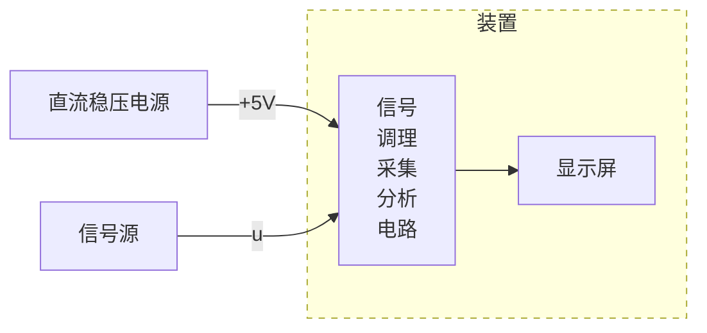

# 周期信号测量分析装置（G 题）

## 一、任务

设计制作周期信号测量分析装置（以下简称为装置），可对信号源输出的周期信号 $u$ 进行测量与分析，信号源输出阻抗为 $50\,\Omega$。装置既能在显示屏上稳定显示 $u$ 的波形图或电压频谱图，也能稳定显示 $u$ 的时域或频域相关参数值，频率分辨率 $500\,\mathrm{Hz}$。

装置组成框图如图 1 所示。

*图 1 装置组成框图*

## 二、要求

### 1．装置输入 $u=u_a$

装置输入 $u=u_a$，其电压峰峰值 $U_{pp}=100\,\mathrm{mV}\sim250\,\mathrm{mV}$，所有频率成分均在 $10\,\mathrm{kHz}\sim200\,\mathrm{kHz}$ 范围内。下列四项要求在启动装置后，每一项完成时间不超过 2 秒。

（1）键控选择一屏显示 $u_a$ 的 1 个或者 3 个完整周期波形。

（2）显示 $u_a$ 的电压峰峰值 $U_{pp}$、有效值 $U_{rms}$，误差的绝对值均 $\leq 5\,\mathrm{mV}$；显示 $u_a$ 的基频值 $f_{a1}$，误差的绝对值 $\leq 1\,\mathrm{kHz}$。

（3）定性显示 $u_a$ 的电压频谱图。

（4）显示 $u_a$ 的电压频谱各分量的幅值，误差的绝对值 $\leq 5\,\mathrm{mV}$。

### 2．装置输入 $u=u_b$

装置输入 $u=u_b$，其电压峰峰值为 $50\,\mathrm{mV}\sim250\,\mathrm{mV}$，所有频率成分均在 $10\,\mathrm{kHz}\sim500\,\mathrm{kHz}$ 范围内。下列四项要求在启动装置后，每一项完成时间不超过 2 秒。

（1）键控选择一屏显示 $u_b$ 的 1 个或者 3 个完整周期波形。

（2）显示 $u_b$ 的电压峰峰值 $U_{pp}$、有效值 $U_{rms}$，误差的绝对值均 $\leq 5\,\mathrm{mV}$；显示 $u_b$ 的基频值 $f_{b1}$，误差的绝对值 $\leq 1\,\mathrm{kHz}$。

（3）定性显示 $u_b$ 的电压频谱图。

（4）显示 $u_b$ 的电压频谱各分量的幅值，误差的绝对值 $\leq 5\,\mathrm{mV}$。

### 3．装置输入 $u=u_b+u_J$

装置输入 $u=u_b+u_J$，其中被测信号 $u_b$ 的电压峰峰值为 $50\,\mathrm{mV}\sim250\,\mathrm{mV}$，所有频率成分均在 $10\,\mathrm{kHz}\sim500\,\mathrm{kHz}$ 范围内；单频干扰 $u_J$ 的电压峰峰值为 $200\,\mathrm{mV}$、频率 $f_J\geq1\,\mathrm{MHz}$。要求装置能在抑制单频干扰 $u_J$ 影响的基础上，完成下列四项要求，在启动装置后，每一项完成时间不超过 2 秒。

（1）键控选择一屏显示 $u_b$ 的 1 个或者 3 个完整周期波形。

（2）显示信号 $u_b$ 的电压峰峰值 $U_{pp}$、有效值 $U_{rms}$，误差的绝对值均 $\leq 5\,\mathrm{mV}$；显示 $u_b$ 的基频值 $f_{b1}$，误差的绝对值 $\leq 1\,\mathrm{kHz}$。

（3）定性显示 $u_b$ 的电压频谱图。

（4）显示 $u_b$ 的电压频谱各分量的幅值，误差的绝对值 $\leq 5\,\mathrm{mV}$。

## 三、说明

1．装置测量与分析的信号 $u_a$ 或 $u_b$ 是由基波分量与 1 个或者 2 个谐波分量组合而成的周期信号。

2．装置在时域测量分析状态下，测量显示的电压有效值应为“真有效值”。

3．装置在频域测量分析状态下，显示的 $u_a$ 或 $u_b$ 电压频谱应为在正频率轴上分布的频率分量。如信号源输出的由基波与其三次、四次谐波组合而成的周期信号表达式为

$$
u=U_1\sin\left(2\pi\times10.5\times10^3t\right)+U_3\sin\left(2\pi\times31.5\times10^3t\right)+U_4\sin\left(2\pi\times42.0\times10^3t\right)\quad(\mathrm{mV})
$$

时，装置显示的电压频谱各分量的频率和幅值应为：

- $10.5\,\mathrm{kHz}$，$U_1\,\mathrm{mV}$
- $31.5\,\mathrm{kHz}$，$U_3\,\mathrm{mV}$
- $42.0\,\mathrm{kHz}$，$U_4\,\mathrm{mV}$

4．定性显示电压频谱图：显示电压频谱图的坐标不一定加刻度，频谱图中正频率轴上离散谱线的根数、谱线频率相对位置、谱线长度之间的相对比例与装置输入信号 $u_a$ 或 $u_b$ 的电压频谱大体吻合即可。

5．装置采用单路 $5\,\mathrm{V}$ 直流稳压电源供电。

6．装置的显示屏尺寸 $\geq 6$ 英寸。

7．本题信号源输出电缆阻抗 $50\,\Omega$，电缆两端均为 BNC 接头，参赛装置电路板上需焊接 BNC 接头座，作为装置输入信号端口。信号源可使用具有“谐波发生器”功能的信号发生器，设置其输出信号 $u$ 的基波与谐波分量幅度与频率值，各参数设置值作为相应参数测量的标称值。
